# Geospatial Assessments of Environmental Threats to Cultural and Natural Heritage UNESCO Sites in South-West Nigeria

---

## 1. Project Overview
This project presents a multi-temporal Remote Sensing and Geographic Information Systems (GIS) assessment of climate-related hazards and anthropogenic environmental pressures affecting the **Osun-Osogbo Sacred Grove**, a UNESCO World Heritage Site located in Osogbo, Osun State, South-West Nigeria. 

Covering a 22-year period (**2002, 2014, and 2024**), the study integrates multispectral optical/thermal satellite imagery and satellite-derived rainfall records to evaluate vegetation degradation, deforestation, habitat heat stress, urban encroachment, and surface water/wetland variability. By overlaying spatial hazard layers with heritage infrastructure (sacred artefacts, shrines, buildings, rivers, and access roads), the research delineates an **Environmental Risk Index** across the core Sacred Grove and its surrounding buffer zone to support conservation planning and ecotourism management.

---

## 2. Research Objectives
- **Identify Environmental Risk Factors:** Assess multi-temporal environmental threats associated with climate variability and land-cover change specifically vegetation degradation, deforestation, habitat heat stress, urban encroachment, wetland fluctuations, and flood susceptibility and evaluate their impacts on ecotourism potential at the Osun-Osogbo Sacred Grove.
- **Evaluate Spatial Relationships:** Examine the spatial and temporal relationships between climate change indicators and environmental threats across the study area (specifically **LST vs. NDVI** and **Rainfall vs. MNDWI**).
- **Assess Infrastructure and Habitat Vulnerability:** Evaluate the impacts of climate-induced thermal and hydrological hazards on wildlife habitats, sacred cultural artefacts, and ecotourism infrastructure.
- **Develop an Environmental Risk Index:** Classify the Sacred Grove and its buffer zone into spatial risk zones (**Low, Moderate, and High Risk**) to prioritize conservation and mitigation interventions.

---

## 3. Study Area
The **Osun-Osogbo Sacred Grove** is situated within the Osogbo Local Government Council of Osun State, South-West Nigeria.
- **Geographic Coordinates:** Latitudes $7^\circ 44' 50.0''\text{ N}$ to $7^\circ 46' 00.0''\text{ N}$ and Longitudes $4^\circ 32' 40''\text{ E}$ to $4^\circ 33' 40''\text{ E}$.
- **Spatial Extent:** Approximately **75 hectares** for the core Sacred Grove, surrounded by a designated buffer zone of approximately **47 hectares**.
- **Topography & Hydrology:** Elevation ranges from **299 m to 332 m** above mean sea level (a.m.s.l.), with the Osun River flowing directly through the forested sanctuary.

### Study Area Map
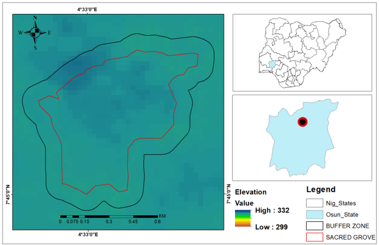
*Map showing the Osun-Osogbo Sacred Grove core boundary, surrounding buffer zone, local elevation profile (299–332 m), and regional context within Osun State and Nigeria.*

---

## 4. Data Sources and Datasets
All spatial datasets utilized in the research are verified from the primary research document:

| Dataset | Source | Acquisition Year / Period | Spatial Resolution | Application in Research |
|---|---|---|---|---|
| **Landsat 7 ETM+** | Google Earth Engine (GEE) | 2002 | 30 m | Baseline calculation of NDVI, LST, NDBI, MNDWI, and deforestation baseline |
| **Landsat 8 OLI / TIRS** | Google Earth Engine (GEE) | 2014, 2024 | 30 m | Multi-temporal monitoring of NDVI, LST, NDBI, MNDWI, and canopy change |
| **Digital Elevation Model (DEM)** | [Information to be provided — e.g., SRTM / ASTER] | [Information to be provided] | [Information to be provided] | Elevation characterization of the Sacred Grove (299 m – 332 m a.m.s.l.) |
| **Monthly Average Rainfall Data** | Tropical Applications of Meteorology using Satellite data and ground-based observations (TAMSAT) | 2002, 2014, 2024 | [Information to be provided — TAMSAT standard ~4 km] | Spatial interpolation of rainfall distribution and flood/drought assessment |
| **Heritage & Infrastructure Layers** | [Information to be provided — e.g., NCMM / Field GPS / Digitized Basemap] | [Information to be provided] | Vector (Points, Lines, Polygons) | Mapping Sacred Grove boundary, buffer zone, artefacts, buildings, roads, and river network |

---

## 5. Software and Technologies
- **ArcGIS 10.7:** Primary desktop GIS platform used for digital image processing, radiometric calibration, spectral index computation (NDVI, LST, NDBI, MNDWI), spatial interpolation of rainfall data, spatial overlay analysis, Environmental Risk Index mapping, and final cartographic layout production.
- **Google Earth Engine (GEE):** Cloud-based geospatial platform used for sourcing and downloading Landsat 7 ETM+ and Landsat 8 OLI satellite imagery.

---

## 6. Methodology
The research workflow integrates multi-temporal optical/thermal remote sensing with GIS spatial overlay analysis:

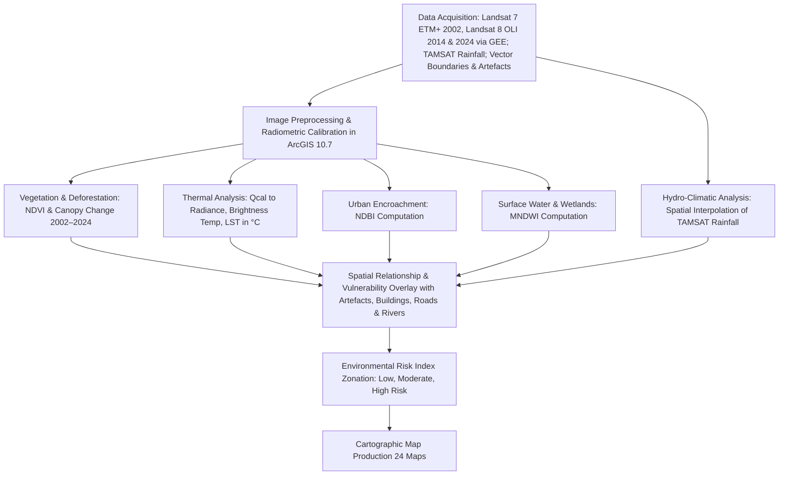

### 6.1 Data Acquisition and Preprocessing
- Multispectral and thermal bands from **Landsat 7 ETM+ (2002)** and **Landsat 8 OLI (2014 and 2024)** at 30 m spatial resolution were acquired via Google Earth Engine.
- Monthly average rainfall datasets for 2002, 2014, and 2024 were retrieved from the **TAMSAT** archive.
- Radiometric calibration was performed on thermal bands by converting digital numbers ($Q_{cal}$) to at-sensor spectral radiance ($L_\lambda$) and Top-of-Atmosphere (TOA) reflectance ($\rho_\lambda$).

### 6.2 Remote Sensing Indices and Thermal Retrieval
1. **Normalized Difference Vegetation Index (NDVI):** Computed to evaluate vegetation density and canopy health across 2002, 2014, and 2024, and used alongside visual/spatial change detection to delineate deforestation patches between 2002 and 2024:
   $$\text{NDVI} = \frac{\text{NIR} - \text{Red}}{\text{NIR} + \text{Red}}$$
2. **Land Surface Temperature (LST):** Extracted from thermal infrared bands by converting spectral radiance ($L_\lambda$) to effective at-sensor brightness temperature ($T$ in Kelvin) using band-specific thermal conversion constants ($K_1$ and $K_2$), followed by conversion to degrees Celsius:
   $$T = \frac{K_2}{\ln\left(\frac{K_1}{L_\lambda} + 1\right)}$$
   $$\text{LST} (^\circ\text{C}) = T - 273.15$$
3. **Normalized Difference Built-up Index (NDBI):** Computed to quantify urban expansion and impervious surface encroachment around the buffer zone:
   $$\text{NDBI} = \frac{\text{SWIR} - \text{NIR}}{\text{SWIR} + \text{NIR}}$$
4. **Modified Normalized Difference Water Index (MNDWI):** Computed using the Green and Short-Wave Infrared (SWIR) bands to monitor surface water extent along the Osun River and associated wetlands:
   $$\text{MNDWI} = \frac{\text{Green} - \text{SWIR}}{\text{Green} + \text{SWIR}}$$

### 6.3 GIS Spatial Interpolation and Overlay Modelling
- **Rainfall Interpolation:** TAMSAT rainfall records were spatially interpolated in ArcGIS 10.7 to generate continuous rainfall distribution surfaces for 2002, 2014, and 2024.
- **Vulnerability & Risk Overlay:** Thematic hazard layers (LST and rainfall) were overlaid with spatial vector inventories of sacred artefacts, buildings/shrines, roads, and rivers. All environmental threat indicators were integrated to derive the **Environmental Risk Index** map, categorizing the landscape into **Low**, **Moderate**, and **High** risk zones.

---

## 7. Maps and Cartographic Outputs

### 7.1 Cartographic Map Inventory
The following 24 cartographic outputs were produced in ArcGIS 10.7:

| No. | Map Title | Suggested Filename | Category |
|---|---|---|---|
| 1 | Map of the Study Area | `01_study_area_map.png` | Reference |
| 2 | 2002 NDVI Map | `02_ndvi_2002.png` | Thematic |
| 3 | 2014 NDVI Map | `03_ndvi_2014.png` | Thematic |
| 4 | 2024 NDVI Map | `04_ndvi_2024.png` | Thematic |
| 5 | Deforestation Map (2002 to 2024) | `05_deforestation_2002_2024.png` | Analytical |
| 6 | 2002 LST Map | `06_lst_2002.png` | Thematic |
| 7 | 2014 LST Map | `07_lst_2014.png` | Thematic |
| 8 | 2024 LST Map | `08_lst_2024.png` | Thematic |
| 9 | 2002 NDBI Map | `09_ndbi_2002.png` | Thematic |
| 10 | 2014 NDBI Map | `10_ndbi_2014.png` | Thematic |
| 11 | 2024 NDBI Map | `11_ndbi_2024.png` | Thematic |
| 12 | 2002 MNDWI Map | `12_mndwi_2002.png` | Thematic |
| 13 | 2014 MNDWI Map | `13_mndwi_2014.png` | Thematic |
| 14 | 2024 MNDWI Map | `14_mndwi_2024.png` | Thematic |
| 15 | 2002 Rainfall Map | `15_rainfall_2002.png` | Thematic |
| 16 | 2014 Rainfall Map | `16_rainfall_2014.png` | Thematic |
| 17 | 2024 Rainfall Map | `17_rainfall_2024.png` | Thematic |
| 18 | 2002 LST with Ecotourism Infrastructure Map | `18_lst_2002_ecotourism_infrastructure.png` | Analytical |
| 19 | 2014 LST with Ecotourism Infrastructure Map | `19_lst_2014_ecotourism_infrastructure.png` | Analytical |
| 20 | 2024 LST with Ecotourism Infrastructure Map | `20_lst_2024_ecotourism_infrastructure.png` | Analytical |
| 21 | 2002 Rainfall with Ecotourism Infrastructure Map | `21_rainfall_2002_ecotourism_infrastructure.png` | Analytical |
| 22 | 2014 Rainfall with Ecotourism Infrastructure Map | `22_rainfall_2014_ecotourism_infrastructure.png` | Analytical |
| 23 | 2024 Rainfall with Ecotourism Infrastructure Map | `23_rainfall_2024_ecotourism_infrastructure.png` | Analytical |
| 24 | Environmental Risk Index Map | `24_environmental_risk_index.png` | Synthesis / Analytical |

### 7.2 Selected Cartographic Previews

#### A. Vegetation Health & Deforestation (NDVI & Canopy Loss)
- **Purpose:** Quantify multi-temporal forest canopy vitality and map discrete forest clearing patches inside the Sacred Grove between 2002 and 2024.
- **Interpretation:** Peak NDVI declined from `0.601885` (2002) and `0.600144` (2014) to `0.515258` (2024), corroborating discrete deforestation patches observed primarily along the northern, central, and eastern margins of the grove.

| 2002 NDVI | 2014 NDVI | 2024 NDVI | Deforestation (2002–2024) |
|---|---|---|---|
| 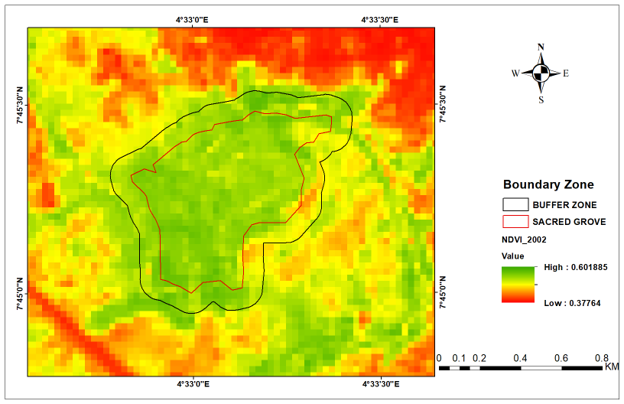 | 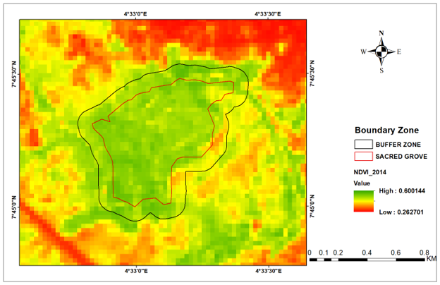 | 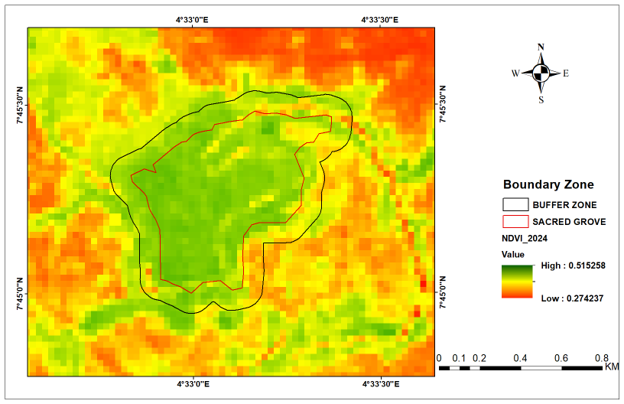 | 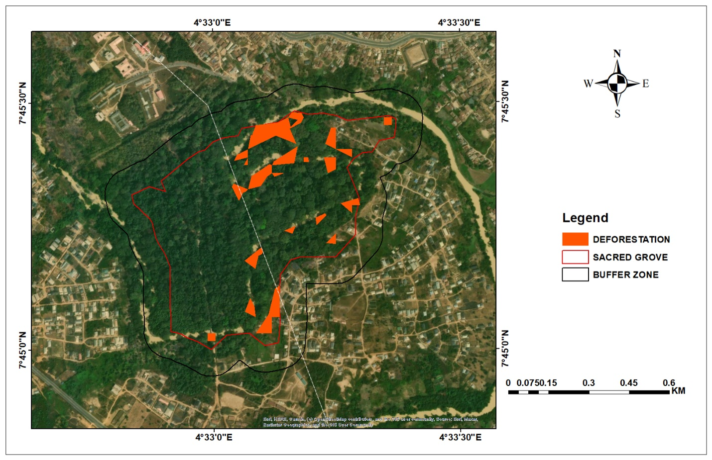 |

#### B. Habitat Heat Stress (Land Surface Temperature)
- **Purpose:** Assess the thermal microclimate of the Sacred Grove and detect internal urban heat island intrusion.
- **Interpretation:** In 2002, the grove acted as a distinct "cool island" (`21.30°C` low vs. `28.42°C` surrounding high). By 2014 (`29.41°C – 29.71°C`) and 2024 (`29.91°C – 30.31°C`), distinct thermal hotspots emerged along the eastern and northern edges, spatially matching deforested patches.

| 2002 LST | 2014 LST | 2024 LST |
|---|---|---|
| 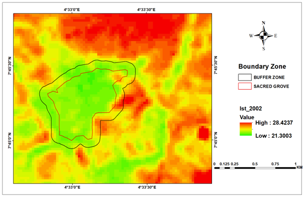 | 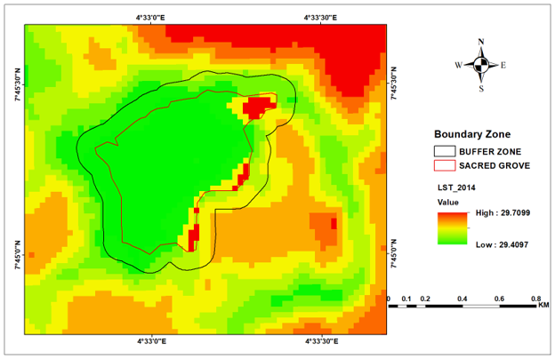 | 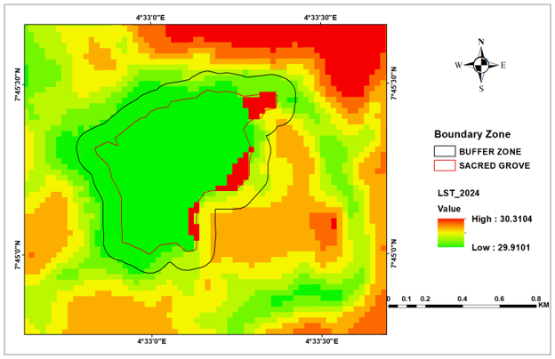 |

#### C. Urban Encroachment (NDBI)
- **Purpose:** Track built-up land expansion around the buffer zone and core heritage boundary.
- **Interpretation:** Maximum scene NDBI rose steadily from `0.208398` (2002) to `0.28949` (2014) and `0.550321` (2024), showing residential and commercial development progressively encircling the buffer zone.

| 2002 NDBI | 2014 NDBI | 2024 NDBI |
|---|---|---|
| 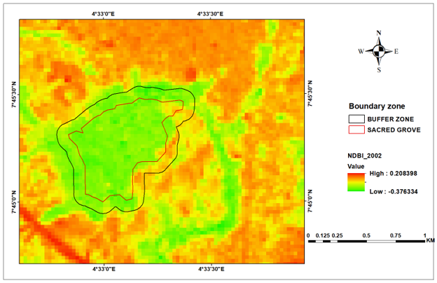 | 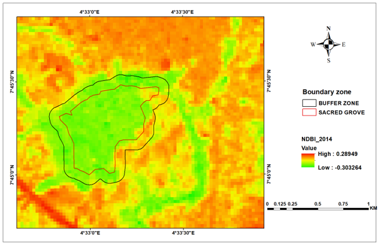 | 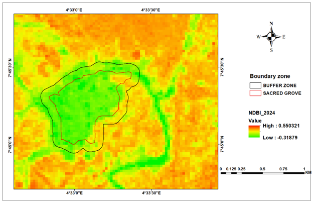 |

#### D. Surface Water & Wetland Dynamics (MNDWI)
- **Purpose:** Evaluate surface water persistence and wetland stress along the Osun River corridor.
- **Interpretation:** Maximum MNDWI dropped sharply from `0.174062` (2002) to `0.0682114` (2014) during a dry phase before rebounding to `0.21519` (2024) within the grove, even as surrounding areas exhibited drying trends.

| 2002 MNDWI | 2014 MNDWI | 2024 MNDWI |
|---|---|---|
| 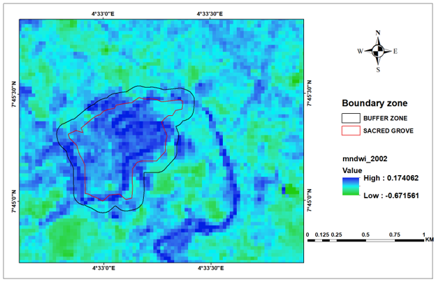 | 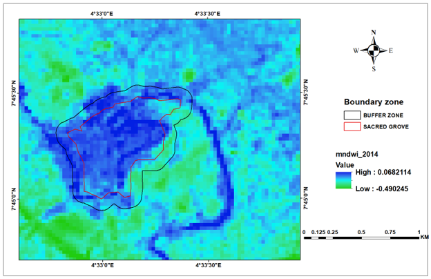 | 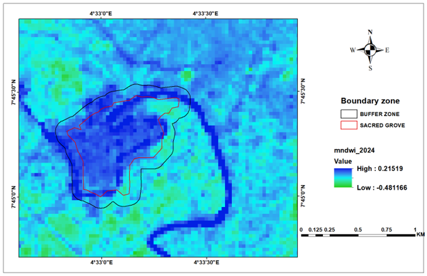 |

#### E. Rainfall Distribution & Flood Susceptibility
- **Purpose:** Map spatial rainfall gradients and upstream precipitation inputs influencing riverine flood risk.
- **Interpretation:** Rainfall over the grove shifted from `211.7 – 226.8 mm` (2002) down to `182.1 – 195.2 mm` (2014), then recovered to `201.6 – 215.9 mm` (2024) with upstream peaks reaching `230.7 mm` in the northeast.

| 2002 Rainfall | 2014 Rainfall | 2024 Rainfall |
|---|---|---|
| 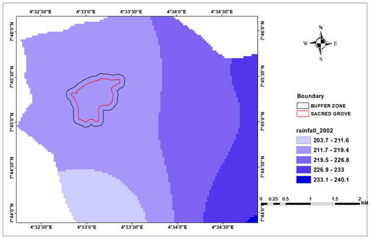 | 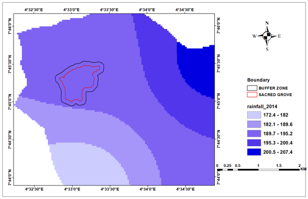 | 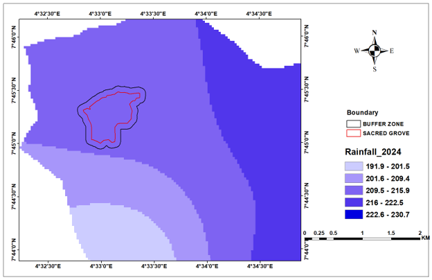 |

#### F. Ecotourism Infrastructure Vulnerability Overlays (LST & Rainfall)
- **Purpose:** Evaluate exposure of sacred artefacts, shrines, buildings, and trail networks to localized heat stress and flooding.
- **Interpretation:** Overlays demonstrate thermal hotspots encroaching upon eastern artefacts and heavy upstream rainfall feeding the Osun River channel directly adjacent to cultural structures.

| LST + Infrastructure (2002) | LST + Infrastructure (2014) | LST + Infrastructure (2024) |
|---|---|---|
| 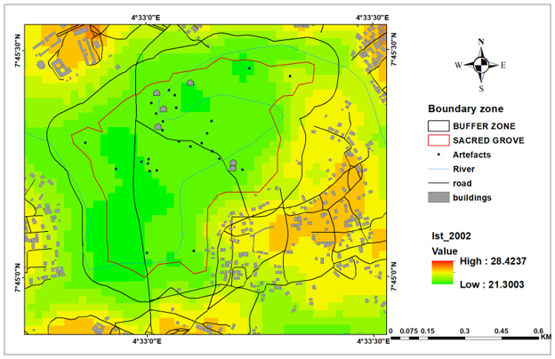 | 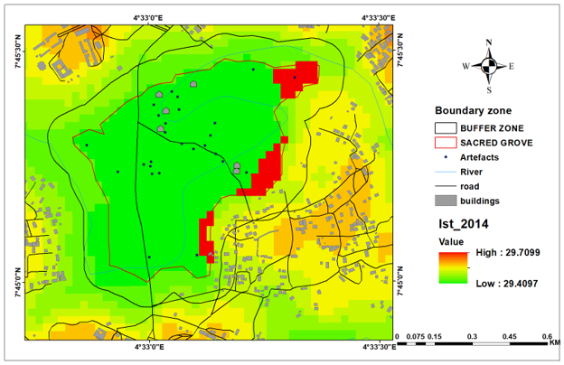 | 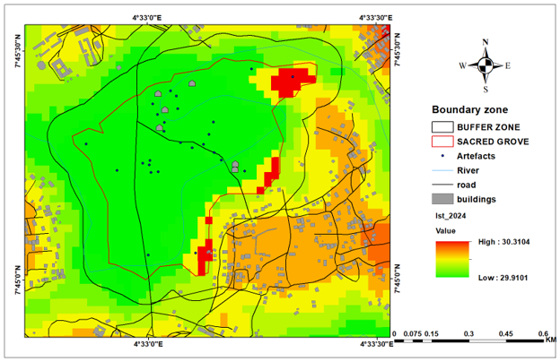 |

| Rainfall + Infrastructure (2002) | Rainfall + Infrastructure (2014) | Rainfall + Infrastructure (2024) |
|---|---|---|
| 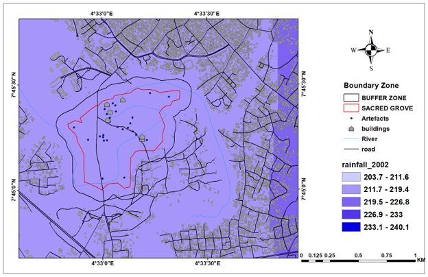 | 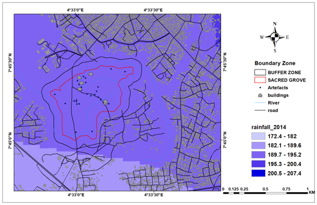 | 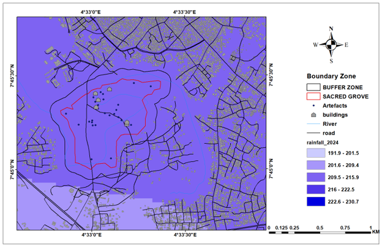 |

#### G. Composite Environmental Risk Index
- **Purpose:** Synthesize multi-hazard and anthropogenic pressures into actionable conservation management zones.
- **Interpretation:** Identifies a well-preserved **Low Risk** central core (`Oodi Sculpture`, `Igbo Epa`, `Lakokan`), a transitional **Moderate Risk** eastern zone (`Busanyin grove`, `Ijumu`), and **High Risk** zones penetrating the northern, eastern, and southern buffer boundaries.

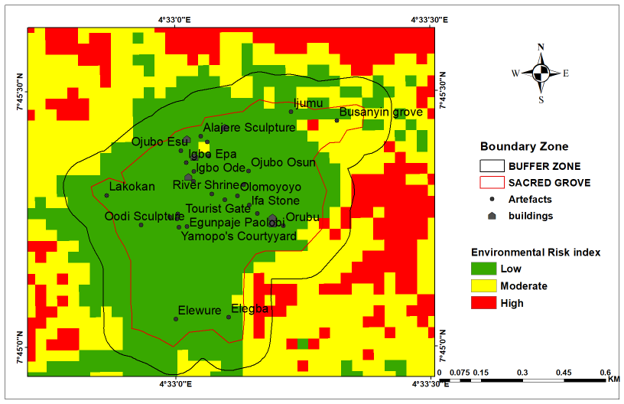

---

## 8. Results and Key Findings

### 8.1 Multi-Temporal Quantitative Summary (2002 – 2024)

| Indicator / Parameter | Unit | 2002 | 2014 | 2024 | Observed Trend (2002–2024) |
|---|---|---|---|---|---|
| **NDVI (Minimum)** | Index ($-1$ to $+1$) | `0.37764` | `0.262701` | `0.274237` | Overall decline in lower-bound vegetation cover |
| **NDVI (Maximum)** | Index ($-1$ to $+1$) | `0.601885` | `0.600144` | `0.515258` | Significant drop in peak canopy density after 2014 |
| **Land Surface Temperature (Low)** | $^\circ\text{C}$ | `21.3003` | `29.4097` | `29.9101` | Substantial warming of minimum baseline surface temperature |
| **Land Surface Temperature (High)** | $^\circ\text{C}$ | `28.4237` | `29.7099` | `30.3104` | Progressive intensification of thermal hotspots |
| **NDBI (Minimum)** | Index ($-1$ to $+1$) | `-0.376334` | `-0.303264` | `-0.31879` | Reduced non-built vegetative spectral signature |
| **NDBI (Maximum)** | Index ($-1$ to $+1$) | `0.208398` | `0.28949` | `0.550321` | Sharp expansion of built-up surfaces surrounding the grove |
| **MNDWI (Minimum)** | Index ($-1$ to $+1$) | `-0.671561` | `-0.490245` | `-0.481166` | Shift in dry-surface spectral response |
| **MNDWI (Maximum)** | Index ($-1$ to $+1$) | `0.174062` | `0.0682114` | `0.21519` | Severe wetland contraction in 2014 followed by 2024 recovery |
| **Rainfall (Sacred Grove Range)** | mm | `211.7 – 226.8` | `182.1 – 195.2` | `201.6 – 215.9` | Wet baseline (2002), dry trough (2014), wetter recovery (2024) |
| **Rainfall (Study Extent Range)** | mm | `203.7 – 240.1` | `172.4 – 207.4` | `191.9 – 230.7` | Highest precipitation consistently concentrated upstream (NE) |

### 8.2 Spatial Correlations and Environmental Risk Zonation
- **Inverse LST–NDVI Relationship:** High-NDVI forest core zones consistently maintained the lowest surface temperatures, whereas deforested patches and high-NDBI urban edges corresponded directly with thermal hotspots exceeding `30.3°C` by 2024.
- **Direct Rainfall–MNDWI Relationship:** Surface water extent inside the grove responded directly to precipitation variability—contracting sharply during the 2014 rainfall trough (`182.1 – 195.2 mm`) and rejuvenating in 2024 (`201.6 – 215.9 mm`).
- **Environmental Risk Zonation:**
  - **Low Risk Zone (Green):** Encompasses the dense forest interior and preserves key cultural assets including *Oodi Sculpture*, *Igbo Epa*, *Igbo Ode*, *Ojubo Esu*, *Ojubo Osun*, *Lakokan*, *River Shrine*, *Olomoyoyo*, *Ifa Stone*, *Tourist Gate*, *Egunpaje Paolobi*, *Yamopo's Courtyard*, *Orubu*, *Elewure*, and *Elegba*.
  - **Moderate Risk Zone (Yellow):** Covers the eastern portion of the Sacred Grove and much of the buffer zone, placing cultural landmarks such as *Busanyin Grove* and *Ijumu* under transitional ecological stress.
  - **High Risk Zone (Red):** Concentrated along the northern, eastern, and southern perimeters bordering urbanized Osogbo, penetrating the eastern buffer zone directly up to the Sacred Grove boundary.

---

## 9. Discussion
The findings demonstrate that the ecological integrity and cultural heritage value of the Osun-Osogbo Sacred Grove face compounding pressures from localized land-use change and regional hydro-climatic variability:
- **Conservation & Buffer Zone Management:** Rapid urban expansion (`NDBI` peaking at `0.550`) has eroded the protective capacity of the 47-hectare buffer zone, creating edge effects, thermal barriers that isolate wildlife habitats, and fuelwood/clearing pressures along the eastern boundary.
- **Heritage & Ecotourism Preservation:** Emerging internal heat hotspots threaten material weathering of exposed sacred sculptures and reduce thermal comfort along visitor trails. Simultaneously, elevated upstream rainfall (`up to 230.7 mm` in 2024) combined with increased impervious runoff from surrounding urban settlements heightens riverine flood and soil erosion risks for low-lying shrines and access roads along the Osun River.

---

## 10. Research Limitations
- **Spatial Resolution Constraints:** Medium-resolution multispectral and thermal imagery (`30 m` Landsat 7 ETM+ and Landsat 8 OLI) captures broad canopy, thermal, and built-up trends across the 75 ha grove and 47 ha buffer zone, but limits the detection of sub-pixel structural encroachments or individual under-canopy artefacts.
- **Satellite Rainfall Interpolation:** Satellite-based rainfall estimates (TAMSAT) provide regional precipitation gradients but carry spatial scale limitations when interpolated over small local catchments without dense in-situ gauge calibration.
- **Unstated Analytical Parameters:** [Information to be provided — specify exact Environmental Risk Index weighting criteria, cloud-cover thresholds, and exact acquisition dates of Landsat scenes if required for full reproducibility].

---

## 11. Conclusion and Recommendations
### Conclusion
Between 2002 and 2024, the Osun-Osogbo Sacred Grove experienced measurable canopy degradation (`peak NDVI` drop from `0.602` to `0.515`), progressive urban encirclement (`peak NDBI` rise from `0.208` to `0.550`), and intensifying surface heat stress (`LST` reaching `30.31°C`). While the central core remains a **Low Risk** ecological and cultural refuge, **High Risk** urban and thermal pressures have breached the eastern buffer zone, and hydro-climatic fluctuations expose the site to alternating wetland drought stress and upstream-driven flooding.

### Recommendations
- [Information to be provided — Note: Your uploaded document contained Chapters 3 and 4; if you have a Chapter 5 with specific management recommendations, insert them here. Based directly on the Chapter 4 findings, recommended actions include:]
  1. **Strict Buffer Zone Enforcement:** Halt residential/commercial encroachment and illegal tree felling along the northern, eastern, and southern High Risk buffer boundaries.
  2. **Targeted Reforestation & Microclimate Restoration:** Prioritize native canopy restoration within the identified 2002–2024 deforestation patches and eastern thermal hotspots to restore the grove's cooling buffer around vulnerable landmarks (*Busanyin Grove* and *Ijumu*).
  3. **Drainage & Flood Mitigation:** Implement stormwater runoff controls along adjacent urban roads and reinforce riverbank erosion protection near riverine shrines and visitor pathways.

---

## 12. Repository Structure
Organize your GitHub repository using the following directory layout so that all relative image paths in this `README.md` render properly:

```text
osun-osogbo-heritage-threat-assessment/
├── README.md                                              # Main project documentation
├── docs/
│   └── Deborah(5).docx                                    # Research manuscript / thesis chapters
└── maps/
    ├── 01_study_area_map.png
    ├── 02_ndvi_2002.png
    ├── 03_ndvi_2014.png
    ├── 04_ndvi_2024.png
    ├── 05_deforestation_2002_2024.png
    ├── 06_lst_2002.png
    ├── 07_lst_2014.png
    ├── 08_lst_2024.png
    ├── 09_ndbi_2002.png
    ├── 10_ndbi_2014.png
    ├── 11_ndbi_2024.png
    ├── 12_mndwi_2002.png
    ├── 13_mndwi_2014.png
    ├── 14_mndwi_2024.png
    ├── 15_rainfall_2002.png
    ├── 16_rainfall_2014.png
    ├── 17_rainfall_2024.png
    ├── 18_lst_2002_ecotourism_infrastructure.png
    ├── 19_lst_2014_ecotourism_infrastructure.png
    ├── 20_lst_2024_ecotourism_infrastructure.png
    ├── 21_rainfall_2002_ecotourism_infrastructure.png
    ├── 22_rainfall_2014_ecotourism_infrastructure.png
    ├── 23_rainfall_2024_ecotourism_infrastructure.png
    └── 24_environmental_risk_index.png
```

---

