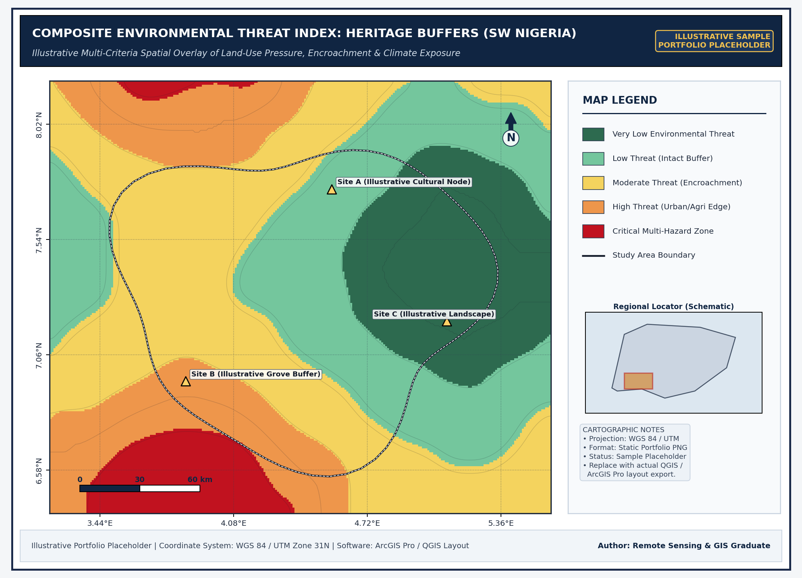
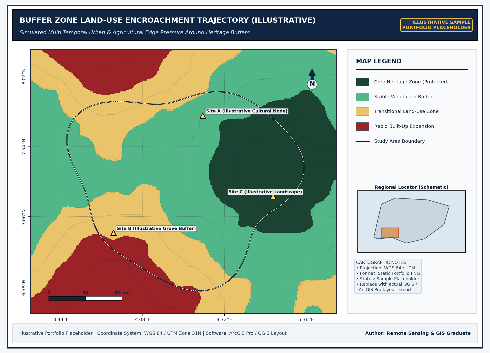

# Geospatial Assessment of Environmental Threats to Cultural and Natural Heritage UNESCO Sites in South-West Nigeria

> **Portfolio Note:** The PNG maps currently stored in `maps/` are **illustrative cartographic templates** demonstrating layout design and thematic structure. Replace them with your actual exported ArcGIS Pro or QGIS layouts.

---

## 1. Project Overview
This project demonstrates a spatial multi-criteria and multi-temporal remote sensing framework for evaluating anthropogenic and environmental pressures surrounding cultural and natural heritage landscapes in South-West Nigeria. The cartographic outputs illustrate buffer zone encroachment, land-cover transition trajectories, and composite environmental threat zonation.

## 2. Research Objectives
- Delineate core heritage boundaries and multi-ring buffer zones (e.g., 1 km, 3 km, and 5 km) for spatial pressure assessment.
- Quantify multi-temporal Land Use/Land Cover (LULC) changes and urban/agricultural encroachment within buffer corridors.
- Integrate biophysical and anthropogenic threat indicators into a Composite Environmental Threat Index map.
- Produce publication-grade cartographic layouts to support heritage conservation planning.

## 3. Study Area
Selected Cultural and Natural Heritage Landscapes in South-West Nigeria (Illustrative regional extent shown in sample maps; update with your exact coordinates, states, and site names).

## 4. Data Sources (Illustrative Examples / Placeholders)
- **Multispectral Satellite Imagery:** Sentinel-2 MSI (10m) / Landsat 8–9 OLI (30m) — *(Placeholder: Specify exact acquisition dates and path/row)*
- **Digital Elevation Model:** Copernicus GLO-30 / SRTM 30m DEM — *(Placeholder)*
- **Heritage & Administrative Boundaries:** UNESCO World Heritage Centre / National Commission for Museums and Monuments (NCMM) / OSGOF — *(Placeholder)*
- **Climate & Ancillary Layers:** CHIRPS Precipitation & OpenStreetMap Road Networks — *(Placeholder)*

## 5. Software Used
- ArcGIS Pro 3.x, QGIS 3.34 LTR, Google Earth Engine (GEE)

## 6. Methodology
1. **Preprocessing & Radiometric Calibration:** Cloud masking, atmospheric correction, and clipping of multi-temporal satellite scenes to heritage buffer extents.
2. **Land-Cover Classification:** Supervised classification (Random Forest / Maximum Likelihood) to extract built-up expansion, agricultural encroachment, and intact forest/grove cover.
3. **Proximity & Disturbance Modelling:** Euclidean distance analysis from road networks, settlements, and drainage channels.
4. **Multi-Criteria Threat Overlay:** Standardization of threat layers and weighted overlay analysis to generate the Composite Environmental Threat Index.
5. **Cartographic Layout Design:** Standardized map production at 300 DPI featuring coordinate grids, scale bars, north arrows, and hierarchical legends.

## 7. Maps Produced
| Map File | Title | Description |
|---|---|---|
| `01_unesco_composite_threat_index.png` | Composite Environmental Threat Index (Illustrative Sample) | Illustrative spatial overlay classifying buffer zones from Very Low Threat to Critical Multi-Hazard Zones. |
| `02_heritage_buffer_encroachment_change.png` | Buffer Zone Land-Use Encroachment Trajectory (Illustrative Sample) | Simulated multi-temporal transition zones highlighting rapid built-up and agricultural edge pressure. |

## 8. Map Preview Gallery

### Composite Environmental Threat Index (Illustrative Sample)

*Illustrative spatial overlay classifying buffer zones from Very Low Threat to Critical Multi-Hazard Zones.*

### Buffer Zone Land-Use Encroachment Trajectory (Illustrative Sample)

*Simulated multi-temporal transition zones highlighting rapid built-up and agricultural edge pressure.*

## 9. Key Findings (Editable Placeholders)
- *[Editable Placeholder — Replace with your actual findings]:* Buffer zones within `[X km]` of the core heritage boundary exhibited `[X%]` conversion from dense vegetation to built-up or cultivated land between `[Year 1]` and `[Year 2]`.
- *[Editable Placeholder]:* Highest composite threat scores were concentrated along `[specify directional corridor / road axis]`, highlighting priority zones for buffer-zone management.

## 10. Limitations
- Current maps in this folder are **illustrative portfolio placeholders** and do not represent real measurements or actual UNESCO site coordinates.
- Medium-resolution optical imagery (10m–30m) may not capture fine-scale structural encroachments beneath dense forest canopies without high-resolution commercial imagery or UAV surveys.

## 11. Author Information
- **Author:** `[Your Full Name]`
- **Discipline:** Remote Sensing & Geographic Information Systems (GIS)
- **Portfolio Home:** [Back to Main Repository](../README.md)
