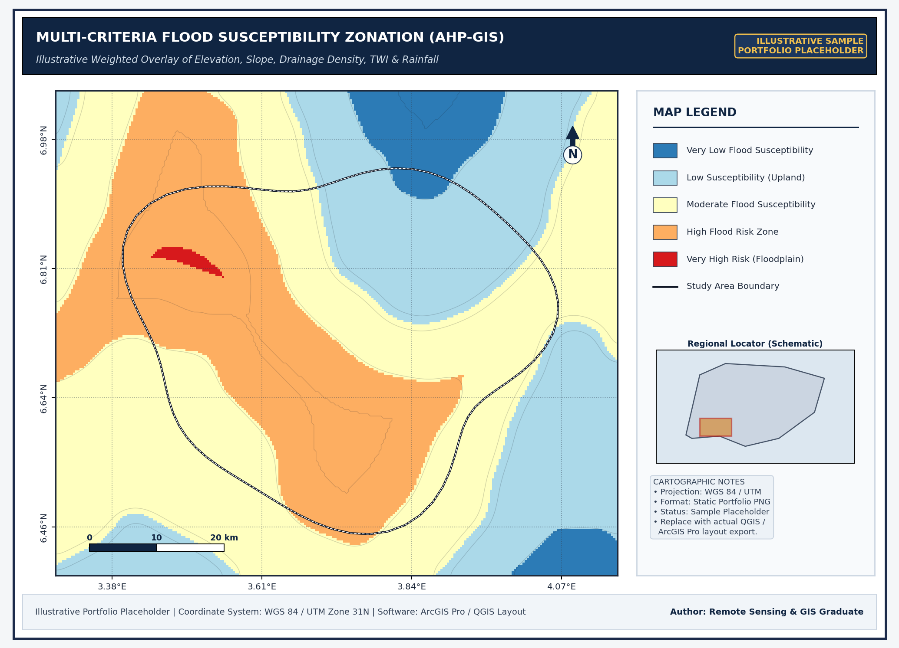
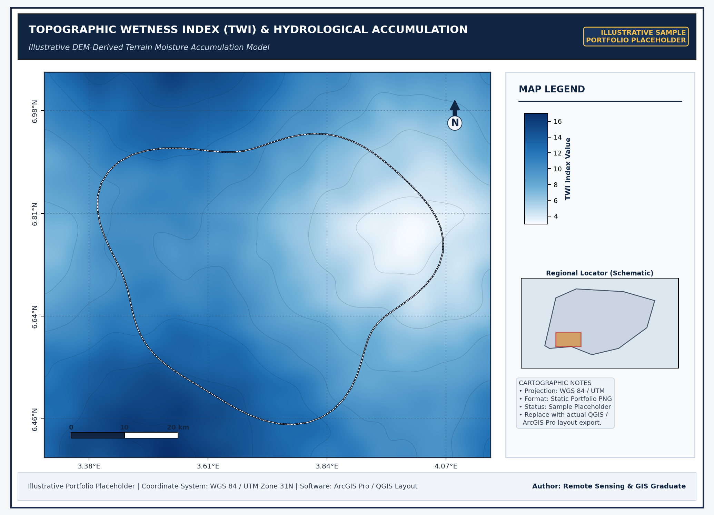

# Multi-Criteria Flood Susceptibility and Hydrological Risk Assessment (AHP-GIS)

> **Portfolio Note:** The PNG maps currently stored in `maps/` are **illustrative cartographic templates** demonstrating layout design and thematic structure. Replace them with your actual exported ArcGIS Pro or QGIS layouts.

---

## 1. Project Overview
This project integrates geomorphometric terrain analysis, hydrological modelling, and the Analytical Hierarchy Process (AHP) within a GIS environment to delineate flood-prone zones. The workflow synthesizes elevation, slope, drainage density, Topographic Wetness Index (TWI), rainfall intensity, and land cover into a spatial flood susceptibility map.

## 2. Research Objectives
- Derive hydrological terrain conditioning layers (flow direction, flow accumulation, stream network, and TWI) from a Digital Elevation Model.
- Assign objective criterion weights using an Analytical Hierarchy Process (AHP) pairwise comparison matrix (Consistency Ratio < 0.10).
- Generate a five-class Flood Susceptibility Zonation map ranging from Very Low to Very High Risk.
- Identify vulnerable settlements and infrastructure within high-risk floodplain corridors.

## 3. Study Area
River Basin / Urbanizing Watershed in South-West Nigeria (Illustrative extent shown in sample maps; update with your actual basin or city name).

## 4. Data Sources (Illustrative Examples / Placeholders)
- **Elevation Data:** SRTM 30m / Copernicus DEM — *(Placeholder)*
- **Rainfall Data:** CHIRPS Gridded Rainfall / NIMET Station Records — *(Placeholder)*
- **Land Use / Imperviousness:** Sentinel-2 Multispectral Classification — *(Placeholder)*
- **Soil Hydrologic Groups:** FAO / HWSD Soil Texture Layers — *(Placeholder)*

## 5. Software Used
- QGIS (GRASS GIS / SAGA Hydrology tools), ArcGIS Pro (Spatial Analyst)

## 6. Methodology
1. **DEM Hydrological Conditioning:** Pit filling, flow direction (D8), flow accumulation, and stream network extraction.
2. **Terrain Wetness Modelling:** Computing Topographic Wetness Index ($TWI = \ln(a / \tan\beta)$) to identify zones of water accumulation.
3. **AHP Weighting & Weighted Overlay:** Standardizing all conditioning factors to a 1–5 susceptibility scale and combining them via weighted linear combination.
4. **Cartographic Layout:** Applying intuitive blue-to-red hazard symbology with clear hypsometric and hydrological context.

## 7. Maps Produced
| Map File | Title | Description |
|---|---|---|
| `01_flood_susceptibility_ahp_map.png` | Multi-Criteria Flood Susceptibility Zonation (Illustrative Sample) | Illustrative AHP-GIS weighted overlay classifying terrain into five flood susceptibility tiers. |
| `02_topographic_wetness_index_twi.png` | Topographic Wetness Index (TWI) Surface (Illustrative Sample) | Illustrative DEM-derived hydrological moisture accumulation surface. |

## 8. Map Preview Gallery

### Multi-Criteria Flood Susceptibility Zonation (Illustrative Sample)

*Illustrative AHP-GIS weighted overlay classifying terrain into five flood susceptibility tiers.*

### Topographic Wetness Index (TWI) Surface (Illustrative Sample)

*Illustrative DEM-derived hydrological moisture accumulation surface.*

## 9. Key Findings (Editable Placeholders)
- *[Editable Placeholder — Replace with your actual findings]:* High and Very High flood susceptibility zones covered `[X%]` of the study watershed, predominantly along low-lying alluvial plains (`< [X] m` elevation) and densely urbanized impervious catchments.
- *[Editable Placeholder]:* Topographic Wetness Index and proximity to main drainage channels accounted for `[X%]` of the total AHP model weight.

## 10. Limitations
- Sample maps shown here are **illustrative portfolio placeholders** and do not represent calibrated hydrodynamic flood depths.
- Index-based AHP susceptibility identifies spatial propensity to flooding rather than return-period flood inundation extents (e.g., 100-year flood modelling via HEC-RAS).

## 11. Author Information
- **Author:** `[Your Full Name]`
- **Discipline:** Remote Sensing & Geographic Information Systems (GIS)
- **Portfolio Home:** [Back to Main Repository](../README.md)
