# Flood Risk Analysis Using 3D Flood Inundation Model Over Lower Niger River Basin

**Multi-Criteria Flood Susceptibility Zonation (AHP-GIS) and Spatial Inundation Exposure Assessment in the Lower Niger River Basin, Nigeria**

## Table of Contents
- [1. Project Overview](#1-project-overview)
- [2. Research Aim and Objectives](#2-research-aim-and-objectives)
- [3. Study Area](#3-study-area)
- [4. Data Sources and Datasets](#4-data-sources-and-datasets)
- [5. Software and Technologies](#5-software-and-technologies)
- [6. Methodology](#6-methodology)
- [7. Maps and Cartographic Outputs](#7-maps-and-cartographic-outputs)
- [8. Results and Key Findings](#8-results-and-key-findings)
- [9. Discussion](#9-discussion)
- [10. Research Limitations](#10-research-limitations)
- [11. Conclusion and Recommendations](#11-conclusion-and-recommendations)

---

## 1. Project Overview

Flooding is one of the most recurring and destructive natural and human-induced hazards globally, causing loss of human life, damage to critical infrastructure and essential services, destruction of crops and livestock, disease outbreaks, and contamination of water supplies. In heavily populated riverine corridors, extensive human settlement and land-use modification adjacent to water bodies amplify socio-economic vulnerability when river discharge exceeds channel storage capacity.

This project applies **Remote Sensing (RS)** and **Geographic Information Systems (GIS)** integrated with the **Analytic Hierarchy Process (AHP)** and **3D flood inundation mapping** to evaluate the spatial distribution of flood risk across the **Lower Niger River Basin, Nigeria**. By synthesizing ten hydro-meteorological, morphometric, pedological, land-cover, and proximity conditioning layers at a uniform $30\text{ m}$ spatial resolution, the study delineates five flood susceptibility tiers from *Very Low* to *Very High* and maps inundated floodplain corridors alongside exposed settlements and Local Government Area (LGA) boundaries to support flood risk management and spatial planning.

---

## 2. Research Aim and Objectives

### Primary Aim
To conduct a flood risk analysis utilizing a 3D flood inundation model over the Lower Niger River Basin, enhancing the understanding of regional flood dynamics through the application of the Analytic Hierarchy Process (AHP).

### Specific Objectives
1. Analyze spatial flood risk across the Lower Niger River Basin using a 3D flood inundation modelling and multi-criteria GIS framework.
2. Identify and delineate geographical areas and riverine corridors most vulnerable to flooding.
3. Develop thematic conditioning maps, composite flood risk zonation maps, and settlement vulnerability assessments.
4. Delineate the spatial extent of flood inundation across the basin's floodplains and administrative boundaries.

---

## 3. Study Area

The **Lower Niger River Basin** is located in central-southern Nigeria, encompassing the main Niger River channel, major tributary confluences, and adjacent floodplains. Based on the coordinate grid extent of the produced cartographic outputs, the study basin spans approximately **Latitudes $6^\circ 32'0''\text{ N}$ to $8^\circ 2'30''\text{ N}$** and **Longitudes $6^\circ 12'20''\text{ E}$ to $7^\circ 12'50''\text{ E}$**, extending across multiple **Local Government Areas (LGAs)** with numerous riparian settlements concentrated along the main river corridor.

* **Topography and Relief:** Terrain elevation derived from the $90\text{ m}$ SRTM Digital Elevation Model (DEM) ranges from **$-8\text{ m}$ to $657\text{ m}$ above mean sea level**, characterized by elevated mountainous terrain in the northern and western/eastern flanks and broad low-lying alluvial floodplains ($-8\text{ m}$ to $94\text{ m}$) along the central and southern river valley.
* **Slope and Drainage:** Terrain slopes range from **$0^\circ$ to $41.23^\circ$**, with flat to gently sloping valley floors ($0^\circ - 2.102^\circ$) prone to surface water pooling and higher drainage density networks ($2.95 - 4.754$) concentrated along the central drainage axis.
* **Soils and Land Cover:** The basin is underlain predominantly by **Hydrologic Soil Group (HSG) C** (slow infiltration, high runoff potential) in the north and central sectors and **HSG B** (moderate infiltration) in the southwest. Land cover comprises **Water Bodies**, **Dense Vegetation**, **Sparse Vegetation**, **Built-up Areas**, **Bare Land**, and **Wetlands**.

### Study Area Location Map

*Placeholder: A dedicated standalone location inset map was not included in Section 3.2 of the technical report; the basin boundary and LGA subdivisions are depicted across the thematic maps below (e.g., `maps/12_flood_inundation_map.png`). Upload a regional location inset map here if desired.*

---

## 4. Data Sources and Datasets

All spatial datasets were standardized and processed at a uniform **$90\text{ m}$ spatial resolution** within ArcGIS 10.8.2 for multi-criteria overlay analysis.

| Dataset | Source | Acquisition Year / Period | Spatial Resolution | Application in Research |
| :--- | :--- | :--- | :--- | :--- |
| **Landsat 8 OLI Multispectral Imagery** | United States Geological Survey (USGS) — Path 189, Row 55 | 2022 | $30\text{ m}$ | Supervised Maximum-Likelihood classification for Land Use/Land Cover (LULC) mapping and Normalized Difference Vegetation Index (NDVI) calculation. |
| **Shuttle Radar Topography Mission (SRTM) DEM** | United States Geological Survey (USGS) | 2007 | $30\text{ m}$ | Derivation of elevation zones, terrain slope (degrees), flow accumulation, drainage density ($1\text{ km}^2$ grid), draining capability, and Topographic Wetness Index (TWI). |
| **Rainfall Dataset** | Tropical Applications of Meteorology using Satellite data and ground-based observations (TAMSAT) | 2023 | 4km | Mapping spatial distribution of average annual rainfall across the basin. |
| **Soil Dataset** | Food and Agriculture Organization of the United Nations (FAO) | `[Version year not specified]` | Processed at $90\text{ m}$ | Classification of Hydrologic Soil Groups (HSG B and HSG C) representing infiltration capacity and runoff propensity. |
| **Hydrography, Road Network, LGA & Settlement Layers** | GRID3 | 2023 | Processed at $30\text{ m}$ (rasterized proximity) / Vector | Generation of Euclidean distance from river and distance from road layers, plus overlay of inundated areas with LGA boundaries and settlements. |

---

## 5. Software and Technologies

* **ArcGIS 10.8.2 (Esri):**
  * **Spatial Analyst Extension (Hydrology & Surface Tools):** Flow accumulation extraction, slope gradient calculation (in degrees), raster reclassification, interpolation, and weighted multi-criteria overlay.
  * **Image Classification Tools:** Maximum-Likelihood supervised classification with image preprocessing and post-processing for LULC mapping.
  * **Cartographic Layout Environment:** Standardization of coordinate grids, scale bars, north arrows, and thematic legends across all 12 output maps.

---

## 6. Methodology

### 6.1 Multi-Criteria Flood Modelling Framework

The study integrates **GIS-based Multi-Criteria Decision Analysis (MCDA)** with the **Analytic Hierarchy Process (AHP)** (Saaty, 1980) and **3D flood inundation delineation** to evaluate spatial flood susceptibility across ten biophysical and anthropogenic conditioning factors:

1. **Elevation (DEM)**
2. **Slope (Degrees)**
3. **Rainfall**
4. **Distance from River**
5. **Distance from Road**
6. **Drainage Density & Draining Capability**
7. **Topographic Wetness Index (TWI)**
8. **Soil (Hydrologic Soil Groups)**
9. **Land Use / Land Cover (LULC)**
10. **Normalized Difference Vegetation Index (NDVI)**

### 6.2 Processing Workflow Diagram

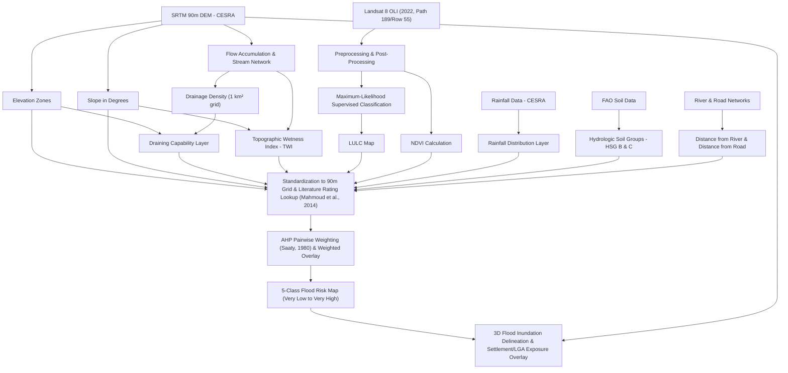

### 6.3 Data Preprocessing and Thematic Layer Preparation

1. **Spatial Standardization:** All raster and vector conditioning datasets were projected and resampled to a uniform **$30\text{ m}$ cell resolution** in ArcGIS 10.8.2.
2. **Terrain and Hydrological Modelling:**
   * **Elevation and Slope:** Elevation zones were reclassified directly from the $90\text{ m}$ SRTM DEM, and terrain slope (in degrees) was computed via the *Surface Analysis* tool in Spatial Analyst.
   * **Flow Accumulation and TWI:** Flow accumulation was derived using the *Hydrology* toolset in ArcGIS, and the **Topographic Wetness Index (TWI)** was computed from slope and upstream contributing area per unit contour length to identify zones of potential soil saturation and water pooling.
   * **Draining Capability:** Drainage density values were calculated across $1\text{ km}^2$ grid cells from the DEM-derived stream network, interpolated into a continuous surface, and overlaid with reclassified elevation zones to generate a composite draining capability rating layer.
3. **Satellite Image Classification and Vegetation Indexing:**
   * **LULC Mapping:** Preprocessed **2022 Landsat 8 OLI** imagery (Path 189, Row 55) was classified using **Maximum-Likelihood supervised classification** and post-processing refinement into six land cover classes: *Water Body*, *Dense Vegetation*, *Sparse Vegetation*, *Built-up Area*, *Bare Land*, and *Wetland*.
   * **NDVI Derivation:** Normalized Difference Vegetation Index values were extracted from the multispectral bands to quantify vegetation density and surface runoff interception potential.
4. **Soil, Rainfall, and Infrastructure Proximity:**
   * **Hydrologic Soil Groups (HSG):** FAO soil classes were categorized into **HSG B** (moderate infiltration) and **HSG C** (slow infiltration).
   * **Proximity Layers:** Euclidean distance surfaces were generated for river channels and road networks to account for overbank flooding proximity and impervious surface runoff/flow obstruction.

### 6.4 AHP Weighting, Overlay, and Inundation Mapping

* **AHP Weighting and Look-Up Ratings:** Relative criteria weights were determined via the **Analytic Hierarchy Process (AHP)** (Saaty, 1980) based on each criterion's physical contribution to flood generation. Standardized ratings/coefficients were assigned via a look-up table grounded in literature (Mahmoud, Mohammad, & Alazba, 2014).
* **Flood Risk Zonation and Inundation Overlay:** Weighted integration of the conditioning layers produced a five-tier **Flood Risk Map** (*Very Low*, *Low*, *Moderate*, *High*, and *Very High*). Subsequently, the inundated floodplain extent was delineated and overlaid with **LGA boundaries** and **settlement point locations** to assess spatial exposure.

---

## 7. Maps and Cartographic Outputs

### 7.1 Cartographic Map Inventory

| No. | Map Title (Report Reference) | Suggested Filename | Category |
| :--- | :--- | :--- | :--- |
| 1 | Distance from River Map  | `01_distance_from_river_map.png` | Conditioning Factor / Proximity |
| 2 | Distance from Road Map  | `02_distance_from_road_map.png` | Conditioning Factor / Proximity |
| 3 | Digital Elevation Model (DEM) Map  | `03_dem_elevation_map.png` | Conditioning Factor / Morphometric |
| 4 | Drainage Density Map  | `04_drainage_density_map.png` | Conditioning Factor / Hydrological |
| 5 | Land Use / Land Cover (LULC) Map  | `05_lulc_map.png` | Conditioning Factor / Thematic |
| 6 | Normalized Difference Vegetation Index (NDVI) Map  | `06_ndvi_map.png` | Conditioning Factor / Spectral Index |
| 7 | Rainfall Distribution Map  | `07_rainfall_map.png` | Conditioning Factor / Climatic |
| 8 | Terrain Slope Map  | `08_slope_map.png` | Conditioning Factor / Morphometric |
| 9 | Soil Map — Hydrologic Soil Groups  | `09_soil_hsg_map.png` | Conditioning Factor / Pedological |
| 10 | Topographic Wetness Index (TWI) Map  | `10_topographic_wetness_index_twi_map.png` | Conditioning Factor / Hydrological |
| 11 | Multi-Criteria Flood Risk Map  | `11_flood_risk_map.png` | Synthesis / Susceptibility Output |
| 12 | Flood Inundation and Settlement Exposure Map  | `12_flood_inundation_map.png` | Synthesis / Inundation Output |

---

### 7.2 Cartographic Gallery and Map Interpretations

#### 1. Distance from River Map 
* **Technical Description:** Reclassified proximity surface categorized into five distance intervals from $0 - 0.04665$ (red) to $0.1867 - 0.2332$ (green).
* **Purpose:** Quantifies direct spatial exposure to overbank river overflow along the Lower Niger River and its tributaries.
* **Interpretation:** Zones closest to the active river channels ($0 - 0.04665$, red) face the highest probability of overbank submergence, while risk diminishes progressively outward toward green zones ($0.1867 - 0.2332$), though distal areas remain susceptible to localized flash flooding.

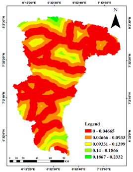

#### 2. Distance from Road Map 
* **Technical Description:** Five-class proximity surface ranging on the map legend from $0 - 0.04773$ (red) to $0.191 - 0.2387$ (green) *(narrative text notes $0 - 0.04665$ to $0.1867 - 0.2332$)*.
* **Purpose:** Captures anthropogenic runoff acceleration from impervious road corridors and potential drainage blockage during storm events.
* **Interpretation:** Areas immediately adjacent to road networks ($0 - 0.04773$, red) experience heightened flood susceptibility due to higher impervious surface concentration and flow constriction, whereas remote zones ($0.191 - 0.2387$, green) experience lower direct infrastructure-induced runoff impacts.

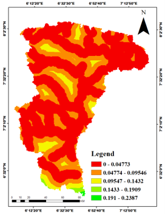

#### 3. Digital Elevation Model (DEM) Map 
* **Technical Description:** $90\text{ m}$ SRTM elevation surface classified into five elevation tiers: $-8 - 94\text{ m}$ (red), $94.01 - 175\text{ m}$ (orange), $175.1 - 262\text{ m}$ (yellow), $262.1 - 370\text{ m}$ (light green), and $370.1 - 657\text{ m}$ (dark green).
* **Purpose:** Identifies low-lying gravitational water accumulation basins versus elevated runoff-generating uplands.
* **Interpretation:** Low-elevation valley floors ($-8\text{ m}$ to $94\text{ m}$, symbolized in red for flood susceptibility) along the central and southern Niger floodplain are highly susceptible to inundation as runoff drains downhill, whereas elevated uplands ($370.1\text{ m}$ to $657\text{ m}$) shed runoff downward without pooling.

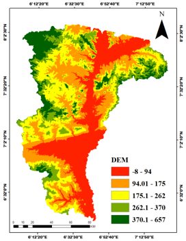

#### 4. Drainage Density Map 
* **Technical Description:** Interpolated stream network density ($1\text{ km}^2$ grid basis) divided into five classes from $0.241 - 1.143$ (dark green) to $3.852 - 4.754$ (red).
* **Purpose:** Evaluates the concentration of surface drainage channels and rapid runoff delivery potential.
* **Interpretation:** High drainage density zones ($2.95 - 4.754$, orange and red) along the central axial corridor and northern confluence rapidly concentrate overland flow, increasing peak discharge and downstream channel overflow risk, whereas low-density zones ($0.241 - 1.143$, dark green) promote slower runoff collection and greater infiltration.

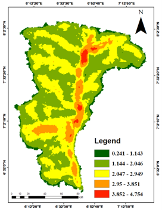

#### 5. Land Use / Land Cover (LULC) Map 
* **Technical Description:** Maximum-Likelihood supervised classification of 2022 Landsat 8 OLI imagery delineating six land cover categories: *Water Body*, *Dense Vegetation*, *Sparse Vegetation*, *Built-up Area*, *Bare Land*, and *Wetland*.
* **Purpose:** Characterizes surface permeability, vegetative interception, and natural floodplain storage across the basin.
* **Interpretation:** *Water Bodies* and riparian *Wetlands* represent active inundation zones and natural flood-retention sponges; *Built-up Areas* and *Bare Land* (prominent in the north and along river crossings) generate high surface runoff due to imperviousness and soil exposure, while *Dense Vegetation* in the south enhances rainfall interception.

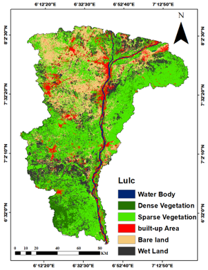

#### 6. Normalized Difference Vegetation Index (NDVI) Map 
* **Technical Description:** Five-class vegetation vigor surface derived from 2022 Landsat 8 OLI imagery, spanning $-0.106 - 0.02127$ (red) to $0.1966 - 0.3644$ (dark green).
* **Purpose:** Quantifies canopy density and biomass conditions governing rainfall interception and infiltration capacity.
* **Interpretation:** Higher NDVI values ($0.1966 - 0.3644$, dark green) in the southern and eastern flanks indicate healthy, dense vegetation that retards overland flow, whereas low and negative NDVI values ($-0.106 - 0.1098$, red and orange) along the river channel and northern/central sectors reflect water surfaces, bare ground, and sparse cover with higher runoff generation.

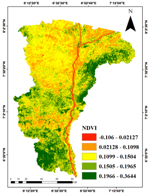

#### 7. Rainfall Distribution Map 
* **Technical Description:** Five-class spatial rainfall distribution categorized on the map legend from $1,240 - 1,371$ (light blue) to $1,766 - 1,896$ (dark blue) *(narrative text reports average annual rainfall ranging from $667\text{ mm}$ to $1,495\text{ mm}$)*.
* **Purpose:** Represents spatial variability in meteorological precipitation input driving surface runoff and river discharge.
* **Interpretation:** Higher precipitation zones (dark blue classes in the southern and northwestern sectors) experience greater rainfall intensity and volume, amplifying flood generation potential compared to lower-rainfall central/northeastern pockets.

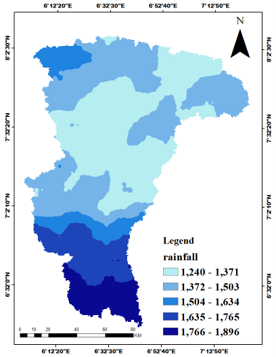

#### 8. Terrain Slope Map 
* **Technical Description:** DEM-derived slope gradient raster in degrees ($0^\circ$ to $41.23^\circ$) grouped into five intervals: $0 - 2.102^\circ$ (red), $2.103 - 5.174^\circ$ (orange), $5.175 - 10.02^\circ$ (yellow), $10.03 - 16.98^\circ$ (light green), and $16.99 - 41.23^\circ$ (dark green).
* **Purpose:** Evaluates topographic control over overland flow velocity versus water stagnation and ponding.
* **Interpretation:** Flat to gently sloping plains ($0^\circ - 2.102^\circ$, red) across the central floodplain and northern lowlands exhibit the highest flood susceptibility because water pools readily, whereas steeper slopes ($16.99^\circ - 41.23^\circ$, green) shed surface water rapidly downhill.

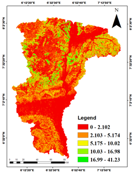

#### 9. Soil Map — Hydrologic Soil Groups 
* **Technical Description:** Spatial distribution of FAO-derived Hydrologic Soil Groups classified into **HSG C** (red) and **HSG B** (yellow).
* **Purpose:** Evaluates soil infiltration rates and subsurface drainage capacity during heavy precipitation.
* **Interpretation:** **HSG C soils** (red), which cover the majority of the northern and central basin, possess fine textures or impeding layers with slow infiltration rates, generating high surface runoff and elevated flood risk; **HSG B soils** (yellow) in the southwest exhibit moderate infiltration rates and lower runoff propensity.

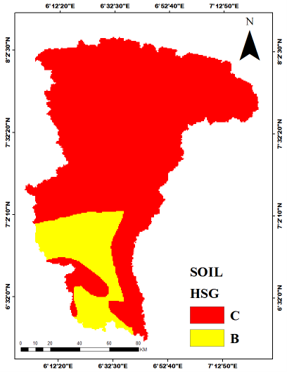

#### 10. Topographic Wetness Index (TWI) Map 
* **Technical Description:** Five-class hydrological wetness surface ranging from $4.672 - 8.001$ (dark green) to $16.22 - 32.97$ (red).
* **Purpose:** Delineates topographic zones prone to soil moisture saturation and surface water accumulation.
* **Interpretation:** High TWI corridors ($12.45 - 32.97$, orange and red) trace the main Niger River valley and tributary floodplains, pinpointing areas of persistent saturation and high flood propensity, while lower TWI uplands ($4.672 - 8.001$, dark green) are well-drained.

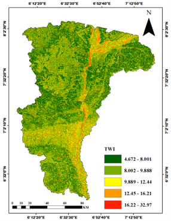

#### 11. Multi-Criteria Flood Risk Map 
* **Technical Description:** Composite AHP-GIS weighted overlay map classifying the Lower Niger River Basin into five flood susceptibility zones: **Very Low** (dark green), **Low** (light green), **Moderate** (yellow), **High** (orange), and **Very High** (red).
* **Purpose:** Synthesizes all ten hydro-environmental and anthropogenic conditioning layers into an actionable flood hazard zonation product.
* **Interpretation:** **Very High** and **High** flood risk zones form a continuous, broad corridor along the central Niger River axis, the northern confluence zone, and the broad southern alluvial floodplain where low elevation, flat slopes, high TWI, HSG C soils, and proximity to drainage channels coincide.

#### 12. Flood Inundation and Settlement Exposure Map 
* **Technical Description:** Spatial inundation extent map displaying **Inundated Area** (blue), **LGA Boundaries** (green outlines), and **Settlement** point locations (red markers).
* **Purpose:** Delineates the spatial footprint of floodwater inundation and identifies exposed communities across administrative jurisdictions.
* **Interpretation:** Extensive flood inundation (blue) concentrates along the north–south Niger River channel, the northeastern tributary confluence, and the wide southwestern/southern confluence floodplains, directly intersecting numerous riparian settlements (red markers) across multiple LGAs.

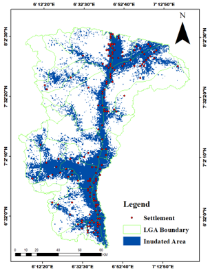

---

## 8. Results and Key Findings

### 8.1 Summary of Conditioning Factor Ranges and Spatial Patterns

| Conditioning Factor | Minimum Value | Maximum Value | Classification Tiers | Spatial Risk Relationship |
| :--- | :--- | :--- | :--- | :--- |
| **Elevation (SRTM DEM)** | $-8\text{ m}$ | $657\text{ m}$ | 5 classes | Lower elevations ($-8\text{ to }94\text{ m}$) along the river valley face the highest inundation risk. |
| **Slope** | $0^\circ$ | $41.23^\circ$ | 5 classes | Gentle slopes ($0^\circ - 2.102^\circ$) promote water ponding and high flood susceptibility. |
| **Topographic Wetness Index (TWI)** | $4.672$ | $32.97$ | 5 classes | Higher TWI values ($16.22 - 32.97$) along river valleys indicate high saturation and flood accumulation. |
| **Drainage Density** | $0.241$ | $4.754$ | 5 classes | Higher densities ($2.95 - 4.754$) concentrate rapid surface runoff along central channels. |
| **NDVI** | $-0.106$ | $0.3644$ | 5 classes | Lower NDVI values ($-0.106 - 0.1098$) indicate water/bare/sparse surfaces with higher runoff. |
| **Rainfall** |  $1,240$  | $1,896$ | 5 classes | Higher precipitation zones increase runoff volume and river discharge. |
| **Distance from River** | $0$ | $0.2332$ | 5 classes | Closest proximity tier ($0 - 0.04665$) experiences the highest overbank flood vulnerability. |
| **Distance from Road** | $0$ | $0.2387$ | 5 classes | Closest proximity tier ($0 - 0.04773$) reflects higher imperviousness and flow obstruction. |
| **Soil (HSG)** | HSG B | HSG C | 2 classes | HSG C soils (slow infiltration) dominate the northern/central basin, increasing runoff risk. |
| **Land Use / Land Cover (LULC)** | — | — | 6 classes | Built-up areas, bare land, water bodies, and wetlands exhibit highest flood exposure/runoff. |

### 8.2 Flood Risk Zonation and Inundation Summary

* **Five-Class Flood Susceptibility Distribution (Fig. 18):** The basin is stratified into **Very Low**, **Low**, **Moderate**, **High**, and **Very High** 
* **Inundated Area and Settlement Exposure (Fig. 19):** Spatial overlay confirms that flood inundation is heavily concentrated along the main Niger River floodplain corridor and major tributary confluences, directly affecting numerous mapped settlements within riparian LGAs. 

---

## 9. Discussion

The spatial synthesis of multi-criteria flood susceptibility and floodplain inundation extent provides critical insights for **disaster risk reduction (DRR)**, **floodplain zoning**, and **watershed management** in the Lower Niger River Basin:

* **Riparian Settlement Vulnerability:** Overlay of the inundated extent with settlement locations reveals high clustering of communities directly within the $-8\text{ m}$ to $94\text{ m}$ elevation zone and high-TWI floodplain corridor. Restricting unregulated urban expansion in *Very High* risk corridors and enforcing river setback regulations are essential to reduce recurring socio-economic losses.
* **Role of Land Cover and Wetlands:** Preservation of natural wetlands and dense riparian vegetation is vital, as wetlands act as natural retention buffers that absorb excess floodwaters, whereas expanding built-up areas and bare land amplify rapid surface runoff.
* **Infrastructure and Drainage Planning:** Areas adjacent to road networks and high-drainage-density corridors require upgraded culvert capacities and stormwater drainage engineering to prevent flow constriction during peak rainfall events.

---

## 10. Research Limitations

Based on the scope and data documented in the technical report:

1. **Spatial Resolution of Input Layers ($30\text{ m}$):** All conditioning factors were standardized to a $30\text{ m}$ grid matching the SRTM DEM; while suitable for basin-scale susceptibility assessment, $90\text{ m}$ resolution cannot resolve micro-topographic urban drainage channels, levees, or individual building footprints.
3. **Susceptibility Index vs. Hydrodynamic Discharge Routing:** Multi-criteria AHP overlay identifies spatial propensity to flooding based on physical terrain and environmental conditioning factors rather than time-stepped hydraulic flow velocities or return-period flood hydrographs (e.g., 10-, 50-, or 100-year discharge simulations).

---

## 11. Conclusion and Recommendations

### Conclusion
Integrating Satellite Remote Sensing, GIS spatial analysis, and the Analytic Hierarchy Process (AHP) provides an effective decision-support framework for delineating flood susceptibility and inundation exposure across the Lower Niger River Basin. By combining ten morphometric, hydrological, climatic, soil, and land-cover parameters at $30\text{ m}$ resolution, the study successfully identifies *High* and *Very High* flood risk corridors along the central Niger River valley and major confluences, highlighting vulnerable settlements across riparian LGAs.

### Recommendations
1. **Floodplain Land-Use Zoning and Development Control:** Enforce strict land-use planning regulations in riverine zones classified under *High* and *Very High* flood risk to restrict permanent residential and critical infrastructure development within active inundation corridors.
2. **Wetland Conservation and Watershed Reforestation:** Protect existing floodplain wetlands as natural flood-attenuation buffers and promote afforestation/vegetative cover restoration in degraded, low-NDVI upland catchments to enhance rainfall infiltration and reduce peak runoff.
3. **Early Warning Systems and Targeted Structural Mitigation:** Prioritize communities located within the delineated inundation corridor for community-based flood early warning systems, elevated evacuation routes, and improved drainage infrastructure.

