**Remote Sensing and GIS-Based Assessment of Poaching and Trafficking Incidents in Okomu National Park, Edo State, Nigeria**

---

## Table of Contents
- [1. Project Overview](#1-project-overview)
- [2. Research Objectives](#2-research-objectives)
- [3. Study Area](#3-study-area)
- [4. Data Sources and Datasets](#4-data-sources-and-datasets)
- [5. Software and Technologies](#5-software-and-technologies)
- [6. Methodology](#6-methodology)
- [7. Cartographic Map Inventory](#7-cartographic-map-inventory)
- [8. Maps and Cartographic Outputs](#8-maps-and-cartographic-outputs)
- [9. Results and Key Findings](#9-results-and-key-findings)
- [10. Discussion](#10-discussion)
- [11. Conclusion and Recommendations](#12-conclusion-and-recommendations)

---

## 1. Project Overview

This project investigates the spatial and spectral impacts of illegal wildlife poaching and trafficking activities on forest vegetation and land surface conditions in **Okomu National Park, Edo State, Nigeria**. Using multi-temporal Landsat 8 Operational Land Imager (OLI) satellite imagery and field-recorded poaching hotspot coordinates, the study evaluates pre-incident and post-incident environmental changes surrounding a documented poaching and trafficking event on **26 January 2022**.

Illegal wildlife poaching and trafficking pose direct threats not only to endangered fauna but also to forest habitat integrity through vegetation trampling, ground clearing, vehicle movement, and temporary encampments. By integrating multispectral remote sensing indices **Normalized Difference Vegetation Index (NDVI)**, **Soil-Adjusted Vegetation Index (SAVI)**, **Normalized Difference Built-up Index (NDBI)**, and **Normalized Difference Tillage Index (NDTI)** with **2023 Land Use / Land Cover (LULC)** mapping in a Geographic Information System (GIS) environment, this analysis detects surface disturbances, identifies high-risk zones, and supports evidence-based protected-area monitoring and habitat restoration planning.

---

## 2. Research Objectives

**Specific Objectives (Derived from the Research Analysis):**
1. **Acquire and Integrate Geospatial Datasets:** Combine multi-temporal Landsat 8 OLI imagery (pre-incident and post-incident) with field-verified poaching and trafficking hotspot coordinates recorded by park rangers.
2. **Assess Pre- and Post-Incident Vegetation and Surface Changes:** Compute and compare NDVI, SAVI, NDBI, and NDTI surfaces before (1 November 2021) and after (1 March 2022) the 26 January 2022 poaching and trafficking incident.
3. **Evaluate Spatial Correspondence with Poaching Hotspots:** Overlay recorded incident coordinates onto spectral index rasters and the 2023 Land Use / Land Cover (LULC) classification to examine landscape disturbance around active poaching zones.
4. **Produce Thematic Cartographic Outputs:** Generate standardized spatial maps to support ranger patrol allocation, habitat restoration prioritization, and conservation decision-making.

---

## 3. Study Area

The study was conducted in **Okomu National Park**, located in **Edo State, Nigeria**. Based on the coordinate graticule of the cartographic outputs, the park boundary spans approximately between longitudes **$5^\circ 01'\text{E}$ and $5^\circ 28'\text{E}$** and latitudes **$6^\circ 10'\text{N}$ and $6^\circ 30'\text{N}$**.

- **Administrative Context:** Edo State, Nigeria 
- **Environmental & Ecological Characteristics:** Dominated by dense forest vegetation interspersed with bare land, minor water bodies, and localized built-up/disturbed patches

### Study Area Map
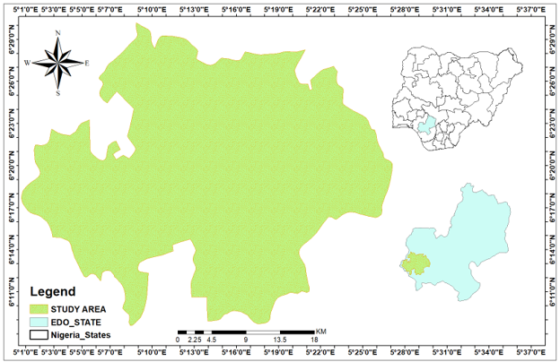
*Figure 1: Location of Okomu National Park within Edo State and Nigeria 

---

## 4. Data Sources and Datasets

| Dataset | Source | Acquisition Date / Period | Spatial Resolution | Application in Research |
| :--- | :--- | :--- | :--- | :--- |
| **Landsat 8 OLI Multispectral Imagery (Pre-Incident)** | United States Geological Survey (USGS) EarthExplorer (`earthexplorer.usgs.gov`) | 1 November 2021 | $30 \times 30\text{ m}$ | Extraction of Red, NIR, and SWIR bands to derive pre-incident NDVI, SAVI, NDBI, and NDTI baseline surfaces. |
| **Landsat 8 OLI Multispectral Imagery (Post-Incident)** | United States Geological Survey (USGS) EarthExplorer (`earthexplorer.usgs.gov`) | 1 March 2022 | $30 \times 30\text{ m}$ | Extraction of Red, NIR, and SWIR bands to derive post-incident NDVI, SAVI, NDBI, and NDTI surfaces for change detection. |
| **Poaching and Trafficking Incident Coordinates** | Forest Reserve Guards, Okomu National Park | 26 January 2022 | Point vector data | Spatial overlay of documented poaching/trafficking hotspots across spectral index and LULC maps. |
| **Administrative Boundary Shapefiles** | GRID3 | 2023 | Vector polygon | Delineation of Okomu National Park, Edo State, and Nigerian state boundaries for the study area map. |

---

## 5. Software and Technologies

The following geospatial software packages were utilized in data processing, visualization, and map production:

- **ArcGIS 10.7.1:** Raster processing, coordinate system projection (UTM WGS 1984 Zone 31N), spectral index computation, spatial overlay of hotspot coordinates, and cartographic map layout production.
- **Google Earth Pro:** Geospatial visualization and auxiliary ground/reference verification.

---

## 6. Methodology

### 6.1 Data Acquisition
Multi-temporal Landsat 8 Operational Land Imager (OLI) scenes covering Okomu National Park were acquired from the USGS EarthExplorer archive for two dates bracketing the documented poaching event: **1 November 2021** (pre-incident) and **1 March 2022** (post-incident). Geographic coordinates of poaching and trafficking hotspots associated with the **26 January 2022** incident were obtained from forest reserve guards at Okomu National Park.

### 6.2 Data Preprocessing and Coordinate Reference System
- Field-collected poaching and trafficking point coordinates were formatted and imported into the GIS environment.
- Satellite bands (Red, Near-Infrared [NIR], and Shortwave Infrared [SWIR]) were extracted and processed into raster format at a uniform spatial resolution of **$30\text{ m}$**.
- All raster and vector datasets were projected to **UTM WGS 1984 Zone 31N** to ensure spatial alignment across layers.

### 6.3 Spectral Index Computation (Remote Sensing Processing)
Four spectral indices were generated in **ArcGIS 10.7.1** for both the pre-incident (1 November 2021) and post-incident (1 March 2022) periods to characterize vegetation vigor, soil exposure, structural encroachment, and ground disturbance:

1. **Normalized Difference Vegetation Index (NDVI):** Quantifies vegetation health and canopy density using visible Red and NIR reflectance.
2. **Soil-Adjusted Vegetation Index (SAVI):** Evaluates vegetation condition while incorporating a soil-brightness correction factor to minimize background soil interference in sparsely vegetated patches.
3. **Normalized Difference Built-up Index (NDBI):** Highlights built-up surfaces, cleared ground, and human structural footprints using SWIR and NIR reflectance.
4. **Normalized Difference Tillage Index (NDTI):** Detects soil disturbance, ground clearing, vehicular tracks, and temporary camp footprints using SWIR band reflectance.

### 6.4 Land Use / Land Cover (LULC) Classification
A **2023 Land Use / Land Cover (LULC)** map of Okomu National Park was produced categorizing the landscape into four thematic classes:
- **Water Body**
- **Vegetation**
- **Bare land**
- **Built-Up Area**

### 6.5 Spatial Overlay and Cartographic Production
The recorded poaching and trafficking hotspot layer was overlaid onto all pre- and post-incident spectral index rasters as well as the 2023 LULC layer to evaluate spatial patterns of disturbance and produce standardized thematic maps with scale bars, north arrows, coordinate graticules, and legends.

### 6.6 Methodological Workflow

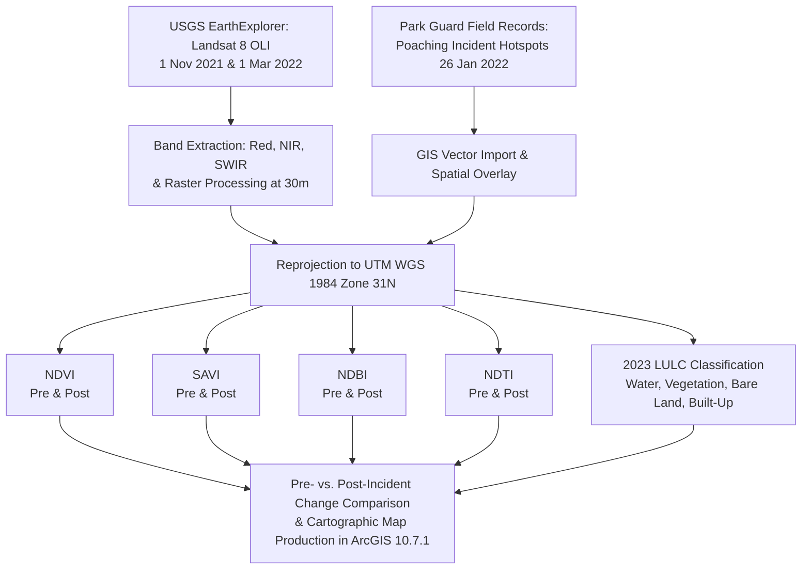

---

## 7. Cartographic Map Inventory

All cartographic outputs produced in the research document are cataloged below. Place the exported high-resolution PNG files in the `maps/` directory using the exact filenames specified.

| No. | Map Title | Suggested Filename | Category |
| :---: | :--- | :--- | :--- |
| 1 | Study Area Map (Okomu National Park, Edo State, Nigeria) | `01_okomu_study_area_map.png` | Reference |
| 2 | Pre-Incident NDVI Map (1 November 2021) | `02_okomu_ndvi_pre_incident.png` | Analytical |
| 3 | Post-Incident NDVI Map (1 March 2022) | `03_okomu_ndvi_post_incident.png` | Analytical |
| 4 | Pre-Incident SAVI Map (1 November 2021) | `04_okomu_savi_pre_incident.png` | Analytical |
| 5 | Post-Incident SAVI Map (1 March 2022) | `05_okomu_savi_post_incident.png` | Analytical |
| 6 | Pre-Incident NDBI Map (1 November 2021) | `06_okomu_ndbi_pre_incident.png` | Analytical |
| 7 | Post-Incident NDBI Map (1 March 2022) | `07_okomu_ndbi_post_incident.png` | Analytical |
| 8 | Pre-Incident NDTI Map (1 November 2021) | `08_okomu_ndti_pre_incident.png` | Analytical |
| 9 | Post-Incident NDTI Map (1 March 2022) | `09_okomu_ndti_post_incident.png` | Analytical |
| 10 | Land Use / Land Cover (LULC) Map (2023) | `10_okomu_lulc_2023_map.png` | Thematic |

---

## 8. Maps and Cartographic Outputs

### 8.1 Normalized Difference Vegetation Index (NDVI) — Pre- and Post-Incident
- **Technical Description:** Continuous raster surfaces ($30\text{ m}$ resolution) illustrating NDVI distribution across Okomu National Park on 1 November 2021 (pre-incident) and 1 March 2022 (post-incident), overlaid with recorded poaching hotspots.
- **Purpose:** To evaluate changes in vegetation vigor and canopy density before and after the 26 January 2022 poaching and trafficking incident.
- **Interpretation:** Pre-incident NDVI ranged from **$0.0662594$** to **$0.774395$**, whereas post-incident NDVI narrowed to **$0.169203$** to **$0.649977$**. The reduction in maximum NDVI values indicates degradation of dense forest canopy cover linked to human movement and habitat disturbance.

| Pre-Incident NDVI (1 November 2021) | Post-Incident NDVI (1 March 2022) |
| :---: | :---: |
| 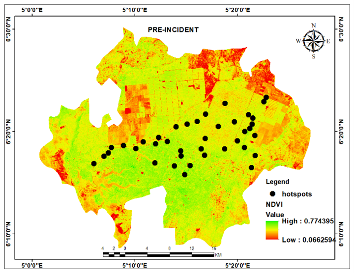 | 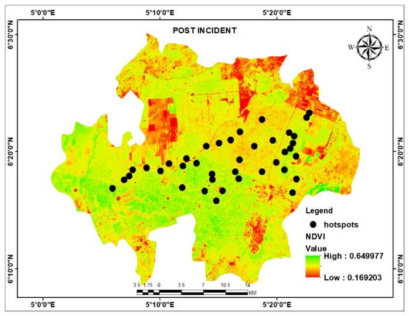 |

---

### 8.2 Soil-Adjusted Vegetation Index (SAVI) — Pre- and Post-Incident
- **Technical Description:** Soil-corrected vegetation index rasters ($30\text{ m}$ resolution) comparing pre-incident and post-incident conditions with hotspot locations overlaid.
- **Purpose:** To assess vegetation health while minimizing soil brightness effects in areas with exposed ground.
- **Interpretation:** Maximum SAVI declined from **$0.610273$** (pre-incident) to **$0.503972$** (post-incident), while minimum values shifted from **$0.0246391$** to **$0.0814958$**. This decline in peak SAVI values corroborates vegetation stress and canopy loss resulting from trampling and soil compaction.

| Pre-Incident SAVI (1 November 2021) | Post-Incident SAVI (1 March 2022) |
| :---: | :---: |
| 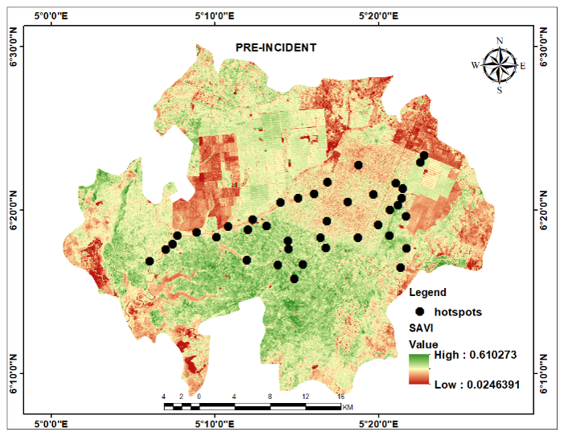 | 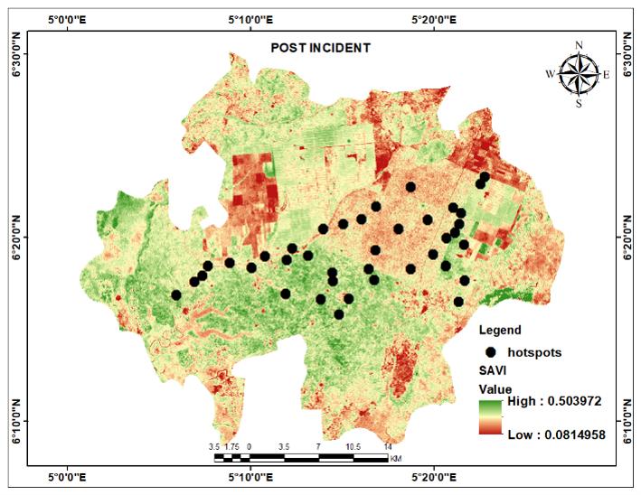 |

---

### 8.3 Normalized Difference Built-up Index (NDBI) — Pre- and Post-Incident
- **Technical Description:** SWIR/NIR-based built-up and surface disturbance rasters ($30\text{ m}$ resolution) for pre- and post-incident dates with poaching hotspot overlays.
- **Purpose:** To detect structural encroachment, cleared paths, or temporary human infrastructure associated with poaching and trafficking.
- **Interpretation:** NDBI values shifted from a pre-incident range of **$-0.469448$** to **$0.154166$** to a post-incident range of **$-0.56063$** to **$0.256502$**. The increase in maximum NDBI and spatial expansion of higher-value zones (notably in northern and northeastern sectors) point to heightened anthropogenic surface disturbance.

| Pre-Incident NDBI (1 November 2021) | Post-Incident NDBI (1 March 2022) |
| :---: | :---: |
| 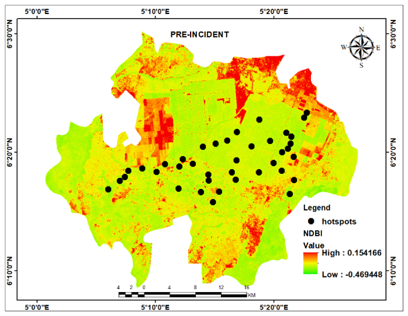 | 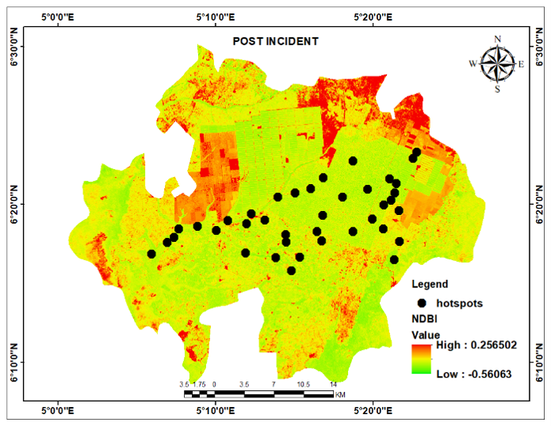 |

---

### 8.4 Normalized Difference Tillage Index (NDTI) — Pre- and Post-Incident
- **Technical Description:** Shortwave infrared surface disturbance maps ($30\text{ m}$ resolution) contrasting ground conditions prior to and following the incident, overlaid with hotspot points.
- **Purpose:** To identify soil disturbance, ground clearing, vehicular tracks, and temporary encampments.
- **Interpretation:** NDTI values increased from a pre-incident range of **$-0.315135$** to **$0.42005$** to a post-incident range of **$-0.223598$** to **$0.472834$**, reflecting elevated soil disturbance and ground clearing after the incident.

| Pre-Incident NDTI (1 November 2021) | Post-Incident NDTI (1 March 2022) |
| :---: | :---: |
| 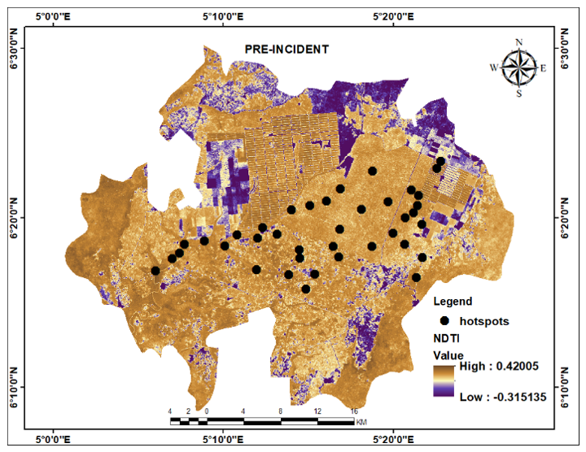 | 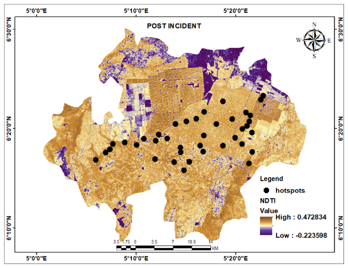 |

---

### 8.5 Land Use / Land Cover (LULC) Map (2023)
- **Technical Description:** Classified thematic land cover map of Okomu National Park depicting four classes (*Water Body*, *Vegetation*, *Bare land*, and *Built-Up Area*) overlaid with poaching hotspot locations.
- **Purpose:** To contextualize poaching hotspot locations within the broader land cover structure of the park.
- **Interpretation:** Vegetation forms the dominant land cover matrix across Okomu National Park, with bare land patches concentrated primarily along the northern and northeastern margins and smaller built-up/disturbed patches scattered internally. Recorded poaching hotspots predominantly cluster across the central-to-eastern forest interior.

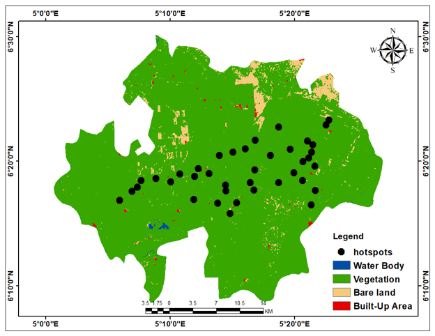

---

## 9. Results and Key Findings

### 9.1 Quantitative Comparison of Pre- and Post-Incident Spectral Indices

| Spectral Index | Pre-Incident Min (1 Nov 2021) | Pre-Incident Max (1 Nov 2021) | Post-Incident Min (1 Mar 2022) | Post-Incident Max (1 Mar 2022) | Change in Max Value | Observed Environmental Signal |
| :--- | :---: | :---: | :---: | :---: | :---: | :--- |
| **NDVI** | $0.0662594$ | $0.774395$ | $0.169203$ | $0.649977$ | $-0.124418$ | Decline in peak canopy density and vegetation health post-incident. |
| **SAVI** | $0.0246391$ | $0.610273$ | $0.0814958$ | $0.503972$ | $-0.106301$ | Vegetation degradation and stress confirmed after soil-brightness adjustment. |
| **NDBI** | $-0.469448$ | $0.154166$ | $-0.56063$ | $0.256502$ | $+0.102336$ | Expansion of disturbed/built-up spectral signatures, especially in northern sectors. |
| **NDTI** | $-0.315135$ | $0.42005$ | $-0.223598$ | $0.472834$ | $+0.052784$ | Increased soil disturbance, clearing, and ground surface disruption. |

### 9.2 Key Analytical Findings
- **Vegetation Canopy Degradation:** Both NDVI and SAVI recorded notable reductions in maximum index values following the 26 January 2022 incident, indicating measurable stress and thinning in previously dense forest zones.
- **Increased Ground and Structural Disturbance:** Both NDBI and NDTI exhibited higher upper-bound values post-incident, aligning with localized ground clearing, trail creation, vehicle movement, or temporary encampments.
- **Spatial Distribution of Hotspots:** Field-recorded poaching and trafficking hotspots are distributed along a southwest-to-northeast corridor across the central and eastern sections of Okomu National Park, providing spatial reference points for targeted ranger surveillance.
- **2023 Land Cover Composition:** Four primary LULC classes were delineated (*Water Body*, *Vegetation*, *Bare land*, and *Built-Up Area*). 

---

## 10. Discussion

The multi-temporal comparison of spectral indices demonstrates how satellite remote sensing complements ground-based ranger patrol records in protected-area management:

- **Early Warning and Disturbance Detection:** Shifts in NDTI and NDBI provide a practical mechanism for detecting unauthorized land clearing, temporary camps, and access trails within forested conservation zones.
- **Targeted Patrol Resource Allocation:** Integrating spectral anomaly maps with known hotspot coordinates enables park authorities to prioritize patrol coverage in high-risk corridors rather than relying solely on uniform surveillance.
- **Habitat Restoration Prioritization:** Areas experiencing sharp post-incident declines in NDVI and SAVI identify localized habitat degradation where ecological restoration and soil stabilization measures are most urgently needed.
- **Evidentiary Support for Conservation Enforcement:** Time-stamped satellite-derived disturbance indicators provide objective spatial documentation of anthropogenic landscape alteration linked to illegal wildlife activities.

---

## 11. Conclusion and Recommendations

### Conclusion
Integrating Landsat 8 OLI spectral indices (NDVI, SAVI, NDBI, and NDTI) with field-recorded incident data in ArcGIS 10.7.1 effectively captures pre- and post-incident vegetation and soil surface changes associated with poaching and trafficking activities in Okomu National Park. Post-incident reductions in peak NDVI and SAVI values, paired with increases in peak NDBI and NDTI values, indicate localized vegetation degradation and ground disturbance across affected sectors of the park.

### Recommendations
1. **Continuous Remote Sensing Monitoring:** Institutionalize routine multi-temporal satellite monitoring (NDVI, SAVI, NDBI, and NDTI) as an early warning tool for detecting unauthorized forest clearing and encroachment in Okomu National Park.
2. **Intelligence-Led Ranger Patrols:** Concentrate anti-poaching patrols and monitoring stations along the central-to-eastern hotspot corridor and northern boundary zones exhibiting elevated NDBI/NDTI disturbance signals.
3. **Targeted Habitat Restoration:** Prioritize degraded forest patches showing pronounced post-incident declines in NDVI and SAVI for ecological recovery and ongoing vegetation monitoring.
