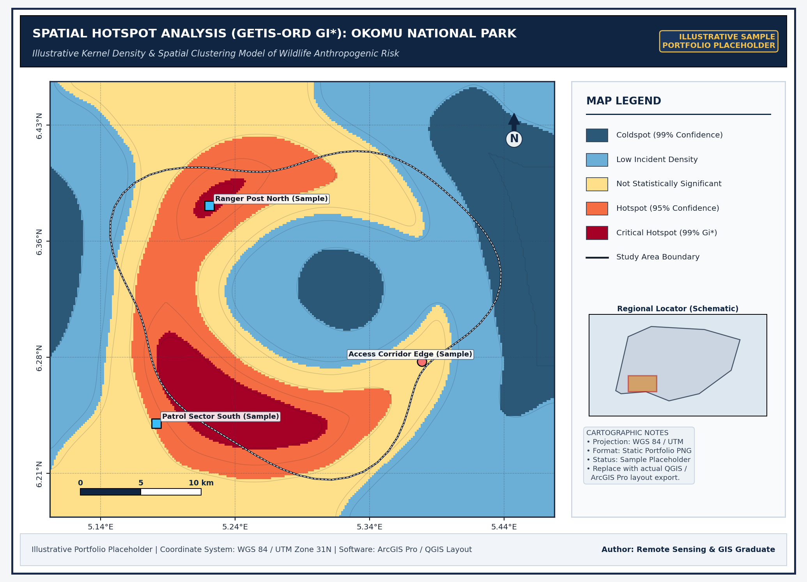
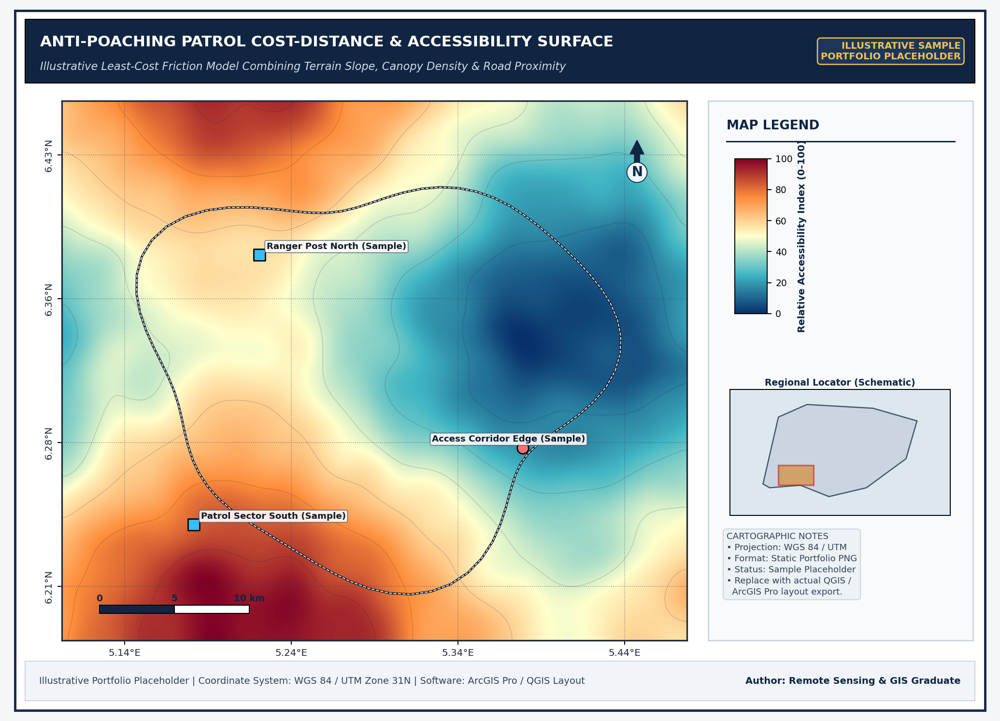

# Spatial Analysis of Poaching Hotspots in Okomu National Park, Nigeria

---

## 1. Project Overview
This project applies spatial statistics, kernel density estimation, and least-cost path/accessibility modelling to examine anthropogenic wildlife threat patterns in Okomu National Park, Edo State, Nigeria. The portfolio maps demonstrate how patrol records and landscape friction variables are synthesized into actionable anti-poaching spatial intelligence.

## 2. Research Objectives
- Identify statistically significant spatial clusters (hotspots and coldspots) of anthropogenic incursion using Getis-Ord Gi* statistics.
- Model landscape accessibility and ease of entry into the park interior using terrain slope, canopy density, and proximity to perimeter roads and settlements.
- Evaluate spatial coverage gaps relative to existing ranger patrol posts and access corridors.
- Design clear, operational cartographic outputs for protected-area management.

## 3. Study Area
Okomu National Park, Ovia South-West Local Government Area, Edo State, Southern Nigeria (Illustrative boundary and sample post locations shown in placeholder maps).

## 4. Data Sources (Illustrative Examples / Placeholders)
- **Protected Area & Sector Boundaries:** Nigeria National Park Service (NNPS) / WDPA 
- **Anthropogenic Threat / Patrol Records:** Illustrative synthetic sample coordinates 
- **Terrain & Land Cover:** SRTM 30m DEM and Sentinel-2 LULC classification 
- **Infrastructure & Drainage:** OpenStreetMap roads, perimeter tracks, and river networks 

## 5. Software Used
- ArcGIS Pro (Spatial Statistics Toolbox), QGIS, Python (PySAL / GeoPandas)

## 6. Methodology
1. **Grid Aggregation:** Partitioning the protected area and peripheral buffer into uniform hexagonal/square analysis cells.
2. **Hotspot Clustering (Getis-Ord Gi*):** Computing local spatial autocorrelation z-scores and p-values to delineate 95% and 99% confidence hotspot clusters.
3. **Cost-Distance Accessibility Modelling:** Assigning friction weights to slope, land cover, and river crossings to compute least-cost accessibility from perimeter access points.
4. **Cartographic Visualization:** Applying diverging colorblind-safe palettes for statistical hotspots and sequential ramps for patrol accessibility.

## 7. Maps Produced
| Map File | Title | Description |
|---|---|---|
| `01_okomu_poaching_hotspot_gi_star.png` | Spatial Hotspot Analysis (Getis-Ord Gi*) (Illustrative Sample) | Illustrative Getis-Ord Gi* clustering surface showing simulated 95% and 99% confidence hotspot zones. |
| `02_okomu_patrol_accessibility_surface.png` | Anti-Poaching Patrol Cost-Distance Surface (Illustrative Sample) | Illustrative friction-weighted accessibility index combining terrain slope, canopy cover, and perimeter road distance. |

## 8. Map Preview Gallery

### Spatial Hotspot Analysis (Getis-Ord Gi*) (Illustrative Sample)

*Illustrative Getis-Ord Gi* clustering surface showing simulated 95% and 99% confidence hotspot zones.*

### Anti-Poaching Patrol Cost-Distance Surface (Illustrative Sample)

*Illustrative friction-weighted accessibility index combining terrain slope, canopy cover, and perimeter road distance.*

## 9. Key Findings (Editable Placeholders)
- *[Editable Placeholder — Replace with your actual findings]:* Statistically significant hotspot clusters ($p < 0.01$) were concentrated within `[X km]` of the `[specify boundary sector]` perimeter where road accessibility is highest.
- *[Editable Placeholder]:* Areas with high canopy density and steep riverine buffers exhibited lower accessibility indices and corresponded with statistical coldspots.

## 10. Limitations
- Displayed maps use **synthetic illustrative distributions**; real anti-poaching coordinates must be obfuscated or aggregated to protect endangered species.
- Patrol-based incident datasets are subject to uneven spatial patrol effort unless normalized by ranger patrol effort (CPUE).

## 11. Author Information
- **Author:** `[Your Full Name]`
- **Discipline:** Remote Sensing & Geographic Information Systems (GIS)
- **Portfolio Home:** [Back to Main Repository](../README.md)
