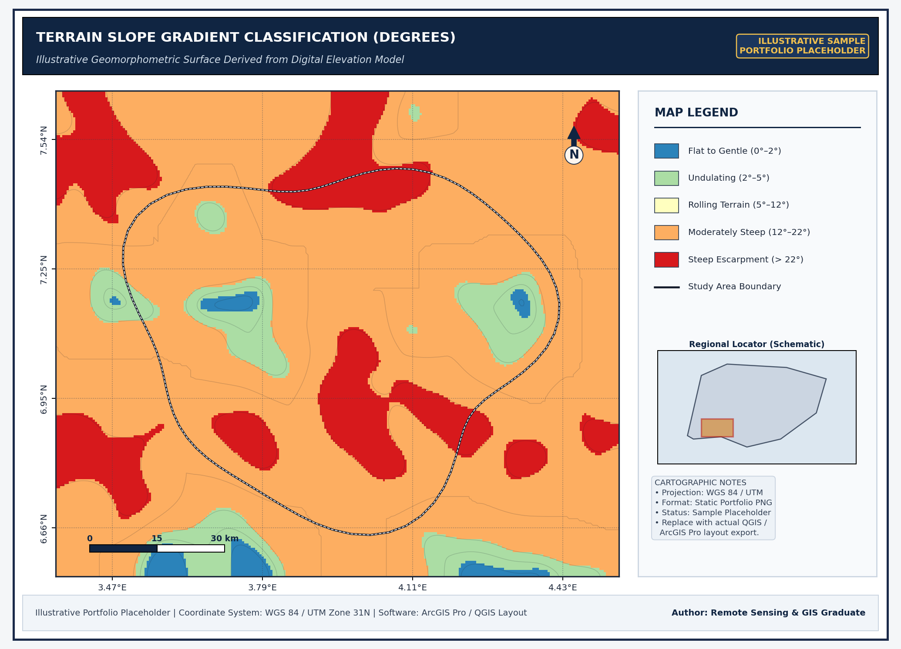
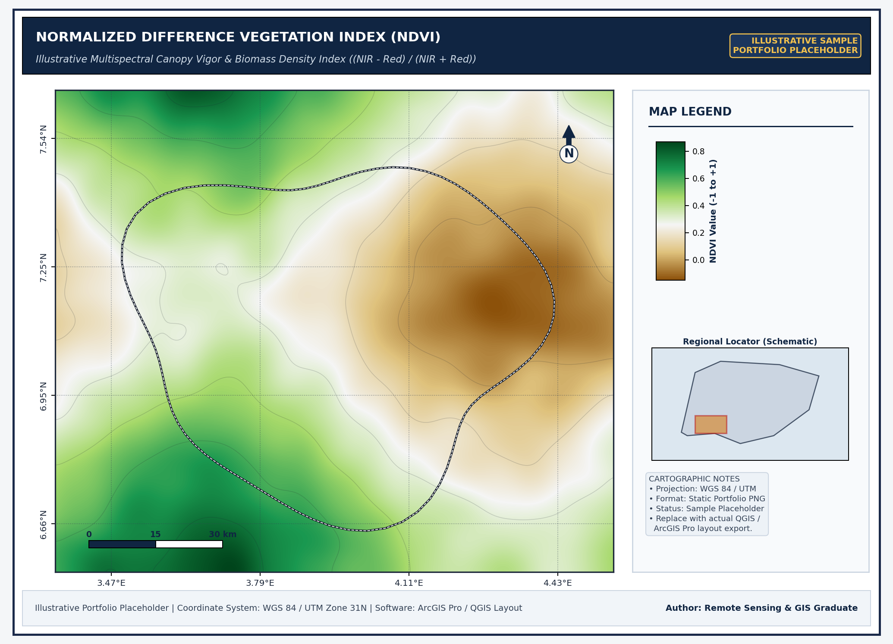

# Other Geospatial & Remote Sensing Thematic Maps

---

## 1. Project Overview
Beyond single-topic research projects, a strong Remote Sensing and GIS portfolio demonstrates mastery of core cartographic, terrain, land-cover, and spectral index workflows. This directory organizes foundational spatial outputs into dedicated thematic subfolders.

## 2. Research Objectives
- Demonstrate clean cartographic design for **Study Area Location & Context Maps**.
- Showcase supervised multispectral classification workflows for **Land Use / Land Cover (LULC)** mapping.
- Derive geomorphometric terrain parameters (**DEM** and **Slope**) from elevation datasets.
- Compute and visualize optical spectral indices (**NDVI** and **NDWI**) for vegetation vigor and surface water delineation.

## 3. Study Area
Representative Regional Sub-Basin & Ecological Transition Zone in South-West Nigeria (Illustrative boundary shown in template maps; update with your actual study extents).

## 4. Data Sources (Illustrative Examples / Placeholders)
- **Optical Multispectral Imagery:** Sentinel-2 Level-2A (10m) & Landsat 8/9 OLI (30m) — *(Placeholder)*
- **Elevation Dataset:** SRTM 1 Arc-Second Global (30m) Digital Elevation Model — *(Placeholder)*
- **Administrative & Reference Vectors:** OSGOF / OpenStreetMap / Field GPS Ground Control Points — *(Placeholder)*

## 5. Software Used
- QGIS 3.34 LTR, ArcGIS Pro 3.x, Google Earth Engine (GEE), SNAP (Sentinel Application Platform)

## 6. Methodology
1. **Base Cartography (Study Area):** Hierarchical symbolization of administrative boundaries, hydrological features, reference stations, and regional locator insets.
2. **LULC Classification:** Training sample collection, Random Forest classification, post-classification majority filtering, and confusion matrix accuracy assessment.
3. **Terrain Analysis:** DEM sink filling, hypsometric color ramp styling, and planar/geodesic slope computation in degrees.
4. **Spectral Index Modelling:** Band arithmetic ($NDVI = (NIR - Red)/(NIR + Red)$; $NDWI = (Green - NIR)/(Green + NIR)$) with standardized diverging color ramps.

## 7. Maps Produced
| Subfolder | Filename | Thematic Output |
|---|---|---|
| `Study_Area_Maps/` | `study_area_location_map.png` | Study Area Location & Administrative Context Map |
| `LULC_Maps/` | `lulc_supervised_classification.png` | Supervised Land Use / Land Cover Classification |
| `Terrain_Maps/` | `dem_elevation_model.png` | Digital Elevation Model (DEM) & Hypsometric Relief |
| `Terrain_Maps/` | `terrain_slope_degrees.png` | Terrain Slope Gradient Classification (Degrees) |
| `Vegetation_Maps/` | `ndvi_vegetation_vigor.png` | Normalized Difference Vegetation Index (NDVI) |
| `Vegetation_Maps/` | `ndwi_surface_water_index.png` | Normalized Difference Water Index (NDWI) |

## 8. Map Preview Gallery

### Study Area Location & Administrative Context Map (Illustrative Sample)

### Land Use / Land Cover (LULC) Classification Map (Illustrative Sample)

### Digital Elevation Model (DEM) & Hypsometric Relief (Illustrative Sample)

### Terrain Slope Gradient Classification (Illustrative Sample)

### Normalized Difference Vegetation Index (NDVI) (Illustrative Sample)

### Normalized Difference Water Index (NDWI) (Illustrative Sample)

## 9. Key Findings (Editable Placeholders)
- *[Editable Placeholder — Replace with your actual summary]:* Supervised LULC classification achieved an overall accuracy of `[XX.X%]` (Kappa = `[0.XX]`), highlighting `[dominant land cover class]` across `[XX%]` of the study area.
- *[Editable Placeholder]:* Mean elevation ranged from `[XX] m` to `[XXX] m` a.s.l., while NDVI values clearly differentiated dense riparian forest (`> 0.65`) from built-up and bare surfaces (`< 0.15`).

## 10. Limitations
- Current PNGs are **illustrative portfolio templates** designed for layout demonstration.
- Optical indices (NDVI/NDWI) are sensitive to seasonal phenology and atmospheric haze; specify wet/dry season acquisition dates when uploading your real maps.

## 11. Author Information
- **Author:** `[Your Full Name]`
- **Portfolio Home:** [Back to Main Repository](../README.md)
