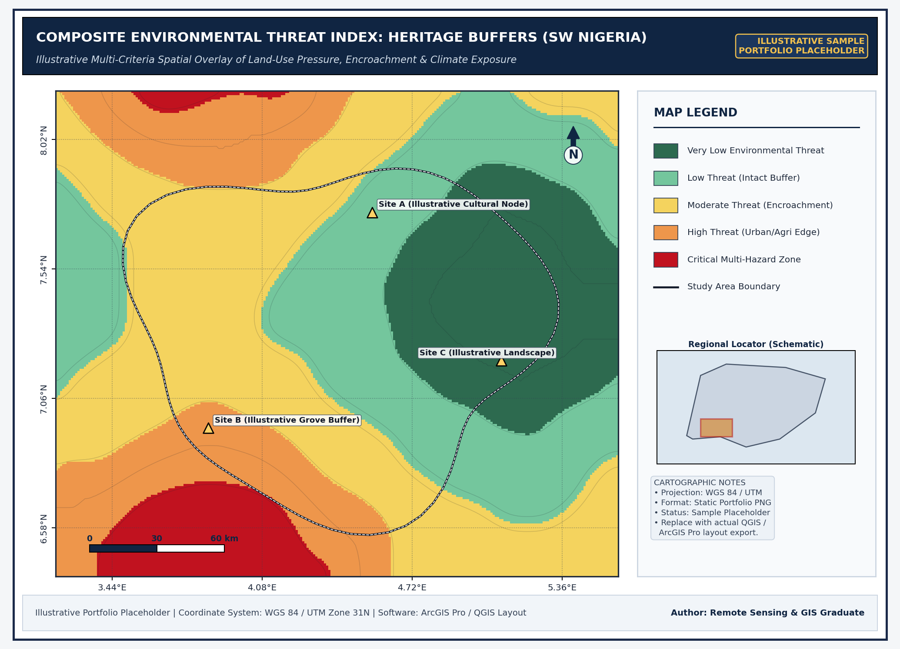
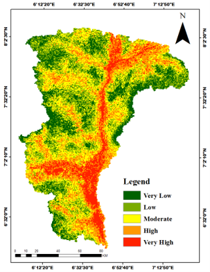

# Remote Sensing & GIS Cartographic Portfolio


---

## Overview

Welcome to my **Remote Sensing & Geographic Information Systems (GIS) Portfolio**. This repository is structured specifically around **high-resolution static PNG map exports** produced in **ArcGIS Pro** and **ARCMAP**.


---

## Repository Directory Structure


```

---

## Featured Project Categories

| # | Project Category | Focus & Techniques | Folder Link |
|---|---|---|---|
| **01** | **Environmental Threats to UNESCO Heritage Sites (SW Nigeria)** | Multi-criteria spatial overlay, buffer encroachment analysis, LULC change detection | [View Project](./Environmental_Heritage_Assessment/README.md) |
| **02** | **Poaching Hotspots in Okomu National Park, Nigeria** | Getis-Ord Gi* spatial clustering, Kernel Density Estimation, least-cost patrol modelling | [View Project](./Okomu_Poaching_Hotspots/README.md) |
| **03** | **Soil Fertility Assessment** | Geostatistical interpolation (Ordinary Kriging), soil nutrient & pH index mapping | [View Project](./Soil_Fertility_Assessment/README.md) |
| **04** | **Flood Risk Assessment** | Analytical Hierarchy Process (AHP), Topographic Wetness Index (TWI), hydrological modelling | [View Project](./Flood_Risk_Assessment/README.md) |
| **05** | **Soil Erosion Assessment** | Revised Universal Soil Loss Equation (RUSLE), R, K, LS, C, and P factor raster modelling | [View Project](./Soil_Erosion_Assessment/README.md) |
| **06** | **Other Geospatial & Remote Sensing Maps** | Study area maps, Random Forest LULC, SRTM DEM, Slope, NDVI, and NDWI outputs | [View Gallery](./Other_Geospatial_Maps/README.md) |

---

## Cartographic Previews

### 01. UNESCO Heritage Environmental Threat Index


### 02. Lower Ogun Osun soil Erosion Analysis


### 04. Multi-Criteria Flood Susceptibility Zonation 


---


---

## Author & Contact

- **Name:** Paul Oluwasegun Adebisi
- **Qualification:** B. Tech Remote Sensing & Geoscience Information Systems
- **Core Tools:** ArcGIS Pro, QGIS, Google Earth Engine (GEE), ENVI
- **GitHub:** `https://github.com/oluwasegunopaul-hub`
- **Email:** `pauloadebisi@yahoo.com`
