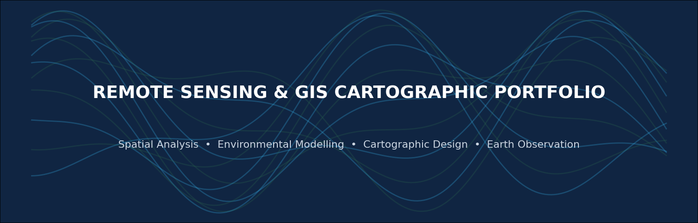
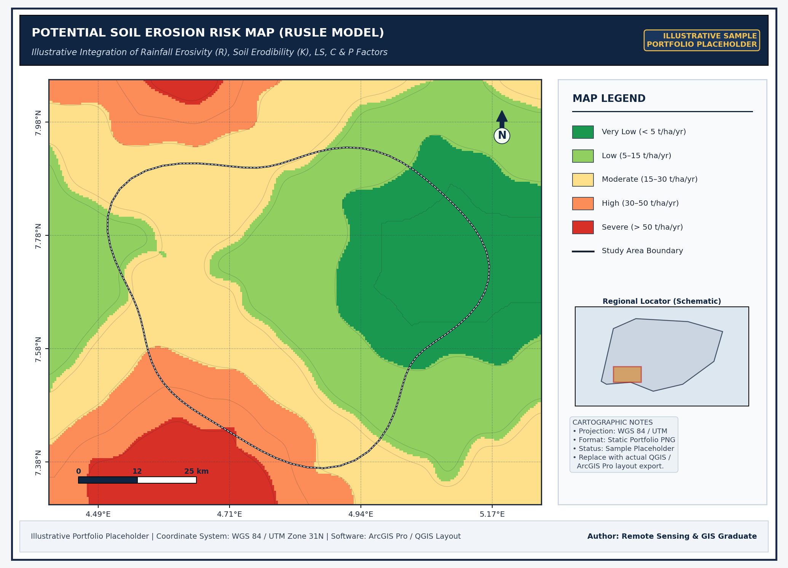

# Remote Sensing & GIS Cartographic Portfolio




---

## Overview

Welcome to my **Remote Sensing & Geographic Information Systems (GIS) Portfolio**. This repository is structured specifically around **high-resolution static PNG map exports** produced in **ArcGIS Pro** and **ARCMAP**, eliminating the need to upload large raw shapefiles, geodatabases, or multi-gigabyte GeoTIFF rasters to GitHub.


---

## Repository Directory Structure

```text
geospatial-remote-sensing-portfolio/
│
├── README.md                                  # Main repository documentation & overview

│
├── 01_Environmental_Heritage_Assessment/
│   ├── maps/
│   │   ├── 01_unesco_composite_threat_index.png
│   │   └── 02_heritage_buffer_encroachment_change.png
│   ├── README.md
│   └── project_information.md
│
├── 02_Okomu_Poaching_Hotspots/
│   ├── maps/
│   │   ├── 01_okomu_poaching_hotspot_gi_star.png
│   │   └── 02_okomu_patrol_accessibility_surface.png
│   ├── README.md
│   └── project_information.md
│
├── 03_Soil_Fertility_Assessment/
│   ├── maps/
│   │   ├── 01_soil_fertility_index_map.png
│   │   └── 02_soil_ph_organic_carbon_surface.png
│   ├── README.md
│   └── project_information.md
│
├── 04_Flood_Risk_Assessment/
│   ├── maps/
│   │   ├── 01_flood_susceptibility_ahp_map.png
│   │   └── 02_topographic_wetness_index_twi.png
│   ├── README.md
│   └── project_information.md
│
├── 05_Soil_Erosion_Assessment/
│   ├── maps/
│   │   ├── 01_rusle_soil_loss_erosion_map.png
│   │   └── 02_rusle_ls_topographic_factor.png
│   ├── README.md
│   └── project_information.md
│
├── 06_Other_Geospatial_Maps/
│   ├── Study_Area_Maps/
│   │   └── study_area_location_map.png
│   ├── LULC_Maps/
│   │   └── lulc_supervised_classification.png
│   ├── Terrain_Maps/
│   │   ├── dem_elevation_model.png
│   │   └── terrain_slope_degrees.png
│   ├── Vegetation_Maps/
│   │   ├── ndvi_vegetation_vigor.png
│   │   └── ndwi_surface_water_index.png
│   └── README.md
│
└── assets/
    └── portfolio-images/
        └── portfolio_banner.png
```

---

## Featured Project Categories

| # | Project Category | Focus & Techniques | Folder Link |
|---|---|---|---|
| **01** | **Environmental Threats to UNESCO Heritage Sites (SW Nigeria)** | Multi-criteria spatial overlay, buffer encroachment analysis, LULC change detection | [View Project](./Environmental_Heritage_Assessment/README.md) |
| **02** | **Poaching Hotspots in Okomu National Park, Nigeria** | Getis-Ord Gi* spatial clustering, Kernel Density Estimation, least-cost patrol modelling | [View Project](./Okomu_Poaching_Hotspots/README.md) |
| **03** | **Soil Fertility Assessment** | Geostatistical interpolation (Ordinary Kriging), soil nutrient & pH index mapping | [View Project](./Soil_Fertility_Assessment/README.md) |
| **04** | **Flood Risk Assessment** | Analytical Hierarchy Process (AHP), Topographic Wetness Index (TWI), hydrological modelling | [View Project](./Flood_Risk_Assessment/README.md) |
| **05** | **Soil Erosion Assessment** | Revised Universal Soil Loss Equation (RUSLE), R, K, LS, C, and P factor raster modelling | [View Project](./Soil_Erosion_Assessment/README.md) |
| **06** | **Other Geospatial & Remote Sensing Maps** | Study area maps, Random Forest LULC, SRTM DEM, Slope, NDVI, and NDWI outputs | [View Gallery](./06_Other_Geospatial_Maps/README.md) |

---

## Sample Cartographic Previews

### 01. UNESCO Heritage Environmental Threat Index


### 02. Lower Ogun Osun soil Erosion Analysis


### 04. Multi-Criteria Flood Susceptibility Zonation 


---


---

## Author & Contact

- **Name:** Paul Oluwasegun Adebisi
- **Qualification:** B. Tech Remote Sensing & Geoscience Information Systems
- **Core Tools:** ArcGIS Pro, QGIS, Google Earth Engine (GEE), ENVI
- **GitHub:** `https://github.com/oluwasegunopaul-hub`
- **Email:** `pauloadebisi@yahoo.com`
