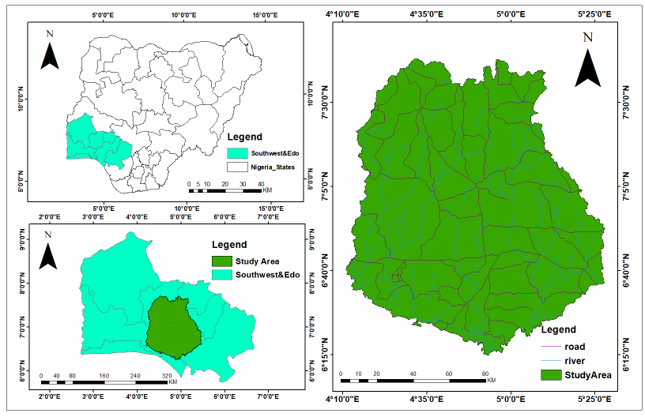
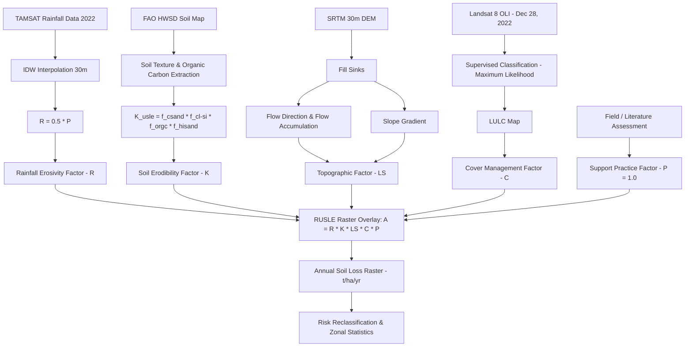
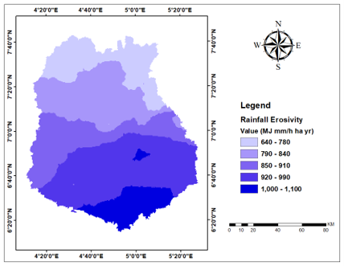
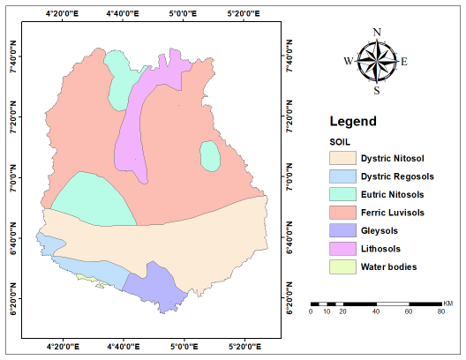
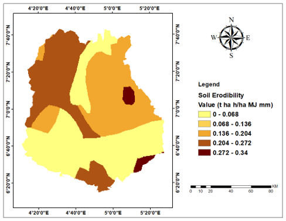
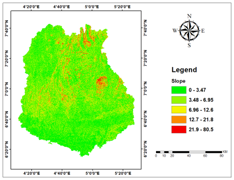
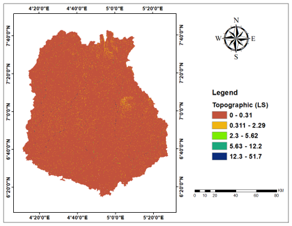
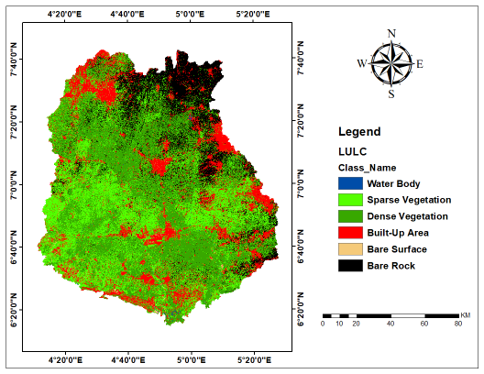
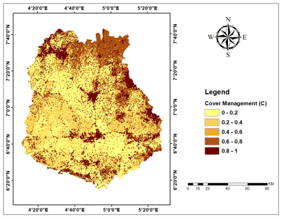
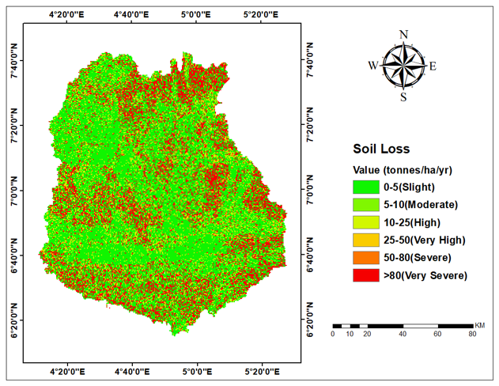

# Assessment of Soil Erosion Potential with Integrated RUSLE Model and GIS in Lower Ogun-Osun Basin, Nigeria

[](#)
[](#)
[](#)
[](#)

---

## Table of Contents
- [Project Overview](#project-overview)
- [Research Objectives](#research-objectives)
- [Study Area](#study-area)
- [Data Sources and Datasets](#data-sources-and-datasets)
- [Software and Technologies](#software-and-technologies)
- [Methodology](#methodology)
- [Maps and Cartographic Outputs](#maps-and-cartographic-outputs)
- [Results and Key Findings](#results-and-key-findings)
- [Discussion](#discussion)
- [Research Limitations](#research-limitations)
- [Conclusion and Recommendations](#conclusion-and-recommendations)
- [Repository Structure](#repository-structure)
- [Author and Project Information](#author-and-project-information)

---

## Project Overview

Soil erosion is a major environmental and land degradation process that depletes fertile topsoil, reduces agricultural productivity, and increases sedimentation in surface water systems. In the **Lower Ogun-Osun Basin** of southern Nigeria—an agriculturally vital region—the spatial extent and severity of water-induced soil erosion have remained inadequately documented, limiting the implementation of targeted soil conservation measures.

This project integrates the **Revised Universal Soil Loss Equation (RUSLE)** with **Remote Sensing (RS)** and **Geographic Information System (GIS)** techniques to model, quantify, and map soil erosion susceptibility across the Lower Ogun-Osun Basin. Using multi-source geospatial datasets—including Landsat 8 Operational Land Imager (OLI) satellite imagery, Shuttle Radar Topography Mission (SRTM) Digital Elevation Model (DEM) data, TAMSAT satellite-gauge rainfall records, and the FAO Harmonized World Soil Database (HWSD)—five biophysical and management factors ($R$, $K$, $LS$, $C$, and $P$) were derived and combined within a raster GIS environment.

The primary purpose of this analysis is to estimate spatially distributed annual soil loss rates ($\text{t ha}^{-1}\text{ yr}^{-1}$), classify erosion severity zones, and provide an empirical cartographic baseline to guide watershed management, agricultural sustainability, and erosion mitigation planning.

---

## Research Objectives

**Research Aim:**  
To evaluate soil erosion susceptibility within the Lower Ogun-Osun Basin of Nigeria utilizing a Geographic Information System (GIS) methodology coupled with integrated Revised Universal Soil Loss Equation (RUSLE) models.

**Specific Objectives:**
1. Integrate RUSLE factors ($R$, $K$, $LS$, $C$, and $P$) into a GIS platform to analyze spatial soil erosion patterns in the Lower Ogun-Osun Basin.
2. Estimate long-term average annual soil erosion rates across the basin using the Revised Universal Soil Loss Equation (RUSLE).
3. Develop a classified soil loss potential map for the study area to identify high-risk zones requiring priority soil conservation interventions.

---

## Study Area

The **Lower Ogun-Osun Basin** is situated in southern Nigeria and spans parts of five states: **Ogun, Osun, Ekiti, Ondo, and Edo States**.

* **Geographic Coordinates:** Latitudes $6^\circ 36'\text{ N}$ to $7^\circ 38'\text{ N}$ and Longitudes $4^\circ 13'\text{ E}$ to $5^\circ 26'\text{ E}$
* **Total Basin Area:** Approximately $16,135\text{ km}^2$ (total classified raster analysis extent: $1,571,753\text{ ha}$)
* **Topography:** Elevation ranges from $-4\text{ m}$ to $1,072\text{ m}$ above mean sea level ($\text{a.m.s.l.}$), with terrain slopes ranging from $0^\circ$ to $80.5^\circ$.
* **Climate:** Characterized by two distinct tropical seasons—a wet season from **April to October** and a dry season from **November to March**—with annual rainfall ranging between $1,290\text{ mm}$ and $2,200\text{ mm}$.
* **Socio-Economic & Land Use Context:** The basin supports diverse communities (including Yoruba and Edo populations), with higher urban population densities in centers such as **Ile-Ife** and **Akure**. Agriculture is the dominant economic activity, centered on the cultivation of cocoa, cassava, maize, and yams, alongside fishing, irrigation farming, trading, and small-scale manufacturing.

### Study Area Reference Map

*Figure 1: Geographical location of the Lower Ogun-Osun Basin across Southwestern Nigeria and Edo State, showing major river networks and road infrastructure.*

---

## Data Sources and Datasets

All spatial datasets were projected to **WGS 1984 UTM Zone 31N** and standardized to a $30\text{ m} \times 30\text{ m}$ raster grid resolution for spatial modeling.

| Dataset | Source | Acquisition Year / Period | Spatial Resolution | Application in the Research |
| :--- | :--- | :--- | :--- | :--- |
| **SRTM Digital Elevation Model (DEM)** | United States Geological Survey (USGS EarthExplorer) | `[Information to be provided]` | $30\text{ m}$ | Hydrological terrain processing (sink filling, flow direction, flow accumulation), slope gradient derivation, and computation of the Topographic ($LS$) factor. |
| **Landsat 8 OLI Satellite Imagery** | United States Geological Survey (USGS EarthExplorer) | December 28, 2022 | $30\text{ m} \times 30\text{ m}$ | Supervised Land Use and Land Cover (LULC) classification and assignment of the Cover and Management ($C$) factor. |
| **Monthly Average Rainfall Data** | Tropical Applications of Meteorology using Satellite data and ground-based observations (TAMSAT) | 2022 | $0.5^\circ \times 0.5^\circ$ (interpolated to $30\text{ m}$) | Spatial rainfall distribution mapping via IDW interpolation and estimation of the Rainfall-Runoff Erosivity ($R$) factor. |
| **Digital Soil Map** | FAO Harmonized World Soil Database (HWSD) | `[Information to be provided]` | $30'' \times 30''$ | Delineation of major soil groups and derivation of topsoil textural and organic carbon parameters for the Soil Erodibility ($K$) factor. |

---

## Software and Technologies

The geospatial processing, statistical computations, and cartographic visualization workflows were executed using the following tools:

* **ArcGIS 10.7.1:** Core GIS and remote sensing environment used for georeferencing, clipping, DEM hydrological conditioning, Inverse Distance Weighted (IDW) interpolation, supervised image classification, raster-to-vector conversions, Raster Calculator map algebra, and cartographic map layout production.
* **Microsoft Excel:** Used for tabular computation of soil erodibility ($K$) sub-factors and statistical area summaries.
* **Microsoft Word:** Used for technical research reporting and documentation.

---

## Methodology

### Workflow Architecture



### 1. Data Acquisition and Preprocessing
All datasets were acquired from authoritative repositories (USGS, TAMSAT, and FAO HWSD), clipped to the Lower Ogun-Osun Basin boundary, and projected to **WGS 1984 UTM Zone 31N**. Continuous raster surfaces were resampled to a uniform spatial resolution of $30\text{ m} \times 30\text{ m}$ to ensure exact cell-by-cell alignment during map algebra overlay.

### 2. Rainfall and Runoff Erosivity Factor ($R$)
The $R$ factor quantifies the kinetic energy and erosive force of rainfall and surface runoff. Using 2022 annual precipitation data ($P$) from TAMSAT, rainfall erosivity was estimated using the empirical equation formulated by Roose (1976):

$$R = 0.5 \times P$$

Point/grid values were interpolated across the basin using the **Inverse Distance Weighted (IDW)** interpolation tool in ArcGIS 10.7.1 and converted into a $30\text{ m} \times 30\text{ m}$ raster layer.

### 3. Soil Erodibility Factor ($K$)
The $K$ factor represents the inherent susceptibility of soil particles to detachment and transport by rainfall and runoff. Using topsoil properties (sand, silt, clay, and organic carbon fractions) extracted from the FAO Harmonized World Soil Database (HWSD), $K$ values were computed using the equations defined by Neitsch et al. (2011):

$$K_{\text{usle}} = f_{\text{csand}} \times f_{\text{cl-si}} \times f_{\text{orgc}} \times f_{\text{hisand}}$$

where:

$$f_{\text{csand}} = 0.2 + 0.3 \times \exp\left[-0.256 \times m_s \times \left(1 - \frac{m_{\text{silt}}}{100}\right)\right]$$

$$f_{\text{cl-si}} = \left(\frac{m_{\text{silt}}}{m_c + m_{\text{silt}}}\right)^{0.3}$$

$$f_{\text{orgc}} = 1 - \frac{0.25 \times \text{orgC}}{\text{orgC} + \exp(3.72 - 2.95 \times \text{orgC})}$$

*(where $m_s$ is percent sand content, $m_{\text{silt}}$ is percent silt content, $m_c$ is percent clay content, and $\text{orgC}$ is percent organic carbon content).*

### 4. Slope Length and Steepness Factor ($LS$)
The topographic $LS$ factor captures the combined effect of slope length ($L$) and slope steepness ($S$) on surface runoff velocity and sediment transport. The $30\text{ m}$ SRTM DEM was hydrologically conditioned using the **Fill** tool in ArcGIS 10.7.1, followed by **Flow Direction**, **Flow Accumulation**, and **Slope** generation. The $LS$ raster was derived in Raster Calculator following Wischmeier and Smith (1978):

$$LS = \left(\frac{\text{Flow Accumulation} \times \text{Cell Size}}{22.13}\right)^{0.4} \times \left(\frac{\sin(\text{Slope})}{0.0896}\right)^{1.3}$$

### 5. Satellite Image Processing and Cover Management Factor ($C$)
A cloud-free **Landsat 8 OLI** scene acquired on **December 28, 2022** ($30\text{ m}$ resolution) was processed in ArcGIS 10.7.1 using **Supervised Classification** with the **Maximum Likelihood (MLH)** algorithm. Six Land Use and Land Cover (LULC) classes were delineated:
1. Water Body
2. Sparse Vegetation
3. Dense Vegetation
4. Built-Up Area
5. Bare Surface
6. Bare Rock

Literature-based $C$ factor coefficients ($0$, $0.03$, $0.25$, $0.6$, and $1.0$) were assigned to the classified LULC categories and converted into a $30\text{ m}$ raster layer.

### 6. Conservation / Support Practice Factor ($P$)
The $P$ factor accounts for structural erosion-control practices such as terracing, contour bunding, and strip cropping, ranging from $0$ (complete erosion control) to $1$ (absence of conservation practices). Due to the lack of widespread documented structural soil conservation practices across the basin, a uniform value of **$P = 1.0$** was applied.

### 7. Spatial Modeling, Classification, and Map Production
All five factor rasters ($R$, $K$, $LS$, $C$, and $P$) were multiplied cell-by-cell in ArcGIS Raster Calculator using the RUSLE equation (Renard et al., 1997):

$$A = R \times K \times LS \times C \times P$$

where $A$ is the estimated average annual soil loss ($\text{t ha}^{-1}\text{ yr}^{-1}$). The resulting continuous soil loss raster was reclassified into six erosion severity categories (`Slight`, `Moderate`, `High`, `Very High`, `Severe`, and `Very Severe`) and exported as standardized cartographic maps.

---

## Maps and Cartographic Outputs

### Map Inventory

| No. | Map Title | Suggested Filename | Category |
| :---: | :--- | :--- | :--- |
| 1 | Location Map of the Study Area | `01_study_area_location_map.png` | Reference |
| 2 | Annual Rainfall Distribution Map | `02_annual_rainfall_map.png` | Thematic (Climatic) |
| 3 | Rainfall Erosivity ($R$) Factor Map | `03_rusle_r_factor_map.png` | RUSLE Factor |
| 4 | Soil Classification Map | `04_soil_classification_map.png` | Thematic (Pedological) |
| 5 | Soil Erodibility ($K$) Factor Map | `05_rusle_k_factor_map.png` | RUSLE Factor |
| 6 | Slope Gradient Map | `06_slope_gradient_map.png` | Thematic (Topographic) |
| 7 | Topographic ($LS$) Factor Map | `07_rusle_ls_factor_map.png` | RUSLE Factor |
| 8 | Land Use and Land Cover (LULC) Map | `08_lulc_classification_map.png` | Thematic (Land Cover) |
| 9 | Cover Management ($C$) Factor Map | `09_rusle_c_factor_map.png` | RUSLE Factor |
| 10 | Classified Soil Loss Potential Map | `10_classified_soil_loss_map.png` | Analytical Synthesis |

---

### Cartographic Gallery & Technical Descriptions

#### 1. Annual Rainfall Distribution Map
* **Technical Description:** Interpolated annual rainfall surface ($\text{mm}$) generated via IDW from 2022 TAMSAT precipitation data across five rainfall classes ($1,290\text{--}2,200\text{ mm}$).
* **Purpose:** Illustrates the spatial gradient of precipitation across the basin as an input to rainfall erosivity modeling.
* **Interpretation:** Rainfall exhibits a distinct latitudinal gradient, increasing progressively from the northern sector ($1,290\text{--}1,570\text{ mm}$) toward the southern coastal-influenced zone ($1,990\text{--}2,200\text{ mm}$).


---

#### 2. Rainfall Erosivity ($R$) Factor Map
* **Technical Description:** Spatial distribution of the RUSLE $R$ factor ($\text{MJ mm ha}^{-1}\text{ h}^{-1}\text{ yr}^{-1}$) derived from $R = 0.5 \times P$ at $30\text{ m}$ resolution.
* **Purpose:** Quantifies the spatial variation in rainfall kinetic energy and runoff erosive potential.
* **Interpretation:** $R$ values range from $640$ to $1,100\text{ MJ mm ha}^{-1}\text{ h}^{-1}\text{ yr}^{-1}$ (mean: $880$, SD: $88$). Erosivity is highest in the southern portion of the basin ($1,000\text{--}1,100$) and lowest in the northern portion ($640\text{--}780$).



---

#### 3. Soil Classification Map
* **Technical Description:** Vector-to-raster pedological map extracted from the FAO Harmonized World Soil Database (HWSD) showing major soil units within the basin.
* **Purpose:** Identifies distinct soil groups to parameterize soil texture and organic matter properties.
* **Interpretation:** Six major soil groups occur across the study area: **Ferric Luvisols** (dominating the central and northern sectors), **Dystric Nitosols** (forming a broad east-west belt in the south), **Eutric Nitosols**, **Lithosols**, **Dystric Regosols**, and **Gleysols**, alongside minor surface water bodies.



---

#### 4. Soil Erodibility ($K$) Factor Map
* **Technical Description:** Continuous spatial surface of soil erodibility ($K$, in $\text{t ha h ha}^{-1}\text{ MJ}^{-1}\text{ mm}^{-1}$) grouped into five susceptibility intervals from $0$ to $0.34$.
* **Purpose:** Represents the differential vulnerability of basin soils to detachment by raindrop splash and overland flow.
* **Interpretation:** $K$ values range from $0$ to $0.34\text{ t ha h ha}^{-1}\text{ MJ}^{-1}\text{ mm}^{-1}$, reflecting low to moderate overall erodibility. Lower erodibility ($0\text{--}0.068$) characterizes the southern Dystric Nitosol belt and central Lithosol strip, whereas higher erodibility ($0.204\text{--}0.34$) occurs predominantly across Ferric Luvisol and Gleysol zones.



---

#### 5. Slope Gradient Map
* **Technical Description:** Terrain slope map (in degrees) derived from the $30\text{ m}$ SRTM DEM, classified into five slope intervals ($0^\circ\text{--}3.47^\circ$, $3.48^\circ\text{--}6.95^\circ$, $6.96^\circ\text{--}12.6^\circ$, $12.7^\circ\text{--}21.8^\circ$, and $21.9^\circ\text{--}80.5^\circ$).
* **Purpose:** Characterizes basin relief and identifies steep escarpments and hilly terrain that accelerate surface runoff velocity.
* **Interpretation:** Gentle slopes ($0^\circ\text{--}6.95^\circ$) dominate the southern and western lowlands, while steep slopes ($12.7^\circ\text{--}80.5^\circ$) are concentrated in the northern and east-central highlands.



---

#### 6. Topographic ($LS$) Factor Map
* **Technical Description:** Dimensionless slope length and steepness ($LS$) raster computed from DEM flow accumulation and slope gradient, classified into five intervals up to $51.7$.
* **Purpose:** Captures the combined topographic control of overland flow accumulation and slope angle on sediment transport capacity.
* **Interpretation:** $LS$ values span from $0$ to $51.7$ (mean: $0.047$, SD: $1.095$). Low values ($0\text{--}0.31$) prevail across flat plains, whereas elevated $LS$ values ($> 2.3$) align with steep ridges and concentrated drainage pathways in the north and east-central uplands.



---

#### 7. Land Use and Land Cover (LULC) Map
* **Technical Description:** Supervised Maximum Likelihood classification of 2022 Landsat 8 OLI imagery ($30\text{ m}$) depicting six land cover classes: `Water Body`, `Sparse Vegetation`, `Dense Vegetation`, `Built-Up Area`, `Bare Surface`, and `Bare Rock`.
* **Purpose:** Maps surface land cover conditions to evaluate vegetative protection against raindrop impact and runoff.
* **Interpretation:** Dense and sparse vegetation cover substantial portions of the central and southwestern basin, while built-up settlements, bare surfaces, and exposed bare rock are prominent in the northern, eastern, and urbanized corridors.



---

#### 8. Cover Management ($C$) Factor Map
* **Technical Description:** Dimensionless RUSLE $C$ factor raster ($0$ to $1$) derived from the 2022 LULC map and classified into five intervals ($0\text{--}0.2$, $0.2\text{--}0.4$, $0.4\text{--}0.6$, $0.6\text{--}0.8$, and $0.8\text{--}1.0$).
* **Purpose:** Quantifies the protective effect of canopy and surface cover relative to bare, continuously tilled land.
* **Interpretation:** Areas with dense vegetative canopy exhibit low $C$ values ($0\text{--}0.2$), providing strong soil protection, whereas bare surfaces, exposed rock, and disturbed urban fringes exhibit high $C$ values ($0.6\text{--}1.0$), indicating heightened erosion susceptibility.



---

#### 9. Classified Soil Loss Potential Map
* **Technical Description:** Final composite RUSLE annual soil loss map ($A = R \times K \times LS \times C \times P$) categorized into six agronomic erosion risk classes (`Slight` to `Very Severe`) at $30\text{ m}$ spatial resolution.
* **Purpose:** Synthesizes all five erosion-controlling factors to delineate spatial soil loss intensity and prioritize high-risk zones for conservation intervention.
* **Interpretation:** While $59.07\%$ of the basin experiences slight erosion ($0\text{--}5\text{ t ha}^{-1}\text{ yr}^{-1}$), $22.26\%$ falls under the **Very Severe** category ($> 80\text{ t ha}^{-1}\text{ yr}^{-1}$), concentrated particularly in the northern, eastern, and southern sectors where steep terrain, sparse cover/bare surfaces, and high rainfall erosivity intersect.



---

## Results and Key Findings

### Summary of RUSLE Factor Parameters

| RUSLE Factor | Unit | Minimum | Maximum | Mean | Standard Deviation |
| :--- | :--- | :---: | :---: | :---: | :---: |
| **Rainfall Erosivity ($R$)** | $\text{MJ mm ha}^{-1}\text{ h}^{-1}\text{ yr}^{-1}$ | $640$ | $1,100$ | $880$ | $88$ |
| **Soil Erodibility ($K$)** | $\text{t ha h ha}^{-1}\text{ MJ}^{-1}\text{ mm}^{-1}$ | $0$ | $0.34$ | `[Not reported]` | `[Not reported]` |
| **Topographic Factor ($LS$)** | Dimensionless | $0$ | $51.7$ | $0.047$ | $1.095$ |
| **Cover Management ($C$)** | Dimensionless | $0$ | $1.0$ | `[Not reported]` | `[Not reported]` |
| **Support Practice ($P$)** | Dimensionless | $1.0$ | $1.0$ | $1.0$ | $0$ |

### Estimated Annual Soil Loss and Risk Classification

* **Mean Annual Soil Loss Rate:** $70.17\text{ t ha}^{-1}\text{ yr}^{-1}$
* **Estimated Total Annual Soil Loss:** Approximately $3.4\text{ million tonnes yr}^{-1}$ across the basin

| Soil Loss Range ($\text{t ha}^{-1}\text{ yr}^{-1}$) | Erosion Risk Intensity | Area ($\text{ha}$) | Area Coverage ($\%$) |
| :---: | :--- | :---: | :---: |
| $0\text{--}5$ | Slight | $928,381$ | $59.07\%$ |
| $5\text{--}10$ | Moderate | $78,819$ | $5.01\%$ |
| $10\text{--}25$ | High | $108,668$ | $6.91\%$ |
| $25\text{--}50$ | Very High | $61,331$ | $3.90\%$ |
| $50\text{--}80$ | Severe | $44,747$ | $2.85\%$ |
| $> 80$ | Very Severe | $349,807$ | $22.26\%$ |
| **Total** | — | **$1,571,753$** | **$100.00\%$** |

### Key Analytical Takeaways
1. **Bimodal Risk Distribution:** Nearly three-fifths ($59.07\%$) of the Lower Ogun-Osun Basin exhibits slight erosion ($0\text{--}5\text{ t ha}^{-1}\text{ yr}^{-1}$), primarily in well-vegetated and low-gradient terrain. However, a substantial proportion ($22.26\%$, or $349,807\text{ ha}$) experiences **Very Severe** soil loss ($> 80\text{ t ha}^{-1}\text{ yr}^{-1}$), elevating the basin-wide mean to $70.17\text{ t ha}^{-1}\text{ yr}^{-1}$.
2. **Compound Environmental Drivers:** High-risk erosion zones are driven by the spatial coincidence of steep slopes (elevated $LS$ values in the north and east-central highlands), exposed surfaces/reduced canopy cover (high $C$ factors), and high southern rainfall erosivity ($R$ up to $1,100\text{ MJ mm ha}^{-1}\text{ h}^{-1}\text{ yr}^{-1}$).
3. **Combined High-to-Very-Severe Exposure:** Collectively, $35.92\%$ of the basin ($564,553\text{ ha}$) experiences erosion rates exceeding $10\text{ t ha}^{-1}\text{ yr}^{-1}$ (`High` to `Very Severe` classes), signaling urgent need for targeted watershed intervention.

---

## Discussion

The spatial pattern of soil erosion in the Lower Ogun-Osun Basin demonstrates how topography, land cover dynamics, and tropical rainfall regimes interact to control land degradation:

* **Agricultural Productivity & Food Security:** Because cocoa, cassava, maize, and yam cultivation underpin local livelihoods across Ogun, Osun, Ekiti, Ondo, and Edo States, severe topsoil loss ($> 50\text{ t ha}^{-1}\text{ yr}^{-1}$ across $25.10\%$ of the basin) threatens soil organic matter, nutrient retention, and long-term crop yields.
* **Watershed & Reservoir Sedimentation:** Accelerated sheet and rill erosion on unprotected slopes increases sediment delivery into rivers and streams, elevating risks of channel siltation, degraded water quality, and reduced storage capacity in downstream water infrastructure.
* **Spatial Planning Utility:** Identifying exact spatial hotspots allows state ministries of agriculture, river basin development authorities (such as the Ogun-Osun River Basin Development Authority), and environmental planners to concentrate limited conservation funding on the $22.26\%$ very-severe risk zones rather than applying uniform basin-wide measures.

---

## Research Limitations

No formal section on study limitations was explicitly documented in the source thesis. However, the following methodological scope parameters are noted directly from the research design:

* **Erosion Process Scope:** In accordance with standard RUSLE formulation, the model estimates long-term average annual soil loss from **sheet and rill erosion** and does not explicitly simulate gully erosion, channel bank collapse, or sediment deposition processes.
* **Support Practice ($P$) Assumption:** Due to the absence of basin-wide spatial records on structural conservation practices, $P$ was parameterized uniformly as $1.0$.
* **Field Calibration / Accuracy Metrics:** `[Information to be provided — e.g., LULC classification confusion matrix / Kappa coefficient or field sediment validation records, if available]`

---

## Conclusion and Recommendations

### Conclusion
Integrating the Revised Universal Soil Loss Equation (RUSLE) with Remote Sensing and ArcGIS 10.7.1 provides a practical, reproducible framework for quantifying spatial soil erosion susceptibility across the $16,135\text{ km}^2$ Lower Ogun-Osun Basin. While $59.07\%$ of the basin undergoes slight erosion ($0\text{--}5\text{ t ha}^{-1}\text{ yr}^{-1}$), the $22.26\%$ experiencing very severe soil loss ($> 80\text{ t ha}^{-1}\text{ yr}^{-1}$) drives an overall mean erosion rate of $70.17\text{ t ha}^{-1}\text{ yr}^{-1}$ ($\approx 3.4\text{ million tonnes yr}^{-1}$), underscoring the necessity for immediate, spatially targeted soil conservation interventions.

### Recommendations
1. **Enact Targeted Soil Conservation in High-Risk Zones:**
   * Implement **contour farming and terracing** on steep slopes to slow overland flow velocity and promote infiltration.
   * Promote **cover cropping** (e.g., legumes and grasses) and **mulching** during off-seasons to shield topsoil from raindrop impact.
   * Establish **vegetative buffer strips, riparian buffers, and grassed waterways** along stream banks and concentrated runoff pathways to trap sediment and prevent gully initiation.
2. **Promote Sustainable Land Management (SLM) Practices:**
   * Encourage **no-till or reduced-till agriculture** to preserve soil structure and surface organic matter.
   * Integrate **agroforestry systems** and **crop rotation/diversification** (alternating deep-rooted and shallow-rooted crops) to reinforce soil binding.
   * Maintain **permanent perennial vegetation** on highly erodible slopes and riparian margins.
3. **Formulate and Enforce Land-Use and Stormwater Policies:**
   * Establish **zoning regulations** restricting agricultural expansion or deforestation in identified very-severe erosion zones.
   * Mandate **Environmental Impact Assessments (EIAs)** prior to major land-use conversions and enforce **reforestation/afforestation** on degraded lands.
   * Implement **urban stormwater management regulations** (permeable pavements, rain gardens, and detention basins) in rapidly urbanizing hubs such as Akure and Ile-Ife to control impervious surface runoff.

---

## Repository Structure

```text
lower-ogun-osun-rusle-soil-erosion/
├── README.md                                  # Complete technical project documentation
├── maps/                                      # Exported cartographic outputs (300 DPI PNGs)
│   ├── 01_study_area_location_map.png         # Fig 1.7: Study area reference map
│   ├── 02_annual_rainfall_map.png             # Fig 4.1.1.1: Annual rainfall map (2022)
│   ├── 03_rusle_r_factor_map.png              # Fig 4.1.1.2: Rainfall erosivity (R) factor map
│   ├── 04_soil_classification_map.png         # Fig 4.1.2.1: FAO HWSD soil groups map
│   ├── 05_rusle_k_factor_map.png              # Fig 4.1.2.2: Soil erodibility (K) factor map
│   ├── 06_slope_gradient_map.png              # Fig 4.1.3.1: SRTM DEM slope map (degrees)
│   ├── 07_rusle_ls_factor_map.png             # Fig 4.1.3.2: Topographic (LS) factor map
│   ├── 08_lulc_classification_map.png         # Fig 4.1.4.1: Landsat 8 LULC map (2022)
│   ├── 09_rusle_c_factor_map.png              # Fig 4.1.4.2: Cover management (C) factor map
│   └── 10_classified_soil_loss_map.png        # Fig 4.3: Classified annual soil loss potential map
└── docs/                                      # Supporting research documentation
    └── ADEBISI_PAUL_UPDATED_2-1.docx          # B.Tech Thesis Manuscript (October 2024)
```

---

## Author and Project Information

* **Author:** Adebisi Paul Oluwasegun
* **Academic Qualification:** B.Tech in Remote Sensing and Geoscience Information System (GIS)
* **Department & Institution:** Department of Remote Sensing and Geoscience Information System, School of Earth and Mineral Science, Federal University of Technology, Akure (FUTA), Ondo State, Nigeria
* **Research Supervisor:** Prof. Suleiman A. Adegboyega
* **Completion Date:** October 2024
* **Project Category:** Watershed Hydrology, Soil Erosion Modeling (RUSLE), Remote Sensing & GIS
* **GitHub Profile:** `[Information to be provided — e.g., https://github.com/yourusername]`
* **LinkedIn / Portfolio:** `[Information to be provided]`
* **Contact Email:** `[Information to be provided]`

---

### Citation
> Adebisi, P. O. (2024). *Assessment of Soil Erosion Potential with Integrated RUSLE Model and GIS in Lower Ogun-Osun Basin, Nigeria*. B.Tech Thesis, Department of Remote Sensing and Geoscience Information System, Federal University of Technology, Akure (FUTA), Nigeria.