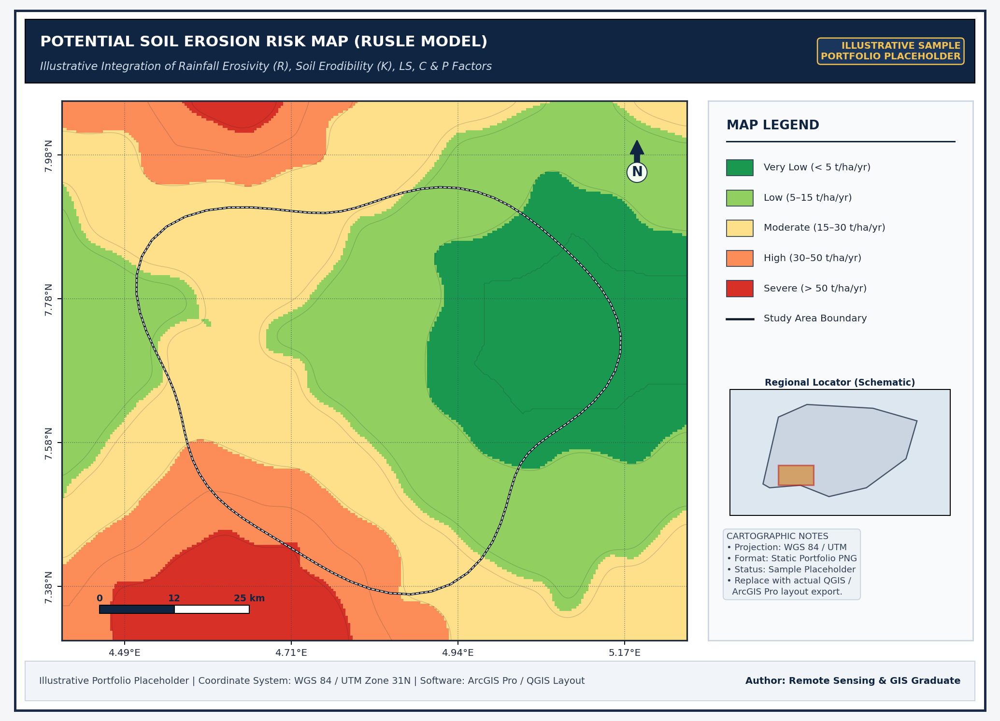
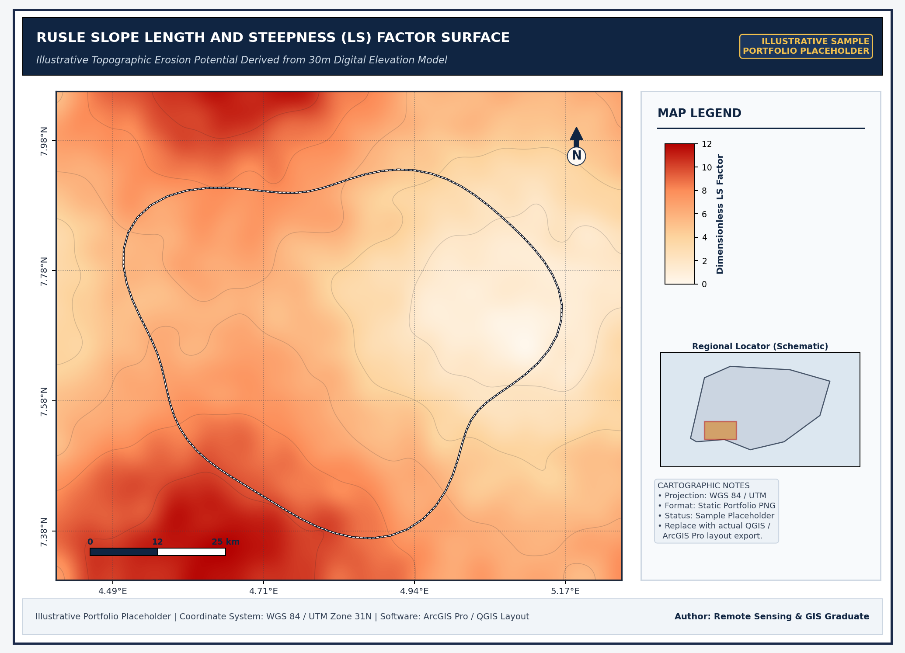

# Spatial Soil Erosion Risk Assessment Using the RUSLE Model

> **Portfolio Note:** The PNG maps currently stored in `maps/` are **illustrative cartographic templates** demonstrating layout design and thematic structure. Replace them with your actual exported ArcGIS Pro or QGIS layouts.

---

## 1. Project Overview
This project implements the Revised Universal Soil Loss Equation (RUSLE) in a raster GIS framework to estimate potential annual soil loss and identify erosion-prone landscapes. By combining rainfall erosivity (R), soil erodibility (K), slope length and steepness (LS), cover management (C), and support practice (P) factors, the study prioritizes watershed soil conservation.

## 2. Research Objectives
- Compute spatially distributed RUSLE factor rasters ($A = R \times K \times LS \times C \times P$) across the study catchment.
- Analyze topographic erosion potential using DEM-derived Slope Length and Steepness (LS) modelling.
- Classify potential annual soil loss ($t\cdot ha^{-1}\cdot yr^{-1}$) into severity categories from Very Low to Severe.
- Produce clear cartographic deliverables to guide erosion control and watershed management.

## 3. Study Area
Agricultural & Upland Catchment in South-West Nigeria (Illustrative extent shown in sample maps; replace with your actual watershed details).

## 4. Data Sources (Illustrative Examples / Placeholders)
- **Rainfall Erosivity (R):** CHIRPS Annual/Monthly Precipitation Dataset — *(Placeholder)*
- **Soil Erodibility (K):** FAO Harmonized World Soil Database / SoilGrids 250m — *(Placeholder)*
- **Topography (LS):** SRTM 30m Digital Elevation Model — *(Placeholder)*
- **Cover Management (C):** Sentinel-2 NDVI & Land-Use Classification — *(Placeholder)*

## 5. Software Used
- ArcGIS Pro (Raster Calculator), QGIS (SAGA GIS LS-Factor module)

## 6. Methodology
1. **Factor Derivation:** Estimating R from regional rainfall-erosivity equations, K from soil texture/organic carbon fractions, LS via Desmet & Govers / Moore & Burch algorithms, and C from NDVI regression.
2. **Map Algebra Integration:** Multiplying the five aligned 30m factor grids in Raster Calculator to estimate potential soil loss.
3. **Severity Classification:** Grouping continuous soil loss estimates into standard agronomic erosion risk classes.
4. **Cartographic Presentation:** Exporting 300 DPI layout maps for both composite soil loss and key individual factors (LS).

## 7. Maps Produced
| Map File | Title | Description |
|---|---|---|
| `01_rusle_soil_loss_erosion_map.png` | Potential Soil Erosion Risk Map (RUSLE) (Illustrative Sample) | Illustrative spatial distribution of estimated annual soil loss categorized from Very Low to Severe. |
| `02_rusle_ls_topographic_factor.png` | RUSLE Slope Length & Steepness (LS) Factor (Illustrative Sample) | Illustrative continuous topographic erosion potential surface derived from a 30m DEM. |

## 8. Map Preview Gallery

### Potential Soil Erosion Risk Map (RUSLE) (Illustrative Sample)

*Illustrative spatial distribution of estimated annual soil loss categorized from Very Low to Severe.*

### RUSLE Slope Length & Steepness (LS) Factor (Illustrative Sample)

*Illustrative continuous topographic erosion potential surface derived from a 30m DEM.*

## 9. Key Findings (Editable Placeholders)
- *[Editable Placeholder — Replace with your actual findings]:* Estimated mean annual soil loss across the catchment was `[X] t/ha/yr`, with severe erosion (`> 50 t/ha/yr`) localized on steep slopes (`> [X]°`) lacking vegetative cover.
- *[Editable Placeholder]:* Intact forest and agroforestry zones maintained soil loss below `[X] t/ha/yr` despite high seasonal rainfall.

## 10. Limitations
- Current maps are **illustrative portfolio examples** and do not represent measured sediment yield data.
- RUSLE estimates sheet and rill erosion potential and does not directly model gully erosion, bank collapse, or sediment deposition.

## 11. Author Information
- **Author:** `[Your Full Name]`
- **Discipline:** Remote Sensing & Geographic Information Systems (GIS)
- **Portfolio Home:** [Back to Main Repository](../README.md)
