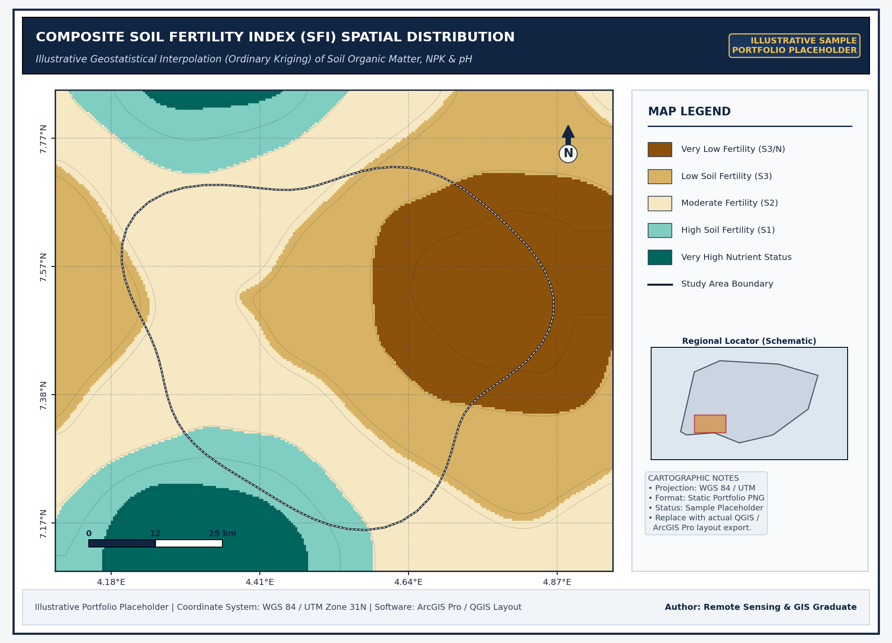
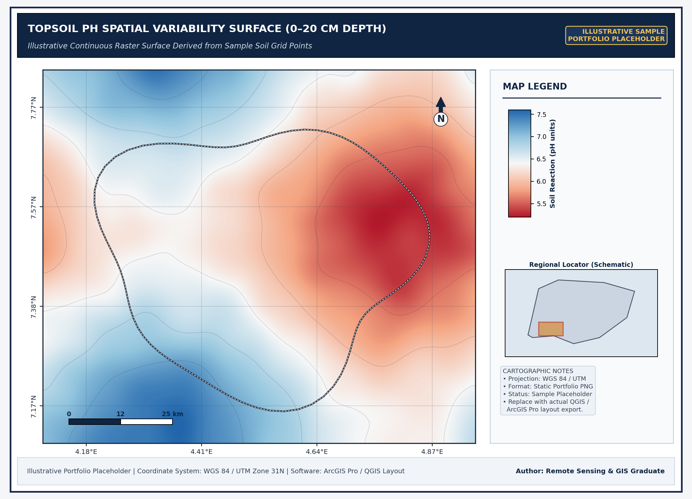

# Geostatistical Soil Fertility Assessment and Nutrient Variability Mapping

> **Portfolio Note:** The PNG maps currently stored in `maps/` are **illustrative cartographic templates** demonstrating layout design and thematic structure. Replace them with your actual exported ArcGIS Pro or QGIS layouts.

---

## 1. Project Overview
This project demonstrates the application of GIS-based geostatistical interpolation and multi-criteria land evaluation to map spatial variations in soil fertility status. Continuous raster surfaces of key physicochemical soil parameters are integrated into a Composite Soil Fertility Index (SFI) to guide precision agriculture and sustainable soil management.

## 2. Research Objectives
- Model the spatial autocorrelation and semivariogram structure of topsoil physicochemical properties (pH, Organic Carbon, Nitrogen, Phosphorus, Potassium).
- Generate continuous prediction surfaces using Ordinary Kriging and Inverse Distance Weighting (IDW).
- Classify agricultural land into fertility suitability zones (S1 to S3/N) using weighted index overlay.
- Produce clear agronomic maps for soil nutrient management.

## 3. Study Area
Agricultural Watershed / Agro-Ecological Zone in South-West Nigeria (Illustrative extent shown in sample maps; update with your exact LGA/State study area).

## 4. Data Sources (Illustrative Examples / Placeholders)
- **Soil Sample Laboratory Data:** Topsoil (0–20 cm) field grid samples — *(Placeholder: Specify sample count N and laboratory methods)*
- **Terrain & Covariates:** SRTM 30m DEM, Slope, and Topographic Wetness Index — *(Placeholder)*
- **Soil Classification Reference:** Harmonized World Soil Database (HWSD) / FAO Soil Map — *(Placeholder)*

## 5. Software Used
- ArcGIS Pro (Geostatistical Analyst), QGIS, R (gstat / sp)

## 6. Methodology
1. **Exploratory Spatial Data Analysis (ESDA):** Checking normality, outliers, and spatial trend across sample points.
2. **Variogram Modelling & Kriging:** Fitting spherical/exponential semivariograms and executing Ordinary Kriging with cross-validation (RMSE).
3. **Parameter Standardization & Weighting:** Reclassifying nutrient surfaces based on agronomic thresholds and computing a weighted Composite Soil Fertility Index.
4. **Cartographic Design:** Using earth-to-teal diverging palettes suited for soil fertility and pH interpretation.

## 7. Maps Produced
| Map File | Title | Description |
|---|---|---|
| `01_soil_fertility_index_map.png` | Composite Soil Fertility Index (SFI) Map (Illustrative Sample) | Illustrative spatial classification of soil fertility zones from Very Low (S3/N) to Very High Nutrient Status. |
| `02_soil_ph_organic_carbon_surface.png` | Topsoil pH Spatial Variability Surface (Illustrative Sample) | Illustrative continuous raster surface depicting spatial variation in topsoil reaction (0–20 cm). |

## 8. Map Preview Gallery

### Composite Soil Fertility Index (SFI) Map (Illustrative Sample)

*Illustrative spatial classification of soil fertility zones from Very Low (S3/N) to Very High Nutrient Status.*

### Topsoil pH Spatial Variability Surface (Illustrative Sample)

*Illustrative continuous raster surface depicting spatial variation in topsoil reaction (0–20 cm).*

## 9. Key Findings (Editable Placeholders)
- *[Editable Placeholder — Replace with your actual findings]:* Approximately `[X%]` of the study area fell within the Moderate Fertility (S2) class, while `[X%]` exhibited low soil pH (`< 5.5`) requiring liming intervention.
- *[Editable Placeholder]:* Higher soil organic matter and nutrient availability correlated strongly with `[alluvial valley bottoms / specific land-use zones]`.

## 10. Limitations
- Current maps are **illustrative portfolio templates** rather than actual laboratory soil survey measurements.
- Interpolation accuracy depends heavily on sampling density and terrain heterogeneity.

## 11. Author Information
- **Author:** `[Your Full Name]`
- **Discipline:** Remote Sensing & Geographic Information Systems (GIS)
- **Portfolio Home:** [Back to Main Repository](../README.md)
