# Assessing the Impacts of Climate Change on Cassava Production and Farmers' Coping Strategies in Ekiti State, Nigeria

## Table of Contents

* [Project Overview](#project-overview)
* [Research Objectives](#research-objectives)
* [Study Area](#study-area)
* [Data Sources and Datasets](#data-sources-and-datasets)
* [Software and Technologies](#software-and-technologies)
* [Methodology](#methodology)
* [Maps and Cartographic Outputs](#maps-and-cartographic-outputs)
* [Hydroclimatic and Agricultural Charts](#hydroclimatic-and-agricultural-charts)
* [Results and Key Findings](#results-and-key-findings)
* [Discussion](#discussion)
* [Research Limitations](#research-limitations)
* [Conclusion and Recommendations](#conclusion-and-recommendations)

---

## Project Overview

Cassava (*Manihot esculenta*) is a vital staple food crop in Southwestern Nigeria whose cultivation is predominantly rain-fed, making it highly sensitive to thermal stress, rainfall variability, and shifts in atmospheric moisture demand. In **Ekiti State, Nigeria**, understanding how multi-decadal climate trends and localized land surface warming affect vegetation vigor and agricultural resilience is essential for sustaining rural livelihoods and food security.

This project integrates **multi-temporal satellite Remote Sensing**, **Geographic Information System (GIS)** spatial analysis, and **34-year hydroclimatic time-series analysis ($1990\text{--}2024$)** to evaluate the impacts of climate change on cassava production and infer the spatial effectiveness of farmers' coping strategies across five contiguous Local Government Areas (LGAs) in northern and central Ekiti State. Medium-resolution multispectral and thermal imagery from **Landsat 8 OLI ($2014$)** and **Landsat 9 OLI ($2024$)** were processed in **ArcGIS 10.7** to derive the **Normalized Difference Vegetation Index (NDVI)**, **Enhanced Vegetation Index (EVI)**, and **Land Surface Temperature (LST)**. These decadal spatial indicators were analyzed alongside long-term **ECMWF ERA-Interim** meteorological records (rainfall, minimum/maximum temperature, solar radiation, minimum/maximum relative humidity, and wind speed) and cassava cultivated area records.

The primary purpose of this analysis is to provide spatially explicit evidence of surface warming and vegetation canopy stress, contextualize annual fluctuations in cassava cultivation, and identify high-vulnerability agricultural zones requiring targeted climate adaptation interventions.

---

## Research Objectives
1. Derive and compare decadal spatial distributions of vegetation health and canopy condition using **NDVI** and **EVI** from Landsat 8 OLI ($2014$) and Landsat 9 OLI ($2024$) imagery.
2. Retrieve and quantify decadal changes in **Land Surface Temperature (LST)** between $2014$ and $2024$ across the five selected LGAs to identify thermal stress hotspots.
3. Analyze $34$-year ($1990\text{--}2024$) inter-annual trends and anomalies in key agro-climatic parameters (rainfall, minimum/maximum temperature, solar radiation, minimum/maximum relative humidity, and wind speed) alongside cassava cultivated area dynamics.
4. Evaluate the spatial-temporal relationships between climatic stressors, vegetation spectral responses, and the efficacy of farmers' climate coping and adaptation strategies.

---

## Study Area

The research was conducted across **five contiguous Local Government Areas (LGAs)** situated primarily in the northern and central sectors of **Ekiti State**, within the Southwestern geopolitical zone of Nigeria:

1. **Ilejemeje**
2. **Ido-Osi**
3. **Oye**
4. **Ikole**
5. **Irepodun/Ifelodun**

* **Geographic Coordinates:** Approximately latitudes $7^\circ 31'\text{ N}$ to $8^\circ 10'\text{ N}$ and longitudes $5^\circ 3'\text{ E}$ to $5^\circ 42'\text{ E}$.
* **Agro-Ecological & Agricultural Context:** The region supports rain-fed arable agriculture in which cassava (*Manihot esculenta*) is a primary staple crop, alongside forested zones, shrublands, and rural-to-peri-urban settlements.

### Study Area Reference Map

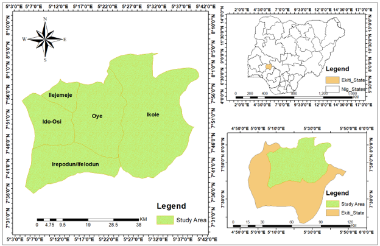  
*Figure 1: Geographical location of the five-LGA study area (Ilejemeje, Ido-Osi, Oye, Ikole, and Irepodun/Ifelodun) within Ekiti State and Nigeria.*

---

## Data Sources and Datasets

All satellite imagery and meteorological datasets utilized in this study were obtained from authoritative international repositories:

| Dataset | Source | Acquisition Year / Period | Spatial Resolution | Application in the Research |
| :--- | :--- | :--- | :--- | :--- |
| **Landsat 8 OLI / TIRS Satellite Imagery** | United States Geological Survey (USGS EarthExplorer) | $2014$ | $30\text{ m}$ | Baseline computation of Normalized Difference Vegetation Index (NDVI), Enhanced Vegetation Index (EVI), and Land Surface Temperature (LST). |
| **Landsat 9 OLI-2 / TIRS-2 Satellite Imagery** | United States Geological Survey (USGS EarthExplorer) | $2024$ | $30\text{ m}$ | Decadal comparison of NDVI, EVI, and LST to detect vegetation stress, canopy changes, and surface warming trends. |
| **ERA-Interim Reanalysis Climatic Data** | European Centre for Medium-Range Weather Forecasts (ECMWF) | $1990\text{--}2024$ ($34\text{ years}$) | 80KM | Time-series and anomaly analysis of annual rainfall, minimum/maximum temperature, solar radiation, minimum/maximum relative humidity, and wind speed. |
| **Administrative Boundary Shapefiles** | GRID3 |  | Vector | Spatial delineation and clipping of Ekiti State and the five target LGAs. |

---

## Software and Technologies

The geospatial processing, thermal/spectral index modeling, and hydroclimatic statistical visualizations were conducted using the following tools:

* **ArcGIS 10.7:** Core GIS and remote sensing platform used for radiometric processing, band math calculations (NDVI, EVI, and thermal LST retrieval), raster clipping, spatial overlay analysis, and cartographic map layout design.
* **Microsoft Excel:** Used for organizing $34$-year ECMWF ERA-Interim meteorological records and cassava cultivation data, calculating climatic anomalies relative to long-term means, and generating time-series and anomaly charts.

---

## Methodology

### Workflow Architecture

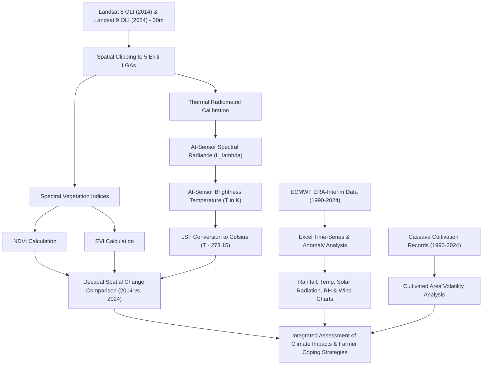

### 1. Data Acquisition and Preprocessing
Multispectral and thermal satellite scenes from **Landsat 8 OLI ($2014$)** and **Landsat 9 OLI ($2024$)** at $30\text{ m}$ spatial resolution were acquired from the USGS EarthExplorer portal (`www.earthexplorer.usgs.gov`) and subsetted to the administrative boundary of the five target LGAs in Ekiti State. Multi-decadal meteorological variables ($1990\text{--}2024$) were retrieved from the ECMWF ERA-Interim archive and structured in Microsoft Excel for inter-annual trend and anomaly analysis.

### 2. Normalized Difference Vegetation Index (NDVI)
NDVI was computed in **ArcGIS 10.7** to quantify vegetation greenness, photosynthetic activity, and spatial variations in plant health across the $2014$ and $2024$ epochs:

$$\text{NDVI} = \frac{\text{NIR} - \text{Red}}{\text{NIR} + \text{Red}}$$

where $\text{NIR}$ is reflectance in the near-infrared band ($0.7\text{--}1.1\ \mu\text{m}$) and $\text{Red}$ is reflectance in the visible red band ($0.6\text{--}0.7\ \mu\text{m}$). Output values range from $-1$ to $+1$, interpreted across four standard biophysical thresholds:

* $\text{NDVI} < 0$**:** Non-vegetated surfaces (water bodies or barren surfaces).
* $\text{NDVI} \approx 0\text{--}0.2$**:** Barren land or sparsely vegetated/built-up areas.
* $\text{NDVI} \approx 0.2\text{--}0.5$**:** Moderate vegetation cover (grasslands, shrublands, or stressed crops).
* $\text{NDVI} \approx 0.5\text{--}1.0$**:** Dense, actively photosynthesizing vegetation (forests and healthy peak-season croplands).

### 3. Enhanced Vegetation Index (EVI)
To complement NDVI and reduce atmospheric aerosol interference and soil background noise in high-biomass agricultural canopies, the **Enhanced Vegetation Index (EVI)** was calculated for both $2014$ and $2024$:

$$\text{EVI} = 2.5 \times \frac{\text{NIR} - \text{Red}}{\text{NIR} + 6 \times \text{Red} - 7.5 \times \text{Blue} + 1}$$

where $\text{Blue}$ represents surface reflectance in the visible blue band. EVI provides heightened sensitivity to canopy structural parameters such as leaf area index (LAI) and canopy vigor.

### 4. Land Surface Temperature (LST) Retrieval
Land Surface Temperature was extracted from the Landsat thermal infrared bands in ArcGIS 10.7 through a sequential radiometric conversion workflow:

1. **Radiometric Calibration (At-Sensor Spectral Radiance):** Conversion of quantized calibrated pixel values ($Q_{\text{cal}}$) to at-sensor spectral radiance ($L_\lambda$, in $\text{W m}^{-2}\text{ sr}^{-1}\ \mu\text{m}^{-1}$).
2. **Top-of-Atmosphere (TOA) Reflectance Conversion:** Conversion of optical bands to TOA planetary reflectance ($\rho_\lambda$).
3. **At-Sensor Brightness Temperature ($T$):** Conversion of thermal spectral radiance ($L_\lambda$) to effective at-sensor brightness temperature in Kelvin ($\text{K}$) using band-specific metadata thermal constants ($K_1$ and $K_2$):

$$T = \frac{K_2}{\ln\left(\frac{K_1}{L_\lambda} + 1\right)}$$

4. **Conversion to Degrees Celsius ($^\circ\text{C}$):** Brightness temperatures were converted from Kelvin to Celsius:

$$T(^\circ\text{C}) = T(\text{K}) - 273.15$$

### 5. Hydroclimatic Time-Series and Anomaly Analysis
Using Microsoft Excel, $34$-year records ($1990\text{--}2024$) of annual rainfall, annual minimum temperature ($T_{\min}$), annual maximum temperature ($T_{\max}$), solar radiation, annual minimum relative humidity ($\text{RH}_{\min}$), annual maximum relative humidity ($\text{RH}_{\max}$), and average wind speed were plotted alongside normalized anomalies (deviations from the $1990\text{--}2024$ long-term mean) to identify dry/wet episodes and secular warming or drying trends.

### 6. Cartographic Output Production
All spatial indices ($\text{NDVI}$, $\text{EVI}$, and $\text{LST}$) for $2014$ and $2024$ were symbolized using standardized continuous color ramps, coordinate grids, north arrows, and metric scale bars in ArcGIS 10.7 to produce comparative decadal maps.

---

## Maps and Cartographic Outputs

### Map Inventory

| No. | Map Title | Suggested Filename | Category |
| :---: | :--- | :--- | :--- |
| 1 | Study Area Location Map (Five Selected LGAs in Ekiti State) | `maps/01_study_area_location_map.png` | Reference |
| 2 | 2014 Normalized Difference Vegetation Index (NDVI) Map | `maps/02_ndvi_2014_map.png` | Thematic (Vegetation Vigor) |
| 3 | 2024 Normalized Difference Vegetation Index (NDVI) Map | `maps/03_ndvi_2024_map.png` | Thematic (Vegetation Vigor) |
| 4 | 2014 Enhanced Vegetation Index (EVI) Map | `maps/04_evi_2014_map.png` | Thematic (Canopy Health) |
| 5 | 2024 Enhanced Vegetation Index (EVI) Map | `maps/05_evi_2024_map.png` | Thematic (Canopy Health) |
| 6 | 2014 Land Surface Temperature (LST) Map | `maps/06_lst_2014_map.png` | Thematic (Thermal Regime) |
| 7 | 2024 Land Surface Temperature (LST) Map | `maps/07_lst_2024_map.png` | Thematic (Thermal Regime) |

### Cartographic Gallery & Technical Descriptions

#### 1. 2014 Normalized Difference Vegetation Index (NDVI) Map
* **Technical Description:** Spatial distribution of baseline NDVI derived from $2014$ Landsat 8 OLI imagery at $30\text{ m}$ resolution, spanning values from $-0.067279$ to $0.663877$.
* **Purpose:** Establishes the $2014$ spatial baseline of vegetation greenness and photosynthetic vigor across Ilejemeje, Ido-Osi, Oye, Ikole, and Irepodun/Ifelodun LGAs.
* **Interpretation:** Extensive portions of the central and southwestern zones exhibit moderate-to-high NDVI values (greens and yellows), indicative of healthy forests and thriving agricultural lands, while localized low-NDVI patches (reds and oranges) occur in parts of the northern and southern sectors.

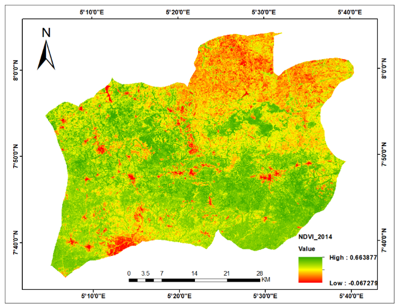

---

#### 2. 2024 Normalized Difference Vegetation Index (NDVI) Map
* **Technical Description:** Decadal follow-up NDVI raster derived from $2024$ Landsat 9 OLI imagery at $30\text{ m}$ resolution, ranging from $-0.024948$ to $0.660064$.
* **Purpose:** Evaluates decadal changes in vegetation vigor and identifies spatial zones experiencing declining crop/vegetation health relative to $2014$.
* **Interpretation:** Although maximum NDVI remained virtually unchanged ($\approx 0.66$), low-to-moderate-low NDVI zones (reds and oranges) expanded and intensified substantially across the northern sector (notably Ikole, Oye, and Ilejemeje) and southern fringes, signaling heightened vegetation stress or land degradation.

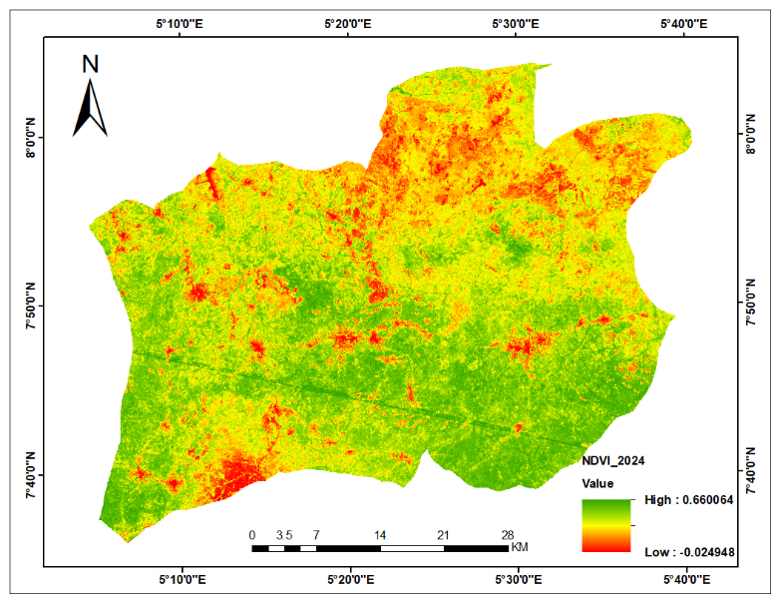

---

#### 3. 2014 Enhanced Vegetation Index (EVI) Map
* **Technical Description:** Baseline $2014$ EVI raster derived from Landsat 8 OLI ($30\text{ m}$), with pixel values ranging from $-0.0543399$ to $0.786884$.
* **Purpose:** Quantifies baseline canopy density and structural vigor while minimizing atmospheric and soil background influences.
* **Interpretation:** High EVI values (greens) dominate the central and southern agricultural and forested belt, whereas lower EVI values (reds and oranges) are concentrated primarily in the northern sector.

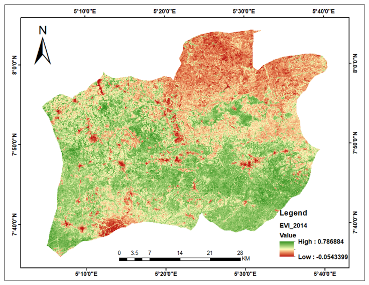

---

#### 4. 2024 Enhanced Vegetation Index (EVI) Map
* **Technical Description:** Decadal $2024$ EVI raster derived from Landsat 9 OLI ($30\text{ m}$), spanning values from $-0.0204979$ to $0.80266$.
* **Purpose:** Detects decadal shifts in crop and vegetation canopy structure across the study area.
* **Interpretation:** While localized peak EVI increased slightly ($0.787 \rightarrow 0.803$), low-to-moderate-low EVI zones expanded markedly across the northern and central-northern sectors compared to $2014$, corroborating NDVI evidence of canopy thinning and moisture/heat stress.

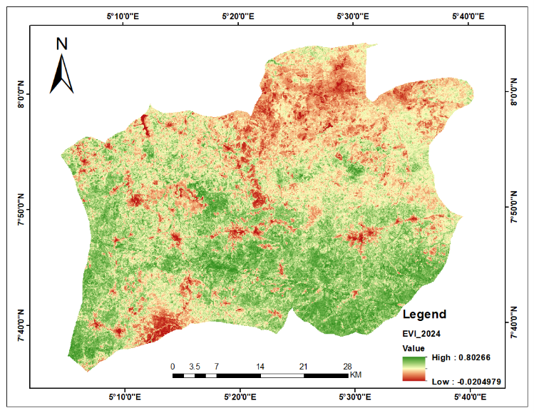

---

#### 5. 2014 Land Surface Temperature (LST) Map
* **Technical Description:** Baseline thermal infrared surface temperature map ($^\circ\text{C}$) derived from $2014$ Landsat 8 thermal data ($30\text{ m}$), ranging from $27.8087^\circ\text{C}$ to $31.3111^\circ\text{C}$.
* **Purpose:** Maps spatial variations in surface thermal load to establish baseline heat exposure across cassava-producing areas.
* **Interpretation:** Cooler surface temperatures (blues) prevail across densely vegetated central and southern areas, whereas elevated surface temperatures (oranges and browns) concentrate in the northern sector, exhibiting a strong inverse spatial relationship with NDVI and EVI.

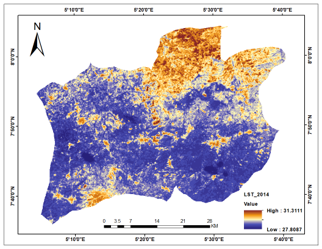

---

#### 6. 2024 Land Surface Temperature (LST) Map
* **Technical Description:** Decadal thermal infrared surface temperature map ($^\circ\text{C}$) derived from $2024$ Landsat 9 thermal data ($30\text{ m}$), ranging from $29.6099^\circ\text{C}$ to $31.7113^\circ\text{C}$.
* **Purpose:** Quantifies decadal surface warming and delineates emerging thermal stress hotspots across the five LGAs.
* **Interpretation:** The entire thermal distribution shifted upward between $2014$ and $2024$: minimum LST rose by approximately $+1.80^\circ\text{C}$ ($27.81^\circ\text{C} \rightarrow 29.61^\circ\text{C}$) and maximum LST increased by $+0.40^\circ\text{C}$ ($31.31^\circ\text{C} \rightarrow 31.71^\circ\text{C}$), with persistent thermal hotspots in the north and expanding warm zones across central and southwestern corridors.

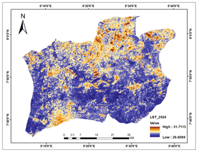

---

## Hydroclimatic and Agricultural Charts

### Chart Inventory

| No. | Chart Title | Suggested Filename | Parameter / Domain | Record Period |
| :---: | :--- | :--- | :--- | :---: |
| 1 | Annual Rainfall and Rainfall Anomaly Chart | `charts/01_annual_rainfall_anomaly_chart.png` | Precipitation (ECMWF ERA-Interim) | $1990\text{--}2024$ |
| 2 | Annual Lowest Temperatures ($T_{\min}$) and Anomaly Chart | `charts/02_annual_lowest_temperature_chart.png` | Minimum Air Temperature | $1990\text{--}2024$ |
| 3 | Annual Highest Temperatures ($T_{\max}$) and Anomaly Chart | `charts/03_annual_highest_temperature_chart.png` | Maximum Air Temperature | $1990\text{--}2024$ |
| 4 | Annual Solar Radiation Chart | `charts/04_annual_solar_radiation_chart.png` | Surface Solar Irradiance | $1990\text{--}2024$ |
| 5 | Annual Lowest Relative Humidity ($\text{RH}_{\min}$) Chart | `charts/05_annual_lowest_rh_chart.png` | Minimum Relative Humidity | $1990\text{--}2024$ |
| 6 | Annual Highest Relative Humidity ($\text{RH}_{\max}$) Chart | `charts/06_annual_highest_rh_chart.png` | Maximum Relative Humidity | $1990\text{--}2024$ |
| 7 | Annual Average Wind Speed Chart | `charts/07_annual_wind_speed_chart.png` | Near-Surface Wind Speed | $1990\text{--}2024$ |
| 8 | Cassava Cultivated Area Dynamics Chart | `charts/08_cassava_cultivated_area_chart.png` | Agricultural Land Allocation | $1990\text{--}2024$ |

### Chart Gallery & Technical Descriptions

#### 1. Annual Rainfall and Rainfall Anomaly Chart ($1990\text{--}2024$)
* **Technical Description:** Time-series and standardized deviation chart generated in Microsoft Excel depicting annual total precipitation and annual rainfall anomalies relative to the $34$-year ($1990\text{--}2024$) long-term mean.
* **Purpose:** Quantifies inter-annual hydroclimatic variability and identifies historical wet and drought episodes affecting rain-fed agriculture.
* **Interpretation:** Annual rainfall exhibits pronounced inter-annual fluctuations oscillating around the zero anomaly line without a monotonic long-term trend. Exceptionally wet positive anomalies occurred in **$1991$, $1998$, and $2019$** (posing waterlogging, root rot, and nutrient leaching risks), while severe negative drought anomalies occurred in **$2001$, $2015$, and $2021$** (inducing soil moisture deficits and yield suppression).

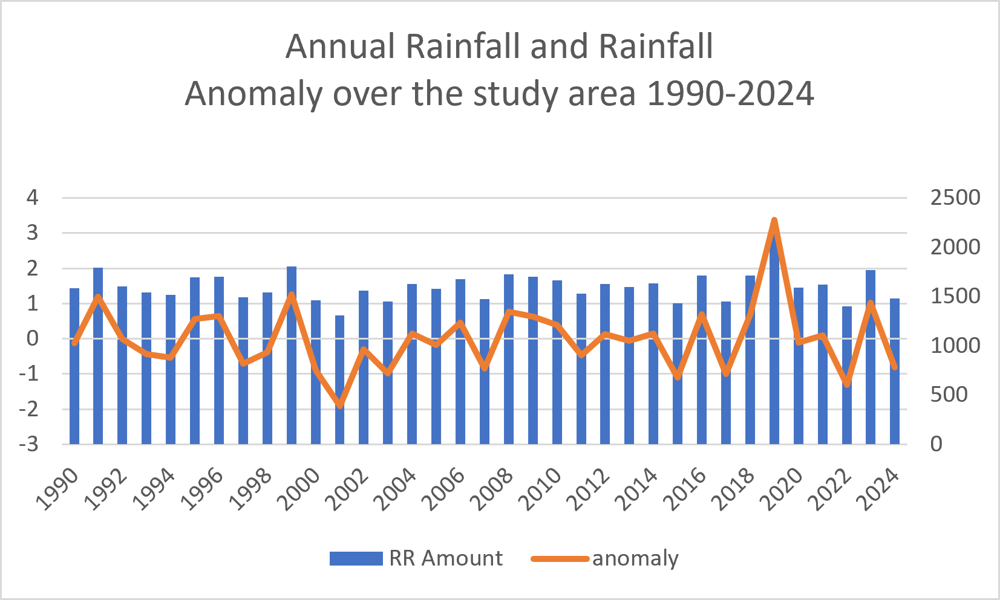

---

#### 2. Annual Lowest Temperatures ($T_{\min}$) and Anomaly Chart ($1990\text{--}2024$)
* **Technical Description:** $34$-year time-series and anomaly chart illustrating annual minimum air temperatures and deviations from the $1990\text{--}2024$ mean.
* **Purpose:** Evaluates long-term warming in baseline/nighttime thermal conditions across the study area.
* **Interpretation:** The chart demonstrates a discernible upward trend in $T_{\min}$, with anomalies shifting from predominantly negative (cooler-than-average lows) in the early $1990\text{s}$ to predominantly positive (warmer-than-average lows) from the mid-$2000\text{s}$ onward—creating warmer conditions favorable for cassava pest and disease survival.

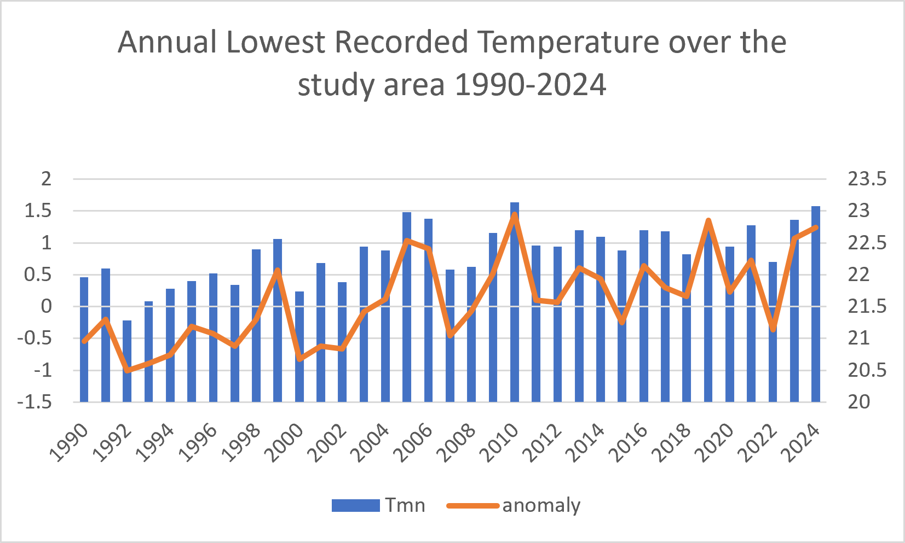

---

#### 3. Annual Highest Temperatures ($T_{\max}$) and Anomaly Chart ($1990\text{--}2024$)
* **Technical Description:** $34$-year time-series and anomaly chart tracking annual peak air temperatures and corresponding temperature anomalies.
* **Purpose:** Quantifies daytime thermal extremes and heat stress trends impacting crop physiology.
* **Interpretation:** Reveals a clear, pronounced upward warming trend in $T_{\max}$ that accelerates markedly from circa **$2014$ onward**, shifting from negative anomalies in the early record to consistently positive, rising anomalies over the most recent decade.

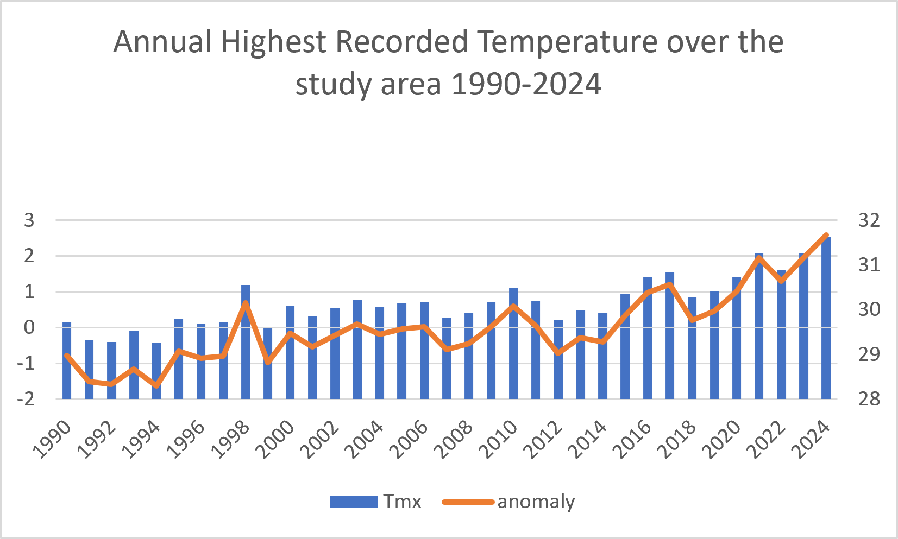

---

#### 4. Annual Solar Radiation Chart ($1990\text{--}2024$)
* **Technical Description:** $34$-year Excel time-series chart of annual surface solar radiation derived from ECMWF ERA-Interim reanalysis data.
* **Purpose:** Assesses temporal variations in incoming solar irradiance driving photosynthesis and surface energy balance.
* **Interpretation:** Solar radiation fluctuated without a consistent trend between $1990$ and $2019$, followed by a marked upward surge from **$2020$ onward** that peaked in **$2022$**—amplifying land surface heating and evaporative demand.

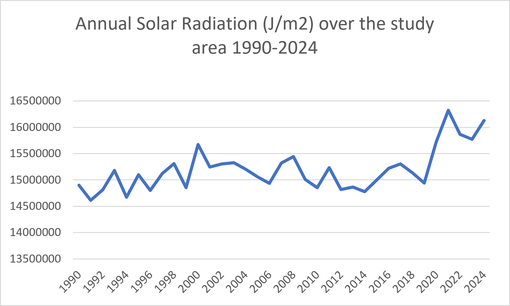

---

#### 5. Annual Lowest Relative Humidity ($\text{RH}_{\min}$) Chart ($1990\text{--}2024$)
* **Technical Description:** $34$-year time-series chart depicting annual minimum relative humidity ($\text{RH}_{\min}$, $\%$), representing peak daytime and dry-season atmospheric dryness.
* **Purpose:** Tracks changes in atmospheric moisture deficit and Vapour Pressure Deficit (VPD) affecting crop transpiration.
* **Interpretation:** $\text{RH}_{\min}$ remained relatively stable between **$48\%$ and $55\%$** from $1990$ to $2019$, before declining sharply post-$2019$ below $50\%$ to reach 34-year record lows of approximately **$45\%$ between $2021$ and $2024$**—substantially increasing transpirational water stress in cassava.

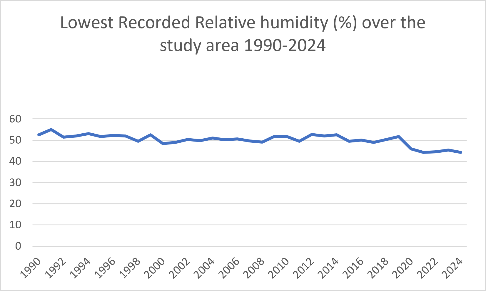

---

#### 6. Annual Highest Relative Humidity ($\text{RH}_{\max}$) Chart ($1990\text{--}2024$)
* **Technical Description:** $34$-year time-series chart tracking annual maximum relative humidity ($\text{RH}_{\max}$, $\%$), indicative of near-saturated nighttime or wet-period atmospheric conditions.
* **Purpose:** Evaluates upper-bound atmospheric moisture dynamics over the $1990\text{--}2024$ period.
* **Interpretation:** Displays considerable inter-annual variability with a subtle post-$2015/2018$ downward tendency, occasionally dipping toward **$85\%$** compared to earlier peaks of **$95\%\text{--}96\%$**.

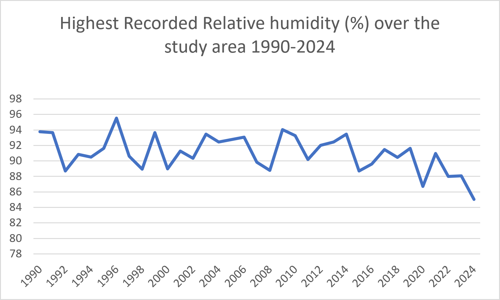

---

#### 7. Annual Average Wind Speed Chart ($1990\text{--}2024$)
* **Technical Description:** $34$-year time-series chart of mean annual near-surface wind speed ($\text{m s}^{-1}$) generated in Microsoft Excel.
* **Purpose:** Examines whether long-term shifts in wind velocity contributed to changes in crop evapotranspiration demand.
* **Interpretation:** Exhibits no monotonic long-term trend, fluctuating around a stable long-term mean of **$2.20\text{--}2.25\text{ m s}^{-1}$** (with slightly higher averages in $1992, 1998, 2001, 2005, 2015$ and lower averages around $1996, 2009, 2019$).

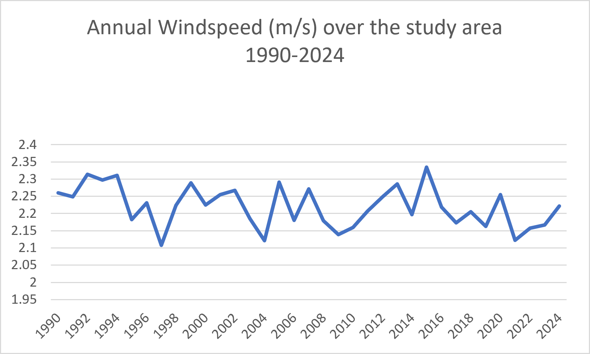

---

#### 8. Cassava Cultivated Area Dynamics Chart ($1990\text{--}2024$)
* **Technical Description:** Multi-decadal time-series chart illustrating inter-annual fluctuations in agricultural land area allocated to cassava cultivation.
* **Purpose:** Contextualizes supply-side cultivation dynamics alongside climatic anomalies to distinguish area-driven shifts from climate-induced yield impacts.
* **Interpretation:** Reveals pronounced multi-phase volatility: minimal cultivated area prior to $1998$, rapid expansion between **$1999$ and $2003/2004$**, general decline from the mid-$2000\text{s}$ to $2012$, a sharp secondary peak around **$2015\text{--}2016$** (coinciding with the $2015$ negative rainfall anomaly), rapid contraction to a trough circa **$2021\text{--}2022$**, and early signs of recovery toward **$2024$**.

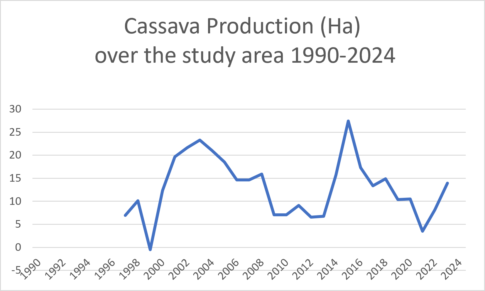

---

## Results and Key Findings

### 1. Decadal Remote Sensing Indices ($2014$ vs. $2024$)

| Spectral / Thermal Parameter | Sensor & Resolution | $2014$ Minimum | $2014$ Maximum | $2024$ Minimum | $2024$ Maximum | Decadal Change & Spatial Pattern |
| :--- | :--- | :---: | :---: | :---: | :---: | :--- |
| **NDVI** | Landsat 8/9 ($30\text{ m}$) | $-0.0673$ | $0.6639$ | $-0.0249$ | $0.6601$ | Peak NDVI stable ($\approx 0.66$); notable spatial expansion of low-to-moderate-low NDVI zones in the northern and southern sectors. |
| **EVI** | Landsat 8/9 ($30\text{ m}$) | $-0.0543$ | $0.7869$ | $-0.0205$ | $0.8027$ | Slight peak increase ($+0.0158$); pronounced expansion of low-EVI canopy-stressed zones in the northern sector. |
| **LST ($^\circ\text{C}$)** | Landsat 8/9 ($30\text{ m}$) | $27.81^\circ\text{C}$ | $31.31^\circ\text{C}$ | $29.61^\circ\text{C}$ | $31.71^\circ\text{C}$ | Minimum LST increased by $+1.80^\circ\text{C}$ and maximum LST increased by $+0.40^\circ\text{C}$, demonstrating basin-wide surface warming. |

### 2. Multi-Decadal Agro-Climatic & Cassava Cultivation Trends ($1990\text{--}2024$)

| Climatic / Agricultural Variable | Record Period | Observed Trend & Key Temporal Milestones | Implications for Cassava (*Manihot esculenta*) Production |
| :--- | :--- | :--- | :--- |
| **Annual Rainfall & Anomalies** | $1990\text{--}2024$ | High inter-annual variability with no monotonic long-term trend. Pronounced wet anomalies in $1991, 1998, 2019$; severe drought anomalies in $2001, 2015, 2021$. | Drought years induce moisture stress and depress tuber yields; excessive rainfall years risk waterlogging, root rot, soil erosion, and nutrient leaching. |
| **Annual Minimum Temperature ($T_{\min}$)** | $1990\text{--}2024$ | Discernible upward warming trend; anomalies shifted from predominantly negative (early $1990\text{s}$) to consistently positive from the mid-$2000\text{s}$ onward. | Warmer nighttime/minimum temperatures favor the survival and proliferation of cassava pests and diseases. |
| **Annual Maximum Temperature ($T_{\max}$)** | $1990\text{--}2024$ | Pronounced upward warming trend accelerating from circa $2014$ onward, with consistently positive anomalies over the last decade. | Increases daytime heat stress, impairs photosynthetic efficiency, and reduces tuber development and water use efficiency. |
| **Solar Radiation** | $1990\text{--}2024$ | Fluctuating without trend from $1990\text{--}2019$, followed by a marked increase from $2020\text{--}2024$, peaking in $2022$. | Potential photosynthetic gains from higher irradiance are offset by concurrent high LST and elevated evaporative demand. |
| **Minimum Relative Humidity ($\text{RH}_{\min}$)** | $1990\text{--}2024$ | Stable between $48\%\text{--}55\%$ ($1990\text{--}2019$), followed by a sharp post-$2019$ decline below $50\%$, reaching 34-year lows of $\approx 45\%$ ($2021\text{--}2024$). | Elevated Vapour Pressure Deficit (VPD) intensifies leaf transpiration, forcing stomatal closure and inducing severe water stress. |
| **Maximum Relative Humidity ($\text{RH}_{\max}$)** | $1990\text{--}2024$ | High inter-annual variability with a slight post-$2015/2018$ downward tendency (dipping toward $85\%$ vs. earlier peaks of $95\%\text{--}96\%$). | Slightly reduced frequency of near-saturated nighttime atmospheric conditions compared to earlier decades. |
| **Annual Average Wind Speed** | $1990\text{--}2024$ | No monotonic long-term trend; fluctuates around a stable long-term mean of $2.20\text{--}2.25\text{ m s}^{-1}$ (higher in $1992, 1998, 2001, 2005, 2015$; lower in $1996, 2009, 2019$). | Acts as a secondary, fluctuating contributor to evaporative demand rather than a primary driver of long-term stress. |
| **Cassava Cultivated Area** | $1990\text{--}2024$ | Minimal pre-$1998$; rapid expansion ($1999\text{--}2003/2004$); decline ($2005\text{--}2012$); sharp secondary peak ($2015\text{--}2016$); rapid contraction to a low ($2021\text{--}2022$), with early recovery toward $2024$. | High cultivated area volatility compounds yield instability; e.g., the $2015\text{--}2016$ area peak coincided with the $2015$ drought anomaly, likely suppressing per-hectare yields. |

---

## Discussion

The convergence of satellite-derived biophysical indicators ($2014\text{--}2024$) and $34$-year ERA-Interim meteorological records ($1990\text{--}2024$) provides coherent evidence of intensifying hydroclimatic stress across northern and central Ekiti State:

* **Synergistic Thermal and Moisture Stress:** The $+1.80^\circ\text{C}$ rise in minimum LST and $+0.40^\circ\text{C}$ rise in maximum LST between $2014$ and $2024$ align directly with the post-2014 acceleration in $T_{\max}$, elevated solar radiation ($2020\text{--}2024$), and sharp drop in $\text{RH}_{\min}$ ($\approx 45\%$ in $2021\text{--}2024$). Together, higher temperatures and lower daytime humidity substantially increase Vapour Pressure Deficit (VPD) and evapotranspiration, placing rain-fed cassava under acute physiological water stress even during years without extreme rainfall deficits.
* **Spatial Diagnostics of Farmer Coping Efficacy:** Multi-temporal NDVI and EVI maps serve as an indirect spatial diagnostic of adaptation outcomes. Zones in central and southwestern Ekiti State that retained high NDVI ($> 0.5$) and EVI ($> 0.6$) between $2014$ and $2024$ indicate resilient agro-ecosystems or effective adoption of adaptive management practices. Conversely, the expansion of degraded/stressed NDVI and EVI zones in the northern sector (Ikole, Oye, and Ilejemeje LGAs) coinciding with the highest LST values highlights areas where existing coping strategies are insufficient to buffer intensifying heat and atmospheric dryness.

---

## Research Limitations

While no dedicated limitations section was included in the uploaded manuscript excerpt, the following methodological scope constraints are noted directly from the research design:

* **Decadal Snapshot Comparison:** Remote sensing change detection relied on two temporal endpoints ($2014$ and $2024$) rather than dense annual satellite time-series composites, which may capture seasonal or phenological variations alongside long-term land degradation.
* **Visual & Descriptive Trend Assessment:** As explicitly noted in Chapter 4, long-term hydroclimatic trends (such as the post-$2019$ $\text{RH}_{\min}$ decline and wind speed fluctuations) were evaluated via visual inspection of time-series and anomaly charts and remain subject to formal non-parametric statistical significance testing (e.g., Mann-Kendall test).

---

## Conclusion and Recommendations

### Conclusion
Multi-temporal Landsat analysis ($2014\text{--}2024$) and $34$-year ECMWF ERA-Interim climatic records ($1990\text{--}2024$) demonstrate that agricultural landscapes in northern and central Ekiti State are experiencing measurable surface warming (minimum LST up by $+1.80^\circ\text{C}$, maximum LST up by $+0.40^\circ\text{C}$), rising maximum and minimum air temperatures, increased post-$2020$ solar radiation, and significantly drier daytime atmospheric conditions ($\text{RH}_{\min}$ dropping to $\approx 45\%$). Corresponding expansions in low-NDVI and low-EVI zones most pronounced in the northern LGAs underscore growing climate vulnerability for rain-fed cassava production and highlight the uneven buffering capacity of current farmer coping strategies.

### Recommendations 
1. **Promote Drought- and Heat-Tolerant Cassava Varieties:** Prioritize the dissemination and adoption of improved, climate-resilient *Manihot esculenta* cultivars in northern Ekiti State (Ikole, Oye, and Ilejemeje LGAs), where elevated LST and declining NDVI/EVI converge.
2. **Strengthen Soil Moisture Conservation Practices:** Scale up agronomic water-conservation techniques including **mulching**, **reduced/minimum tillage**, and **organic matter management** to reduce soil evaporation and mitigate elevated Vapour Pressure Deficit (VPD) during dry spells.
3. **Optimize Planting Calendars and Spatial Planning:** Align cassava planting dates and planting densities with updated rainfall onset patterns and use spatial LST/NDVI vulnerability maps to target agricultural extension services toward high-stress farming communities.
