# Impacts of Climate Change and Public Perception on Oil Palm Production in Ekiti State, Nigeria

## Table of Contents
- [Project Overview](#project-overview)
- [Research Objectives](#research-objectives)
- [Study Area](#study-area)
- [Data Sources and Datasets](#data-sources-and-datasets)
- [Software and Technologies](#software-and-technologies)
- [Methodology](#methodology)
- [Maps and Cartographic Outputs](#maps-and-cartographic-outputs)
- [Climatic Charts and Time-Series Outputs](#climatic-charts-and-time-series-outputs)
- [Results and Key Findings](#results-and-key-findings)
- [Discussion](#discussion)
- [Research Limitations](#research-limitations)
- [Conclusion and Recommendations](#conclusion-and-recommendations)

---

## Project Overview

Oil palm (*Elaeis guineensis*) is a vital perennial cash crop in Ekiti State, southwestern Nigeria, whose physiological development, canopy vigor, and fruit yield depend heavily on stable thermal and hydrological regimes as well as available agricultural land. Over recent decades, changing climatic conditions characterized by rising temperatures, fluctuating precipitation patterns, and shifts in atmospheric moisture alongside rapid urban expansion have introduced compounding environmental pressures on agricultural landscapes.

This project integrates **Remote Sensing (RS)**, **Geographic Information System (GIS)** spatial analysis, and **multi-decadal agro-climatic time-series modeling** to evaluate environmental and climatic changes affecting oil palm production across **Ado-Ekiti** and **Ikere** Local Government Areas (LGAs) in Ekiti State, Nigeria. Using multi-temporal **Landsat 8 Operational Land Imager (OLI)** imagery ($30\text{ m}$ resolution) for **2014** and **2024**, spatial distribution maps were generated for the Normalized Difference Vegetation Index ($\text{NDVI}$), Enhanced Vegetation Index ($\text{EVI}$), Land Surface Temperature ($\text{LST}$), Normalized Difference Water Index ($\text{NDWI}$), and Land Use and Land Cover ($\text{LULC}$). These decadal spatial assessments were combined with a 30-year (**1994–2024**) climatic record from the **ECMWF ERA-Interim** archive covering rainfall, maximum and minimum temperatures ($T_{\max}$, $T_{\min}$), incident solar radiation, relative humidity ($\text{RH}$), and wind speed.

The primary purpose of this analysis is to quantify decadal land-cover transformation, surface warming, vegetation stress, and long-term climatic anomalies, providing an empirical geospatial baseline to support climate-resilient oil palm management and agricultural land-use planning in Ekiti State.

---

## Research Objectives

**Specific Objectives:**
1. Assess decadal spatial and temporal variations in vegetation health and canopy vigor ($2014$ vs. $2024$) across Ado-Ekiti and Ikere LGAs using Landsat 8-derived $\text{NDVI}$ and $\text{EVI}$.
2. Quantify decadal changes in Land Surface Temperature ($\text{LST}$) and landscape moisture conditions ($\text{NDWI}$) between $2014$ and $2024$ to evaluate thermal and water stress on vegetated and agricultural zones.
3. Map Land Use and Land Cover ($\text{LULC}$) transitions between $2014$ and $2024$ to examine urban encroachment and land competition affecting vegetation and oil palm cultivation areas.
4. Analyze 30-year ($1994\text{--}2024$) historical trends and standardized anomalies in rainfall, temperature ($T_{\max}$ and $T_{\min}$), solar radiation, relative humidity, and wind speed.

---

## Study Area

The study area comprises **Ado-Ekiti** and **Ikere** Local Government Areas (LGAs) in **Ekiti State, southwestern Nigeria**.

* **Geographic Coordinates:** Approximately Latitudes $7^\circ 26'\text{ N}$ to $7^\circ 40'\text{ N}$ and Longitudes $5^\circ 07'\text{ E}$ to $5^\circ 24'\text{ E}$
* **Administrative Context:** Encompasses Ado-Ekiti LGA (the state capital in the northern sector of the study area) and contiguous Ikere LGA (in the southern sector), situated within central-southern Ekiti State.
* **Climate & Agro-Ecological Context:** Tropical climate supporting dense forest vegetation and perennial cash-crop agriculture, notably oil palm plantations. Settlement and built-up infrastructure are concentrated in the northwestern (Ado-Ekiti) and south-central (Ikere) urban corridors, surrounded by vegetated agricultural belts in the eastern, central, and southern sectors.

### Study Area Reference Map
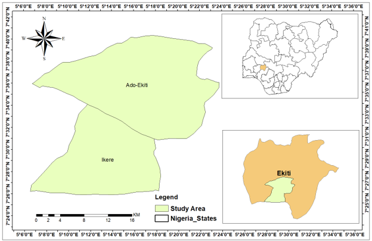
*Figure 1: Geographical location of the study area (Ado-Ekiti and Ikere LGAs) within Ekiti State and Nigeria.*

---

## Data Sources and Datasets

| Dataset | Source | Acquisition Year / Period | Spatial Resolution | Application in the Research |
| :--- | :--- | :--- | :--- | :--- |
| **Landsat 8 OLI Satellite Imagery** | United States Geological Survey (USGS EarthExplorer) | $2014$ and $2024$ *(exact scene dates  | $30\text{ m} \times 30\text{ m}$ | Derivation of $\text{NDVI}$, $\text{EVI}$, $\text{LST}$ (Band 10 thermal infrared), $\text{NDWI}$, and $\text{LULC}$ classification maps for $2014$ and $2024$. |
| **Annual Rainfall Data** | European Centre for Medium-Range Weather Forecasts (ECMWF) — ERA-Interim | $1994\text{--}2024$ (and $2014$, $2024$ spatial layers) | 80 km | 30-year annual precipitation and standardized anomaly charting ($1994\text{--}2024$) and spatial rainfall distribution mapping ($2014$ and $2024$). |
| **Temperature Data ($T_{\max}$ & $T_{\min}$)** | ECMWF — ERA-Interim | $1994\text{--}2024$ | 80 km | Multi-decadal time-series and standardized anomaly charting of annual highest ($T_{\max}$) and lowest ($T_{\min}$) temperatures. |
| **Incident Solar Radiation Data** | ECMWF — ERA-Interim | $1994\text{--}2024$ | 80 km | Assessment of 30-year temporal variability in annual surface solar radiation ($\text{J m}^{-2}$). |
| **Relative Humidity ($\text{RH}$) Data** | ECMWF — ERA-Interim | $1994\text{--}2024$ | 80 km | Trend evaluation of annual lowest and highest relative humidity ($\%$) and atmospheric evaporative demand. |
| **Wind Speed Data** | ECMWF — ERA-Interim | $1994\text{--}2024$ | 80 km | Evaluation of inter-annual variations in annual wind speed ($\text{m s}^{-1}$) and boundary-layer evapotranspiration effects. |
| **Administrative Boundary Shapefiles** | GRID3 |  | Vector | Spatial delineation of Nigeria states, Ekiti State, and Ado-Ekiti / Ikere LGA boundaries. |

---

## Software and Technologies

The spatial analysis, remote sensing index computation, climatic charting, and cartographic visualization workflows were executed using the following tools:

* **ArcGIS 10.7.1:** Primary GIS and remote sensing platform used for raster band math ($\text{NDVI}$, $\text{EVI}$, $\text{NDWI}$, and thermal $\text{LST}$ retrieval), Land Use and Land Cover ($\text{LULC}$) classification, spatial rainfall mapping, clipping to study area boundaries, and cartographic map layout production.
* **Microsoft Excel:** Used for organizing 30-year ($1994\text{--}2024$) ECMWF ERA-Interim climatic datasets, computing standardized climatic anomalies, and producing statistical time-series charts.

---

## Methodology

### Workflow Architecture

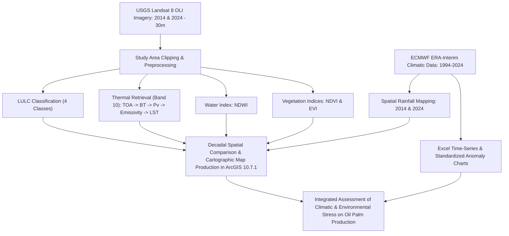

### 1. Data Acquisition and Preprocessing
Multi-temporal **Landsat 8 OLI** scenes ($30\text{ m} \times 30\text{ m}$ spatial resolution) for **2014** and **2024** were downloaded from the USGS EarthExplorer repository, and 30-year (**1994–2024**) climatic records (annual rainfall, temperature, relative humidity, solar radiation, and wind speed) were obtained from the **ECMWF ERA-Interim** archive. Satellite raster bands were clipped to the administrative boundary of Ado-Ekiti and Ikere LGAs within **ArcGIS 10.7.1**.

### 2. Vegetation Indices ($\text{NDVI}$ and $\text{EVI}$)
To evaluate vegetation condition, canopy density, and spatial-temporal stress across oil palm plantations and surrounding land cover, two spectral vegetation indices were derived in ArcGIS 10.7.1 for $2014$ and $2024$:

* **Normalized Difference Vegetation Index ($\text{NDVI}$):** Computed from Near-Infrared (Band 5) and Red (Band 4) reflectance:

$$\text{NDVI} = \frac{\text{NIR} - \text{RED}}{\text{NIR} + \text{RED}} = \frac{\text{Band 5} - \text{Band 4}}{\text{Band 5} + \text{Band 4}}$$

* **Enhanced Vegetation Index ($\text{EVI}$):** Derived using the Blue, Red, and Near-Infrared spectral bands to minimize soil background brightness and atmospheric interference while maintaining sensitivity over high-biomass canopies such as mature oil palm stands and dense forest cover.

### 3. Normalized Difference Water Index ($\text{NDWI}$)
$\text{NDWI}$ rasters were generated in ArcGIS 10.7.1 for $2014$ and $2024$ to assess vegetation water content, canopy hydration, and spatial patterns of landscape moisture deficit.

### 4. Land Surface Temperature ($\text{LST}$) Retrieval
Land Surface Temperature ($^\circ\text{C}$) was retrieved from Landsat 8 thermal infrared data (**Band 10**) and optical bands (**Band 4** and **Band 5**) for $2014$ and $2024$ using the following four-stage radiative transfer procedure:

1. **Top of Atmosphere ($\text{TOA}$) Spectral Radiance ($L$):**

$$L = M_L \times Q_{\text{cal}} + A_L$$

where $M_L$ is the band-specific multiplicative rescaling factor (`RADIANCE_MULT_BAND_10`), $Q_{\text{cal}}$ corresponds to quantized pixel values of Band 10, and $A_L$ is the band-specific additive rescaling factor (`RADIANCE_ADD_BAND_10`).

2. **Brightness Temperature ($BT$, in $^\circ\text{C}$):**

$$BT = \frac{K_2}{\ln\left(\frac{K_1}{L}\right) + 1} - 273.15$$

where $K_1$ (`K1_CONSTANT_BAND_10`) and $K_2$ (`K2_CONSTANT_BAND_10`) are band-specific thermal conversion constants obtained from the Landsat metadata file.

3. **Proportion of Vegetation ($P_v$) and Land Surface Emissivity ($\varepsilon$):**

$$P_v = \left(\frac{\text{NDVI} - \text{NDVI}_{\min}}{\text{NDVI}_{\max} - \text{NDVI}_{\min}}\right)^2$$

$$\varepsilon = 0.004 \times P_v + 0.986$$

4. **Land Surface Temperature ($\text{LST}$, in $^\circ\text{C}$):**

$$\text{LST} = \frac{BT}{1 + \left(\frac{0.00115 \times BT}{1.4388}\right) \times \ln(\varepsilon)}$$

### 5. Land Use and Land Cover ($\text{LULC}$) Classification and Spatial Rainfall Mapping
* **LULC Classification:** The $2014$ and $2024$ Landsat 8 OLI images were classified in ArcGIS 10.7.1 into four discrete land-cover categories: `Water body`, `Vegetation`, `Built-up Area`, and `Bare land` *(Classification algorithm and accuracy assessment metrics: `[Information to be provided]`)*.
* **Spatial Rainfall Mapping:** Continuous rainfall distribution maps ($\text{mm}$) were generated for $2014$ and $2024$ in ArcGIS 10.7.1 and categorized into five precipitation intervals.

### 6. Multi-Decadal Climatic Time-Series and Anomaly Analysis
Historical annual climatic variables from ECMWF ERA-Interim ($1994\text{--}2024$) were compiled in **Microsoft Excel**. Standardized anomalies were calculated relative to the 30-year long-term mean for annual rainfall, maximum temperature ($T_{\max}$), and minimum temperature ($T_{\min}$), alongside multi-decadal trend charts for incident solar radiation ($\text{J m}^{-2}$), minimum and maximum relative humidity ($\%$), and wind speed ($\text{m s}^{-1}$).

---

## Maps and Cartographic Outputs

### Map Inventory

| No. | Map Title | Suggested Filename | Category |
| :---: | :--- | :---: | :--- | :--- |
| 1 | Study Area Map (Ado-Ekiti & Ikere LGAs) | Study Area | `01_study_area_map.png` | Reference |
| 2 | 2014 NDVI Map of the Study Area  | `02_ndvi_2014_map.png` | Vegetation Index |
| 3 | 2024 NDVI Map of the Study Area  | `03_ndvi_2024_map.png` | Vegetation Index |
| 4 | 2014 EVI Map of the Study Area  | `04_evi_2014_map.png` | Vegetation Index |
| 5 | 2024 EVI Map of the Study Area  | `05_evi_2024_map.png` | Vegetation Index |
| 6 | 2014 Land Surface Temperature (LST) Map  | `06_lst_2014_map.png` | Thermal Analysis |
| 7 | 2024 Land Surface Temperature (LST) Map  | `07_lst_2024_map.png` | Thermal Analysis |
| 8 | 2014 NDWI Map of the Study Area  | `08_ndwi_2014_map.png` | Moisture / Water Index |
| 9 | 2024 NDWI Map of the Study Area  | `09_ndwi_2024_map.png` | Moisture / Water Index |
| 10 | 2014 Rainfall Distribution Map  | `10_rainfall_2014_map.png` | Climatic Spatial |
| 11 | 2024 Rainfall Distribution Map  | `11_rainfall_2024_map.png` | Climatic Spatial |
| 12 | 2014 Land Use / Land Cover (LULC) Map  | `12_lulc_2014_map.png` | Thematic Classification |
| 13 | 2024 Land Use / Land Cover (LULC) Map  | `13_lulc_2024_map.png` | Thematic Classification |

---

### Cartographic Gallery & Technical Descriptions

#### 1. Normalized Difference Vegetation Index ($\text{NDVI}$) Maps ($2014$ vs. $2024$)
* **Technical Description:** Continuous $30\text{ m}$ spatial distribution rasters of $\text{NDVI}$ derived from Landsat 8 OLI Bands 4 and 5 for $2014$ (range: $0.0239$ to $0.5813$) and $2024$ (range: $-0.0356$ to $0.6100$).
* **Purpose:** Evaluates decadal spatial changes in green vegetation vigor, canopy density, and potential vegetation stress across oil palm and forest landscapes.
* **Interpretation:** While healthy dense vegetation persists in the eastern and southern sectors, low-$\text{NDVI}$ zones expanded notably in the northwestern (Ado-Ekiti) and south-central (Ikere) corridors by $2024$, reflecting localized vegetation degradation and land-cover conversion.

| 2014 NDVI Map (Fig. 4.1a) | 2024 NDVI Map (Fig. 4.1b) |
| :---: | :---: |
| 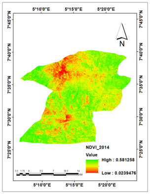 | 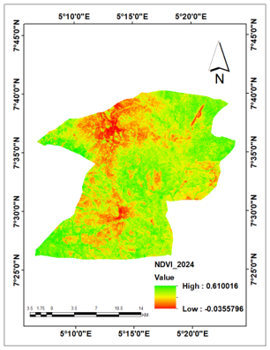 |

---

#### 2. Enhanced Vegetation Index ($\text{EVI}$) Maps ($2014$ vs. $2024$)
* **Technical Description:** Continuous $30\text{ m}$ $\text{EVI}$ rasters computed for $2014$ (range: $0.0149$ to $0.6847$) and $2024$ (range: $-0.0212$ to $0.7361$) with reduced soil and atmospheric background interference.
* **Purpose:** Complements $\text{NDVI}$ by isolating canopy structural and photosynthetic variations in high-biomass vegetation such as mature oil palm plantations.
* **Interpretation:** Consistent with $\text{NDVI}$, high-$\text{EVI}$ zones remain concentrated in the eastern and southwestern sectors, whereas low-$\text{EVI}$ zones intensified and expanded in the northwest and south-central areas between $2014$ and $2024$.

| 2014 EVI Map (Fig. 4.2a) | 2024 EVI Map (Fig. 4.2b) |
| :---: | :---: |
| 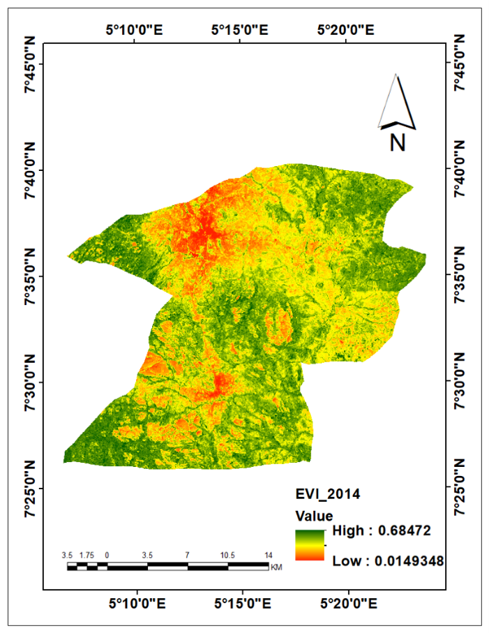 | 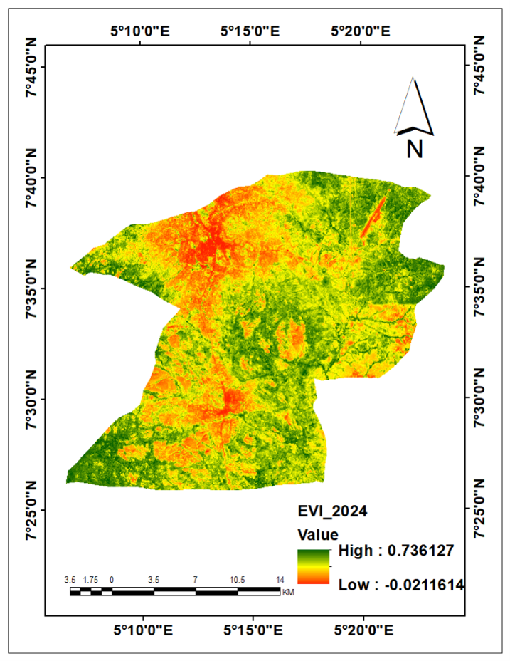 |

---

#### 3. Land Surface Temperature ($\text{LST}$) Maps ($2014$ vs. $2024$)
* **Technical Description:** Emissivity-corrected thermal surface temperature rasters ($^\circ\text{C}$) derived from Landsat 8 Band 10 for $2014$ ($29.21^\circ\text{C}$ to $30.31^\circ\text{C}$) and $2024$ ($29.71^\circ\text{C}$ to $31.11^\circ\text{C}$).
* **Purpose:** Quantifies spatial thermal patterns and decadal surface warming affecting agricultural microclimates and crop heat stress.
* **Interpretation:** Both minimum ($+0.50^\circ\text{C}$) and maximum ($+0.80^\circ\text{C}$) surface temperatures increased over the decade. Elevated $\text{LST}$ zones expanded outward from the northwestern and south-central urban centers, displaying a clear inverse spatial correlation with dense vegetation cover.

| 2014 LST Map (Fig. 4.3a) | 2024 LST Map (Fig. 4.3b) |
| :---: | :---: |
| 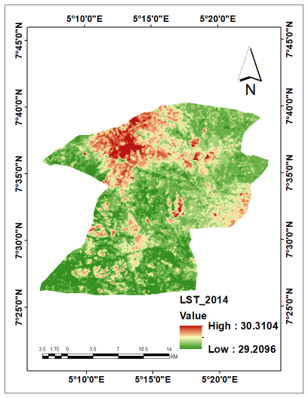 | 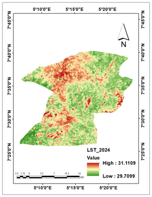 |

---

#### 4. Normalized Difference Water Index ($\text{NDWI}$) Maps ($2014$ vs. $2024$)
* **Technical Description:** Spatial moisture index rasters for $2014$ (range: $-0.3043$ to $0.3959$) and $2024$ (range: $-0.2671$ to $0.3872$).
* **Purpose:** Monitors spatial variations in canopy hydration and landscape water stress across the study area.
* **Interpretation:** Contiguous zones of high $\text{NDWI}$ observed in $2014$ became visibly fragmented by $2024$, accompanied by an expansion of lower-$\text{NDWI}$ areas indicative of increased landscape water stress.

| 2014 NDWI Map (Fig. 4.4a) | 2024 NDWI Map (Fig. 4.4b) |
| :---: | :---: |
| 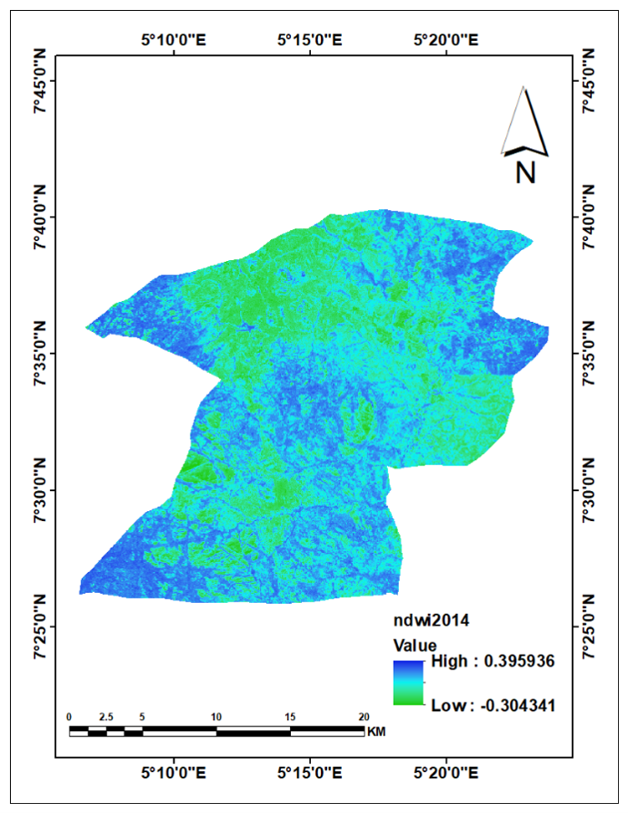 | 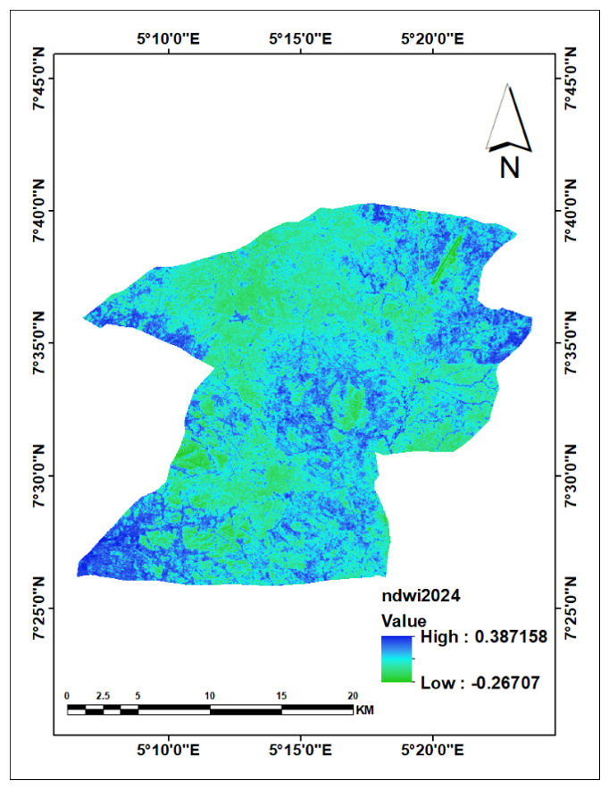 |

---

#### 5. Spatial Rainfall Distribution Maps ($2014$ vs. $2024$)
* **Technical Description:** Classified spatial rainfall surfaces ($\text{mm}$) across five precipitation intervals for $2014$ ($122.01\text{--}155.49\text{ mm}$) and $2024$ ($173.5\text{--}222.8\text{ mm}$).
* **Purpose:** Depicts west-to-east spatial precipitation gradients and decadal shifts in rainfall magnitude across the study area.
* **Interpretation:** Rainfall consistently increases from the northwestern sector toward the eastern and southeastern boundaries in both years, with $2024$ exhibiting substantially higher precipitation totals across the entire study area than $2014$.

| 2014 Rainfall Map (Fig. 4.5a) | 2024 Rainfall Map (Fig. 4.5b) |
| :---: | :---: |
| 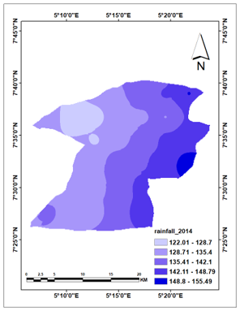 | 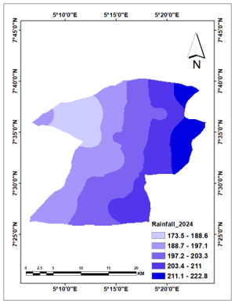 |

---

#### 6. Land Use and Land Cover ($\text{LULC}$) Maps ($2014$ vs. $2024$)
* **Technical Description:** Categorical $30\text{ m}$ land-cover maps depicting four classes (`Water body`, `Vegetation`, `Built-up Area`, and `Bare land`) for $2014$ and $2024$.
* **Purpose:** Tracks decadal land-cover conversion, urban settlement expansion, and agricultural land loss.
* **Interpretation:** Between $2014$ and $2024$, substantial areas of `Vegetation` were converted into `Built-up Area` and `Bare land`, particularly around Ado-Ekiti in the north and Ikere in the south, directly encroaching upon potential and existing oil palm cultivation zones.

| 2014 LULC Map (Fig. 4.6a) | 2024 LULC Map (Fig. 4.6b) |
| :---: | :---: |
| 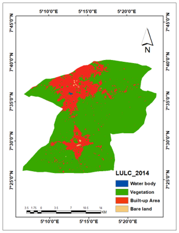 | 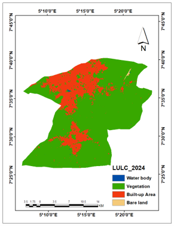 |

---

## Climatic Charts and Time-Series Outputs

In addition to the decadal spatial maps, seven multi-decadal ($1994\text{--}2024$) agro-climatic charts were generated in **Microsoft Excel** from **ECMWF ERA-Interim** reanalysis records to evaluate long-term temporal variability and standardized anomalies across Ado-Ekiti and Ikere LGAs.

### Chart Inventory

| No. | Chart Title | Paper Reference | Suggested Filename | Category |
| :---: | :--- | :---: | :--- | :--- |
| 1 | Annual Rainfall and Standardized Rainfall Anomaly ($1994\text{--}2024$) | Rainfall Chart | `01_annual_rainfall_anomaly_chart.png` | Hydrological Time-Series |
| 2 | Annual Highest Temperature ($T_{\max}$) and Standardized Anomaly ($1994\text{--}2024$) | Tmax Chart | `02_tmax_anomaly_chart.png` | Thermal Time-Series |
| 3 | Annual Lowest Temperature ($T_{\min}$) and Standardized Anomaly ($1994\text{--}2024$) | Tmin Chart | `03_tmin_anomaly_chart.png` | Thermal Time-Series |
| 4 | Total Annual Incident Solar Radiation ($1994\text{--}2024$) | Solar Radiation Chart | `04_solar_radiation_chart.png` | Radiative Flux Time-Series |
| 5 | Annual Lowest Relative Humidity ($\text{RH}_{\min}$, $1994\text{--}2024$) | Lowest RH Chart | `05_lowest_rh_chart.png` | Atmospheric Moisture |
| 6 | Annual Highest Relative Humidity ($\text{RH}_{\max}$, $1994\text{--}2024$) | Highest RH Chart | `06_highest_rh_chart.png` | Atmospheric Moisture |
| 7 | Annual Wind Speed ($1994\text{--}2024$) | Windspeed Chart | `07_annual_windspeed_chart.png` | Boundary-Layer Dynamics |

---

### Climatic Chart Gallery & Technical Descriptions

#### 1. Annual Rainfall and Standardized Rainfall Anomaly Chart ($1994\text{--}2024$)
* **Technical Description:** Dual-axis time-series chart displaying total annual rainfall amounts ($\text{mm}$, blue bars on the right vertical axis) alongside the dimensionless standardized rainfall anomaly (orange line on the left vertical axis) relative to the $1994\text{--}2024$ mean.
* **Purpose:** Identifies wet and dry climatic episodes and quantifies inter-annual precipitation departures affecting oil palm water availability.
* **Interpretation:** Precipitation fluctuated markedly over the 30-year record, with strong positive anomalies (wetter-than-average conditions) in **$1995$** and **$2023$**, and pronounced negative anomalies (rainfall deficits/drought stress) in **$2001$**, **$2013$**, and **$2017$**. Both severe dry years (moisture deficit) and extreme wet years (waterlogging, soil erosion, and nutrient leaching) drive inter-annual fluctuations in oil palm fruit yield.

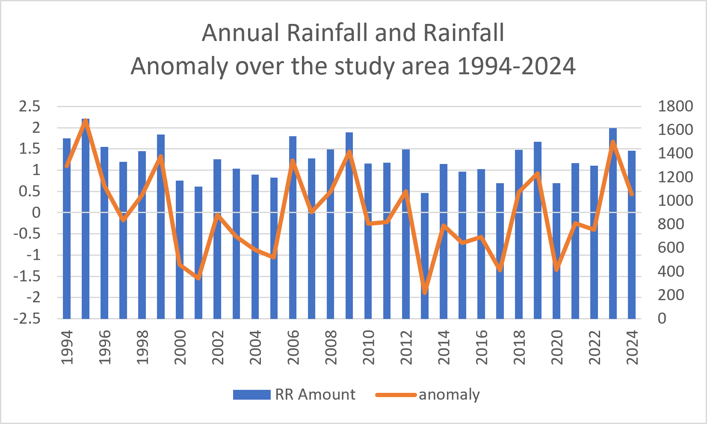

---

#### 2. Annual Maximum ($T_{\max}$) and Minimum ($T_{\min}$) Temperature Charts ($1994\text{--}2024$)
* **Technical Description:** Paired time-series and standardized anomaly charts depicting the annual highest recorded temperature ($T_{\max}$) and annual lowest recorded temperature ($T_{\min}$) relative to their $1994\text{--}2024$ long-term means.
* **Purpose:** Evaluates long-term thermal warming trends and shifts in daytime heat extremes and nighttime minimum temperatures.
* **Interpretation:** $T_{\max}$ exhibits a pronounced upward warming trend from approximately **$2012$** onwards, culminating in the highest positive anomalies during **$2020\text{--}2024$**, indicating heightened heat stress on photosynthesis, flowering, and fruit set. Concurrently, $T_{\min}$ shifted from predominantly negative anomalies before approximately **$2004$** to predominantly positive anomalies thereafter, signaling warmer low-temperature extremes that can favor agricultural pest and disease survival.

| Annual Maximum Temperature ($T_{\max}$) Chart | Annual Minimum Temperature ($T_{\min}$) Chart |
| :---: | :---: |
| 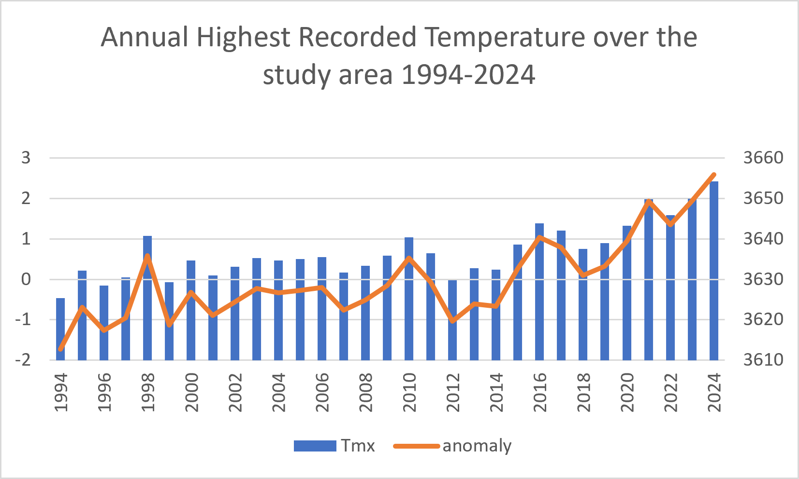 | 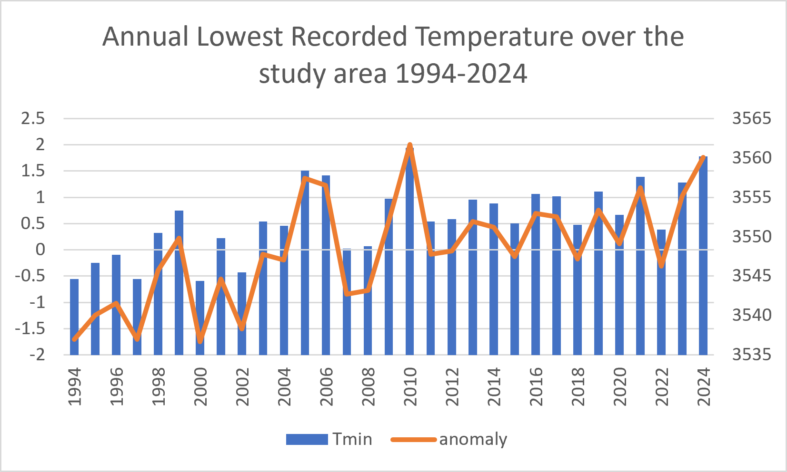 |

---

#### 3. Total Annual Incident Solar Radiation Chart ($1994\text{--}2024$)
* **Technical Description:** Temporal line profile of total annual incident surface solar radiation (measured in $\text{J m}^{-2}$) across the Ekiti State study area from $1994$ to $2024$.
* **Purpose:** Assesses long-term variations in Photosynthetically Active Radiation ($\text{PAR}$) and surface radiative energy loading.
* **Interpretation:** Incident solar radiation showed substantial inter-annual variability without a clear linear trend between $1994$ and circa $2019$, followed by a marked increase during **$2020\text{--}2024$** that peaked in **$2022$**. While higher radiation supports photosynthetic capacity when water is non-limiting, its coincidence with elevated $\text{LST}$ and $T_{\max}$ amplifies atmospheric evaporative demand.

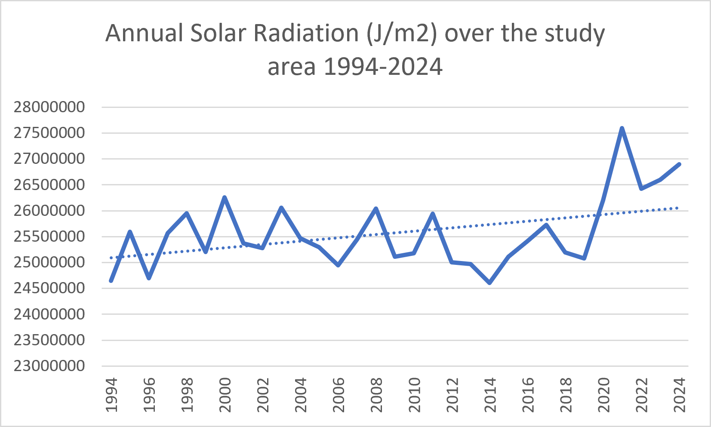

---

#### 4. Annual Lowest and Highest Relative Humidity ($\text{RH}$) Charts ($1994\text{--}2024$)
* **Technical Description:** Time-series charts tracking annual minimum relative humidity ($\text{RH}_{\min}$, in $\%$) and annual maximum relative humidity ($\text{RH}_{\max}$, in $\%$) from $1994$ to $2024$.
* **Purpose:** Evaluates atmospheric moisture trends and changes in Vapour Pressure Deficit ($\text{VPD}$) governing oil palm transpiration and stomatal conductance.
* **Interpretation:** Annual lowest $\text{RH}$ exhibited inter-annual variability from $1994$ to circa $2019$ before undergoing a sharp decline starting around **$2020$**, reaching unprecedented 30-year lows during **$2020\text{--}2024$**. Coinciding with high $T_{\max}$, this drop elevates $\text{VPD}$ and accelerates plant water stress. Conversely, annual highest $\text{RH}$ showed high variability without a consistent long-term trend (with minor post-$2018$/$2020$ visual shifts noted as uncertain due to axis scaling).

| Annual Lowest Relative Humidity ($\text{RH}_{\min}$) Chart | Annual Highest Relative Humidity ($\text{RH}_{\max}$) Chart |
| :---: | :---: |
| 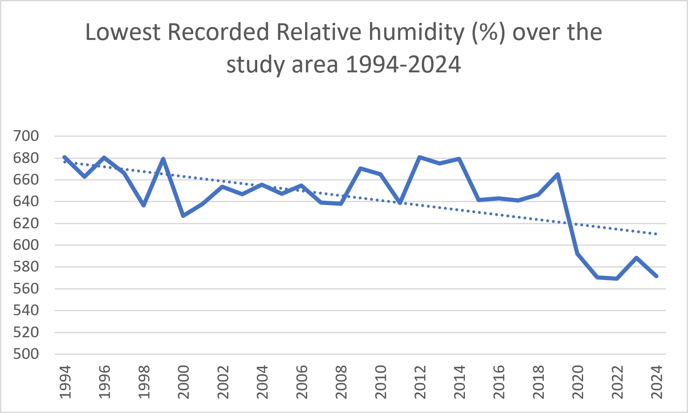 | 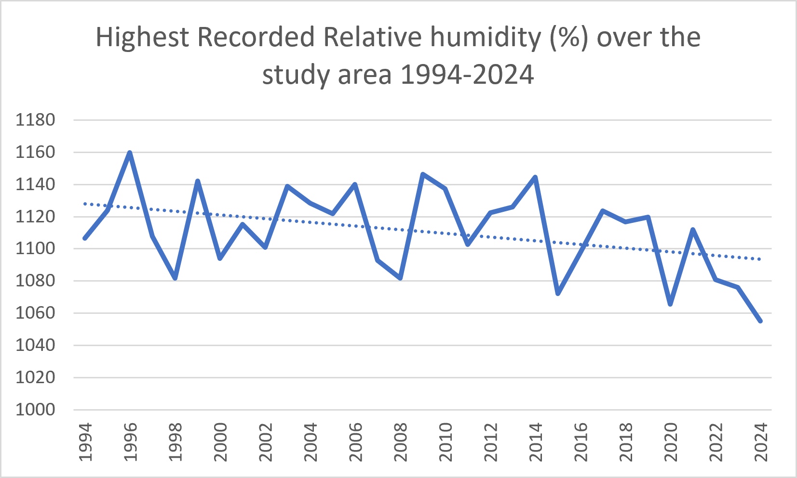 |

---

#### 5. Annual Wind Speed Chart ($1994\text{--}2024$)
* **Technical Description:** Temporal variation plot of annual mean wind speed (in $\text{m s}^{-1}$) covering the 30-year period from $1994$ to $2024$.
* **Purpose:** Characterizes inter-annual variations in near-surface airflow that regulate leaf boundary-layer resistance and evapotranspiration rates.
* **Interpretation:** Annual wind speed displayed pronounced inter-annual fluctuations rather than a statistically significant long-term monotonic trend, with notable peaks around **$1994$**, **$2002$**, **$2006$**, and **$2015$**, and lower values around **$1996$**, **$2004$**, **$2009$**, and **$2021$**. Peak wind-speed years compound evapotranspirative demand during hot, low-humidity periods.

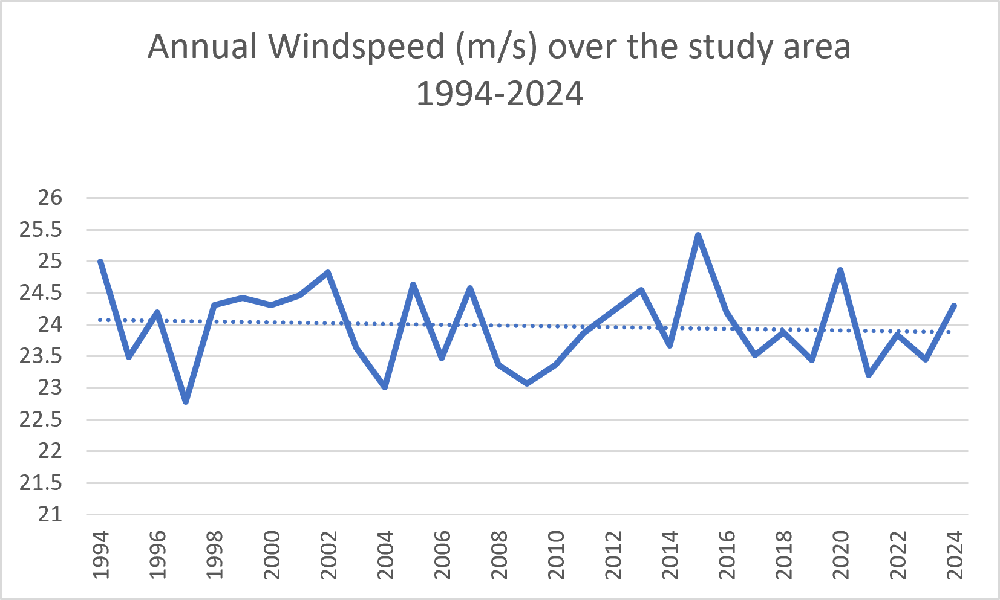

---

## Results and Key Findings

### Decadal Remote Sensing & Spatial Parameter Comparison ($2014$ vs. $2024$)

| Parameter / Index | Unit | 2014 Minimum | 2014 Maximum | 2024 Minimum | 2024 Maximum | Observed Decadal Shift |
| :--- | :--- | :---: | :---: | :---: | :---: | :--- |
| **NDVI** | Dimensionless | $0.0239$ | $0.5813$ | $-0.0356$ | $0.6100$ | Minimum decreased by $-0.0595$; expansion of low-NDVI zones in NW and south-central sectors. |
| **EVI** | Dimensionless | $0.0149$ | $0.6847$ | $-0.0212$ | $0.7361$ | Minimum decreased by $-0.0361$; intensification of low-EVI stress/clearance corridors. |
| **Land Surface Temperature ($\text{LST}$)** | $^\circ\text{C}$ | $29.21^\circ\text{C}$ | $30.31^\circ\text{C}$ | $29.71^\circ\text{C}$ | $31.11^\circ\text{C}$ | $+0.50^\circ\text{C}$ rise in min LST and $+0.80^\circ\text{C}$ rise in max LST; expanded urban heat footprint. |
| **NDWI** | Dimensionless | $-0.3043$ | $0.3959$ | $-0.2671$ | $0.3872$ | Fragmentation of contiguous high-NDWI vegetation zones; increased landscape water stress. |
| **Spatial Rainfall** | $\text{mm}$ | $122.01$ | $155.49$ | $173.50$ | $222.80$ | Entire 2024 rainfall range exceeded the 2014 maximum ($+51.49\text{ mm}$ min; $+67.31\text{ mm}$ max). |

### Multi-Decadal Climatic Trends ($1994\text{--}2024$, ECMWF ERA-Interim)

| Climatic Variable | Period | Key Temporal Behavior & Notable Extremes | Agro-Climatic Implication for Oil Palm |
| :--- | :---: | :--- | :--- |
| **Annual Rainfall & Anomaly** | $1994\text{--}2024$ | High inter-annual variability; strong positive anomalies in $1995$ and $2023$; marked drought/negative anomalies in $2001$, $2013$, and $2017$. | Drought years induce water stress and depress fruit development; extreme wet years risk waterlogging, soil erosion, and nutrient leaching. |
| **Maximum Temperature ($T_{\max}$)** | $1994\text{--}2024$ | Distinct upward warming trend from $\approx 2012$ onwards, with highest positive anomalies in $2020\text{--}2024$. | Elevated peak temperatures increase heat stress, impair photosynthesis/flowering, and reduce bunch yields. |
| **Minimum Temperature ($T_{\min}$)** | $1994\text{--}2024$ | Shift from predominantly negative anomalies before $\approx 2004$ to predominantly positive anomalies thereafter. | Warmer nighttime/minimum temperatures can favor pest and pathogen survival and proliferation. |
| **Incident Solar Radiation** | $1994\text{--}2024$ | Fluctuated without linear trend ($1994\text{--}2019$), followed by a notable rise in $2020\text{--}2024$, peaking in $2022$. | Higher radiation increases photosynthetic potential only if water and temperature are non-limiting; otherwise amplifies evaporative demand. |
| **Relative Humidity ($\text{RH}$)** | $1994\text{--}2024$ | Sharp drop in annual lowest $\text{RH}$ starting around $2020$, reaching unprecedented 30-year lows in $2020\text{--}2024$. | Low $\text{RH}$ combined with high $T_{\max}$ elevates Vapour Pressure Deficit ($\text{VPD}$), triggering stomatal closure and water stress. |
| **Annual Wind Speed** | $1994\text{--}2024$ | Inter-annual fluctuation without long-term monotonic trend; peaks in $1994, 2002, 2006, 2015$; lows in $1996, 2004, 2009, 2021$. | Higher wind speeds reduce leaf boundary-layer resistance, compounding evapotranspirative water loss during hot, dry periods. |

### Land Use and Land Cover ($\text{LULC}$) Transition Summary ($2014\text{--}2024$)
* **Categories Mapped:** `Water body`, `Vegetation`, `Built-up Area`, and `Bare land`.
* **Observed Spatial Dynamics:** Significant loss of `Vegetation` cover and corresponding expansion of `Built-up Area` and `Bare land` between $2014$ and $2024$, concentrated around Ado-Ekiti and Ikere urban centers.
* **Quantitative Area & Accuracy Metrics:** `[Information to be provided — insert LULC class area table in km²/ha, percentage change, and classification accuracy metrics if available]`

### Public Perception Findings
* `[Information to be provided — summarize key statistical findings from the farmer/public perception survey regarding observed climate changes, yield impacts, and adaptation practices]`

---

## Discussion

The integration of multi-temporal satellite remote sensing ($2014\text{--}2024$) and 30-year reanalysis climate charts ($1994\text{--}2024$) highlights dual environmental pressures on oil palm production in Ado-Ekiti and Ikere LGAs:

1. **Synergistic Climatic Stress:** Although recent spatial rainfall totals ($2024$) and extreme wet years ($2023$) indicate higher precipitation volume, simultaneous post-$2012$/$2020$ increases in $T_{\max}$, Land Surface Temperature ($+0.80^\circ\text{C}$ maximum $\text{LST}$), and solar radiation—paired with unprecedented drops in minimum relative humidity ($2020\text{--}2024$)—substantially elevate Vapour Pressure Deficit ($\text{VPD}$) and atmospheric evaporative demand. Even when annual rainfall increases, episodic dry spells and high $\text{VPD}$ can induce stomatal closure and constrain oil palm productivity.
2. **Urban Encroachment & Land Competition:** The spatial coincidence of declining $\text{NDVI}/\text{EVI}$, fragmented $\text{NDWI}$, rising $\text{LST}$, and expanding `Built-up Area` / `Bare land` around Ado-Ekiti and Ikere demonstrates that rapid urbanization is directly displacing vegetative cover and competing with perennial agricultural land.
3. **Relevance to Agricultural & Spatial Planning:** Combining satellite biophysical monitoring and long-term climatic trend charting with local farmer perception provides agricultural extension agencies and state land-use planners with actionable spatial evidence to protect prime oil palm corridors and promote climate-smart plantation management.

---

## Research Limitations

The following methodological considerations and data limitations are noted from the research text:

* **Sensor and Atmospheric Sensitivity:** $\text{NDVI}$ effectiveness can be influenced by atmospheric interference, sensor calibration, and canopy saturation in dense vegetation (addressed in part by complementing $\text{NDVI}$ with $\text{EVI}$).
* **Highest Relative Humidity Chart Scaling:** Assessment of long-term trends in annual maximum relative humidity ($\text{RH}_{\max}$) was constrained by chart axis scaling limitations and high inter-annual variability.
* **Landscape-Wide Vegetation Scope:** The $2014$ and $2024$ spectral indices ($\text{NDVI}$, $\text{EVI}$, $\text{NDWI}$) and $\text{LULC}$ classifications characterize overall landscape vegetation rather than isolating oil palm plantations exclusively from surrounding forest and crop cover.
* **Additional Manuscript Limitations:** `[Information to be provided — insert any survey sample size, field validation, or reanalysis resolution limitations discussed in the full manuscript]`

---

## Conclusion and Recommendations

### Conclusion
`[Information to be provided — summarize the overarching conclusions integrating both the geospatial/climatic analysis and the public perception findings from Chapter Five]`

### Recommendations
`[Information to be provided — insert the specific agronomic, climate adaptation, and land-use policy recommendations from Chapter Five of your manuscript]`
