# Verification of Multi-Resolution Model Forecasts of Heavy Rainfall Events in 2024 over Nigeria

[](#)
[](#)
[](#)
[](#)

---

## Table of Contents
- [Project Overview](#project-overview)
- [Research Objectives](#research-objectives)
- [Study Area](#study-area)
- [Data Sources and Datasets](#data-sources-and-datasets)
- [Software and Technologies](#software-and-technologies)
- [Methodology](#methodology)
- [Maps and Cartographic Outputs](#maps-and-cartographic-outputs)
- [Results and Key Findings](#results-and-key-findings)
- [Discussion](#discussion)
- [Research Limitations](#research-limitations)
- [Conclusion and Recommendations](#conclusion-and-recommendations)
- [Repository Structure](#repository-structure)
- [Author and Project Information](#author-and-project-information)

---

## Project Overview

Accurate spatial and quantitative forecasting of rainfall distribution is critical for flood risk management, water resources planning, and agricultural decision-making across Nigeria, where precipitation regimes are governed by strong seasonal migrations of the West African Monsoon and Harmattan wind systems. Evaluating how multi-resolution numerical weather prediction (NWP) forecast products capture localized heavy rainfall events relative to satellite-gauge reference observations provides essential insight into model reliability across distinct climatic zones.

This project investigates and verifies the monthly spatial distribution and peak intensity of forecasted daily rainfall across **Nigeria** for the year **2024** using **Remote Sensing** and **Geographic Information System (GIS)** techniques. Daily satellite-based rainfall estimates from **TAMSAT v3.1** (`rfe_filled`) serve as the historical reference baseline against which four forecast model products (`rrarp_24`, `rrdwd_24`, `rrecmwf_24`, and `rruk_24`) are evaluated from **January to December 2024**.

Using **Panoply** for NetCDF multidimensional data inspection and **ArcGIS 10.8** for geospatial processing, spatial comparison, and cartographic visualization, this analysis documents model agreement, spatial displacement errors, and intensity biases across Nigeria's dry, transitional, and peak wet seasons.

---

## Research Objectives

**Research Aim:**  
To verify the spatial distribution and peak intensity of multi-resolution model forecasts of heavy rainfall events over Nigeria in 2024 against TAMSAT satellite-based rainfall observations.  
*(Note: `[Information to be provided — insert the exact verbatim Research Aim from Chapter One if different]`)*

**Specific Objectives:**  
1. `[Information to be provided — insert Specific Objective 1 from Chapter One]`
2. `[Information to be provided — insert Specific Objective 2 from Chapter One]`
3. `[Information to be provided — insert Specific Objective 3 from Chapter One]`

*(Based on Chapters Three and Four of the manuscript, the analytical scope encompasses: [1] acquiring and inspecting 2024 NetCDF satellite rainfall estimates and multi-resolution model forecast products; [2] mapping monthly spatial rainfall distributions across Nigeria's 36 states and the Federal Capital Territory; and [3] comparing forecasted spatial patterns and peak intensities against historical TAMSAT observations from January to December 2024.)*

---

## Study Area

The study area is the **Federal Republic of Nigeria**, located in West Africa along the coast of the Gulf of Guinea.

* **Geographic Coordinates:** Approximately Latitudes $4^\circ\text{N}$ to $14^\circ\text{N}$ and Longitudes $2^\circ 30'\text{E}$ to $15^\circ\text{E}$
* **Administrative Boundaries:** Comprises 36 states and the Federal Capital Territory (FCT), sharing international land borders with **Niger** to the north, **Chad** to the northeast, **Cameroon** to the east, and **Benin** to the west, while bounded to the south by the **Atlantic Ocean**
* **Total Land Area:** Approximately $923,768\text{ km}^2$
* **Topography and Relief:** Varied physiography characterized by southern lowlands and coastal plains (including the Niger Delta) that transition northward into central hills and plateaus
* **Climatic Regime:** Exhibits a pronounced north-south climatic gradient driven by seasonal moisture advection from the Atlantic Ocean and dry, dust-laden Saharan Harmattan winds—featuring a bimodal rainfall regime in the south (interrupted by the July/August "Little Dry Season" or "August Break") and a unimodal wet season peaking in August across the northern Sahelian zone

### Study Area Reference Map
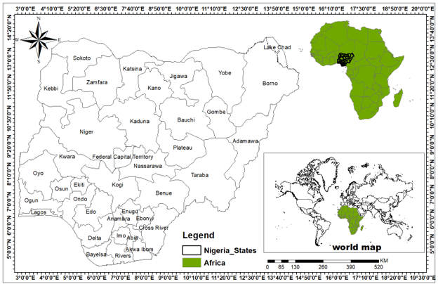
*Figure 1: Administrative map of the Federal Republic of Nigeria showing state boundaries, geographical coordinates, and continental/global locator insets.*

---

## Data Sources and Datasets

Five primary gridded datasets covering **January to December 2024** were utilized in this research: one satellite-based reference rainfall dataset and four numerical weather forecast model products.

| Dataset | Source | Acquisition Year / Period | Spatial Resolution | Application in the Research |
| :--- | :--- | :--- | :--- | :--- |
| **TAMSAT v3.1 Daily Recovered Rainfall Estimate (`rfe_filled`)** | Tropical Applications of Meteorology using SATellite data (TAMSAT), Dept. of Meteorology, University of Reading; accessed via IRI Data Library, Lamont-Doherty Earth Observatory, Columbia University | January – December 2024 (Daily) | $0.0375^\circ \times 0.0375^\circ$ | Historical/observed reference baseline selected for enhanced local accuracy and suitability for African rainfall analysis. |
| **`rrarp_24` Forecast Product** | `[Information to be provided — e.g., Météo-France ARPEGE model product]` | January – December 2024 | `[Information to be provided]` | Multi-resolution forecast model evaluated for spatial rainfall distribution and peak intensity ($\text{mm}$). |
| **`rrdwd_24` (`RRDWD`) Forecast Product** | German National Meteorological Service (Deutscher Wetterdienst, DWD) | January – December 2024 | `[Information to be provided]` | Multi-resolution forecast model evaluated for spatial rainfall distribution and peak intensity ($\text{mm}$). |
| **`rrecmwf_24` Forecast Product** | `[Information to be provided — e.g., European Centre for Medium-Range Weather Forecasts (ECMWF)]` | January – December 2024 | `[Information to be provided]` | Multi-resolution forecast model evaluated for spatial rainfall distribution and peak intensity ($\text{mm}$). |
| **`rruk_24` Forecast Product** | `[Information to be provided — e.g., UK Met Office model product]` | January – December 2024 | `[Information to be provided]` | Multi-resolution forecast model evaluated for spatial rainfall distribution and peak intensity ($\text{mm}$). |

*(Note: Chapter Three of the manuscript also references `RRGFS` from the Global Forecast Service and `RREM` during dataset selection; the four forecast layers systematically mapped and verified across Chapter Four are `rrarp_24`, `rrdwd_24`, `rrecmwf_24`, and `rruk_24`.)*

---

## Software and Technologies

The geospatial data inspection, spatial analysis, and cartographic layout workflows were conducted using the following tools:

* **Panoply:** Used to open, visualize, and inspect multidimensional climate datasets downloaded in **NetCDF** (`.nc`) format and to identify/select the target analysis year (**2024**) exhibiting the highest rainfall.
* **ArcGIS 10.8:** Core GIS software platform utilized for spatial data processing, raster visualization, overlay comparison with Nigerian administrative state boundaries (`Nig_States`), and production of all final monthly historical and forecast cartographic outputs.

---

## Methodology

### Workflow Architecture

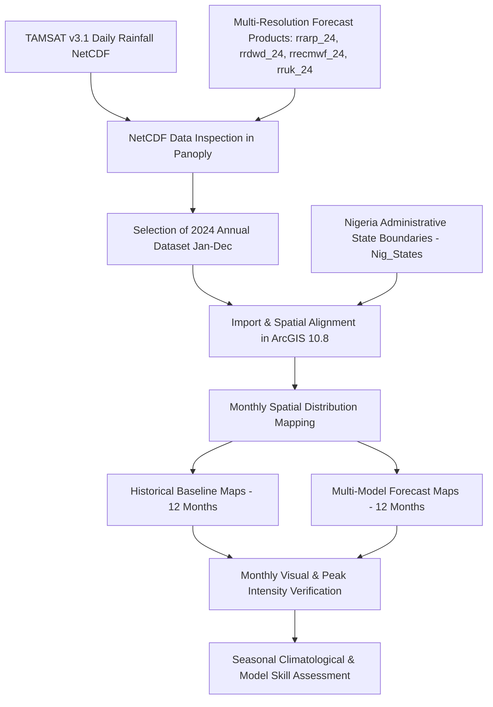

### 1. Data Acquisition
Daily recovered rainfall estimates (`rfe_filled`, Version 3.1) were retrieved from the TAMSAT archive via the International Research Institute for Climate and Society (IRI) Data Library at Columbia University (`https://iridl.ldeo.columbia.edu/SOURCES/.Reading/.Meteorology/.TAMSAT/.v3p1/.daily/.rfe_filled/index.html#info`). Concurrent 2024 forecast products (`rrarp_24`, `rrdwd_24`, `rrecmwf_24`, and `rruk_24`) were acquired from their respective meteorological modeling centers based on their established literature use over Nigeria, spatial resolution, and accessibility.

### 2. NetCDF Inspection and Preprocessing
Downloaded NetCDF climate files were inspected in **Panoply** to verify temporal dimensions, variable attributes, and annual precipitation magnitudes, confirming the selection of the **2024** dataset for analysis. The datasets were subsequently imported into **ArcGIS 10.8** and spatially clipped/overlaid against Nigeria's state boundary shapefile (`Nig_States`).

### 3. Spatial Analysis and Forecast Verification
Monthly rainfall surfaces from January through December 2024 were analyzed in **ArcGIS 10.8** using continuous color-ramp symbology (ranging from low/zero rainfall in dark blue to peak rainfall intensities in red). Each monthly historical TAMSAT map was compared against the corresponding multi-model forecast maps across three diagnostic criteria:
* **Spatial Location and Rain-Belt Migration:** Evaluating whether models accurately capture the northward advance (March–August) and southward retreat (September–November) of the Intertropical Discontinuity / rain belt, as well as localized coastal or Sahelian precipitation cores.
* **Peak Rainfall Intensity ($\text{mm}$):** Comparing maximum predicted grid values against historical TAMSAT peak values for each month.
* **Inter-Model Consensus:** Assessing agreement or divergence among `rrarp_24`, `rrdwd_24`, `rrecmwf_24`, and `rruk_24` across dry, transitional, and wet seasons.

### 4. Cartographic Production
Standardized map layouts—incorporating geographic coordinate grids, north arrows, scale bars ($\text{km}$), state boundary overlays, and model-specific value legends—were generated in **ArcGIS 10.8**, producing one study area reference map and 24 monthly rainfall distribution maps.

---

## Maps and Cartographic Outputs

### Map Inventory

| No. | Map Title | Suggested Filename | Category |
| :---: | :--- | :--- | :--- |
| 1 | Study Area Map (`Fig 1`) | `01_study_area_map.png` | Reference |
| 2 | Historical Daily Rainfall Distribution – January 2024 (`Fig 2`) | `02_historical_rainfall_january_2024.png` | Thematic (Historical) |
| 3 | Forecasted Daily Rainfall Distribution – January 2024 (`Fig 3`) | `03_forecast_rainfall_january_2024.png` | Analytical (Forecast) |
| 4 | Historical Daily Rainfall Distribution – February 2024 (`Fig 4`) | `04_historical_rainfall_february_2024.png` | Thematic (Historical) |
| 5 | Forecasted Daily Rainfall Distribution – February 2024 (`Fig 5`) | `05_forecast_rainfall_february_2024.png` | Analytical (Forecast) |
| 6 | Historical Daily Rainfall Distribution – March 2024 (`Fig 6`) | `06_historical_rainfall_march_2024.png` | Thematic (Historical) |
| 7 | Forecasted Daily Rainfall Distribution – March 2024 (`Fig 7`) | `07_forecast_rainfall_march_2024.png` | Analytical (Forecast) |
| 8 | Historical Daily Rainfall Distribution – April 2024 (`Fig 8`) | `08_historical_rainfall_april_2024.png` | Thematic (Historical) |
| 9 | Forecasted Daily Rainfall Distribution – April 2024 (`Fig 9`) | `09_forecast_rainfall_april_2024.png` | Analytical (Forecast) |
| 10 | Historical Daily Rainfall Distribution – May 2024 (`Fig 10`) | `10_historical_rainfall_may_2024.png` | Thematic (Historical) |
| 11 | Forecasted Daily Rainfall Distribution – May 2024 (`Fig 11`) | `11_forecast_rainfall_may_2024.png` | Analytical (Forecast) |
| 12 | Historical Daily Rainfall Distribution – June 2024 (`Fig 12`) | `12_historical_rainfall_june_2024.png` | Thematic (Historical) |
| 13 | Forecasted Daily Rainfall Distribution – June 2024 (`Fig 13`) | `13_forecast_rainfall_june_2024.png` | Analytical (Forecast) |
| 14 | Historical Daily Rainfall Distribution – July 2024 (`Fig 14`) | `14_historical_rainfall_july_2024.png` | Thematic (Historical) |
| 15 | Forecasted Daily Rainfall Distribution – July 2024 (`Fig 15`) | `15_forecast_rainfall_july_2024.png` | Analytical (Forecast) |
| 16 | Historical Daily Rainfall Distribution – August 2024 (`Fig 16`) | `16_historical_rainfall_august_2024.png` | Thematic (Historical) |
| 17 | Forecasted Daily Rainfall Distribution – August 2024 (`Fig 17`) | `17_forecast_rainfall_august_2024.png` | Analytical (Forecast) |
| 18 | Historical Daily Rainfall Distribution – September 2024 (`Fig 18`) | `18_historical_rainfall_september_2024.png` | Thematic (Historical) |
| 19 | Forecasted Daily Rainfall Distribution – September 2024 (`Fig 19`) | `19_forecast_rainfall_september_2024.png` | Analytical (Forecast) |
| 20 | Historical Daily Rainfall Distribution – October 2024 (`Fig 20`) | `20_historical_rainfall_october_2024.png` | Thematic (Historical) |
| 21 | Forecasted Daily Rainfall Distribution – October 2024 (`Fig 21`) | `21_forecast_rainfall_october_2024.png` | Analytical (Forecast) |
| 22 | Historical Daily Rainfall Distribution – November 2024 (`Fig 22`) | `22_historical_rainfall_november_2024.png` | Thematic (Historical) |
| 23 | Forecasted Daily Rainfall Distribution – November 2024 (`Fig 23`) | `23_forecast_rainfall_november_2024.png` | Analytical (Forecast) |
| 24 | Historical Daily Rainfall Distribution – December 2024 (`Fig 24`) | `24_historical_rainfall_december_2024.png` | Thematic (Historical) |
| 25 | Forecasted Daily Rainfall Distribution – December 2024 (`Fig 25` / labeled `Fig 3` in text) | `25_forecast_rainfall_december_2024.png` | Analytical (Forecast) |

---

### Cartographic Gallery & Monthly Technical Descriptions

#### 1. January 2024 (Peak Dry Season / Harmattan)
* **Historical Map (`02_historical_rainfall_january_2024.png`):** TAMSAT spatial rainfall raster showing nationwide dry Harmattan conditions ($0\text{ mm}$) across northern, central, and inland southern states, with localized coastal rainfall peaking at $14.1\text{ mm}$ over Bayelsa and Rivers States in the Niger Delta.
* **Forecast Comparison Map (`03_forecast_rainfall_january_2024.png`):** Four-panel comparison (`rrarp_24`, `rrdwd_24`, `rrecmwf_24`, `rruk_24`). All models accurately capture northern and central dryness, but diverge on southern coastal placement and intensity (`rrecmwf_24` peaks at $3.52\text{ mm}$ over the central Niger Delta; `rrarp_24` peaks at $1.44\text{ mm}$ in the southwest; `rruk_24` shows widespread light southern showers up to $1.20\text{ mm}$; `rrdwd_24` predicts near-total dryness with $1.12\text{ mm}$ on the immediate delta coast).

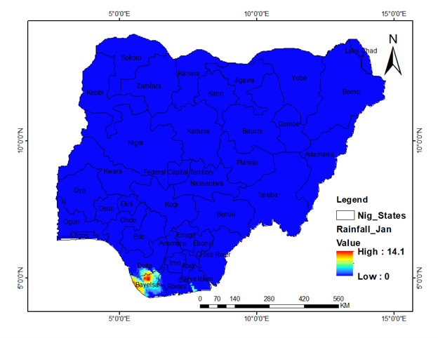
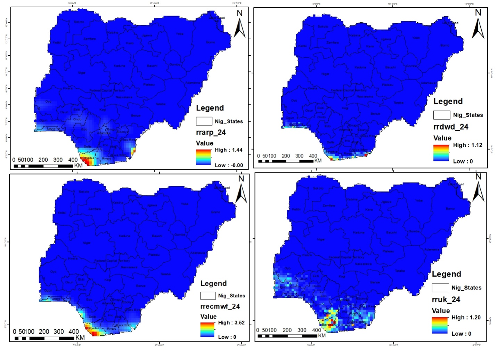

---

#### 2. February 2024 (Late Dry Season)
* **Historical Map (`04_historical_rainfall_february_2024.png`):** TAMSAT raster depicting persistent nationwide dry conditions interrupted by a distinct band of low-intensity rainfall (peaking at $8.3\text{ mm}$) across southwestern states (Ogun, Ondo, Ekiti, Osun, and Oyo).
* **Forecast Comparison Map (`05_forecast_rainfall_february_2024.png`):** `rrarp_24` ($1.46\text{ mm}$) and `rrdwd_24` ($2.96\text{ mm}$) best align with the historical southwestern spatial footprint, whereas `rrecmwf_24` ($1.84\text{ mm}$) displaces peak rain eastward into the Niger Delta and `rruk_24` ($1.29\text{ mm}$) forecasts overly scattered southern precipitation.

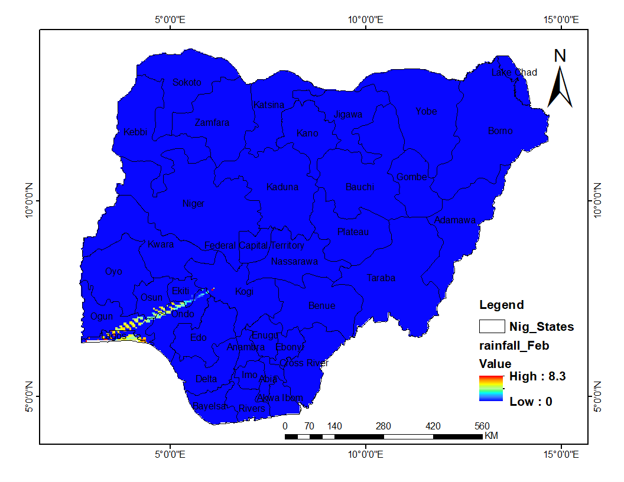
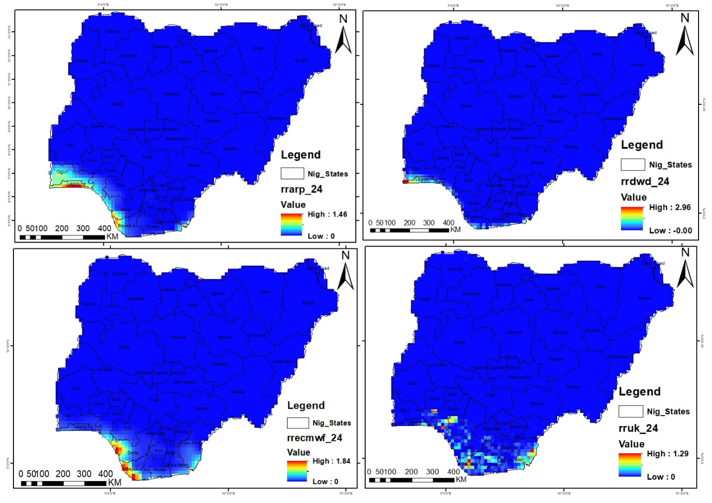

---

#### 3. March 2024 (Rainy Season Onset Transition)
* **Historical Map (`06_historical_rainfall_march_2024.png`):** Marks the northward advance of the rain belt into the south and central Middle Belt (including Nasarawa, FCT, and Kogi), with peak intensity rising sharply to $114.7\text{ mm}$.
* **Forecast Comparison Map (`07_forecast_rainfall_march_2024.png`):** All four models substantially underestimate peak rainfall intensity (`rruk_24`: $45.58\text{ mm}$; `rrecmwf_24`: $30.95\text{ mm}$; `rrarp_24`: $29.64\text{ mm}$; `rrdwd_24`: $24.89\text{ mm}$). `rruk_24` captures the broadest southern-to-Middle-Belt onset front, while `rrdwd_24` produces an anomalous north-central rain patch near Kaduna/Plateau.

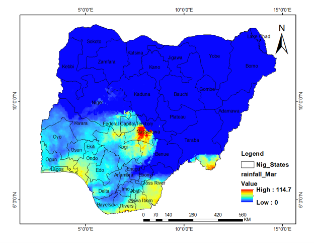
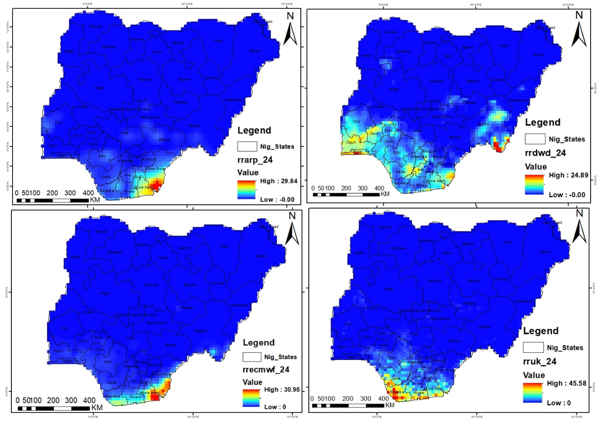

---

#### 4. April 2024 (Early Wet Season Establishment)
* **Historical Map (`08_historical_rainfall_april_2024.png`):** Shows widespread, established rainfall across the south, Middle Belt (Plateau, Nasarawa, Benue, Kwara), and southern fringes of Kaduna and Bauchi, with legend peak of $29.5\text{ mm}$ (cited as $216.9\text{ mm}$ in manuscript narrative).
* **Forecast Comparison Map (`09_forecast_rainfall_april_2024.png`):** All four models forecast a severe negative rainfall anomaly (`rruk_24`: $13.16\text{ mm}$; `rrdwd_24`: $9.83\text{ mm}$; `rrarp_24`: $4.14\text{ mm}$; `rrecmwf_24`: $1.89\text{ mm}$), underpredicting both spatial inland penetration and peak intensity.

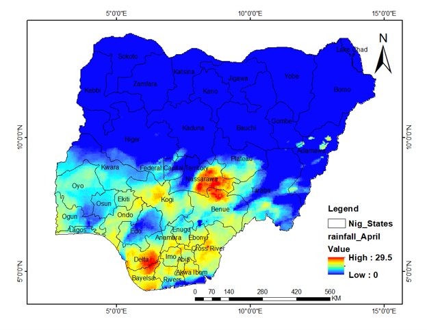
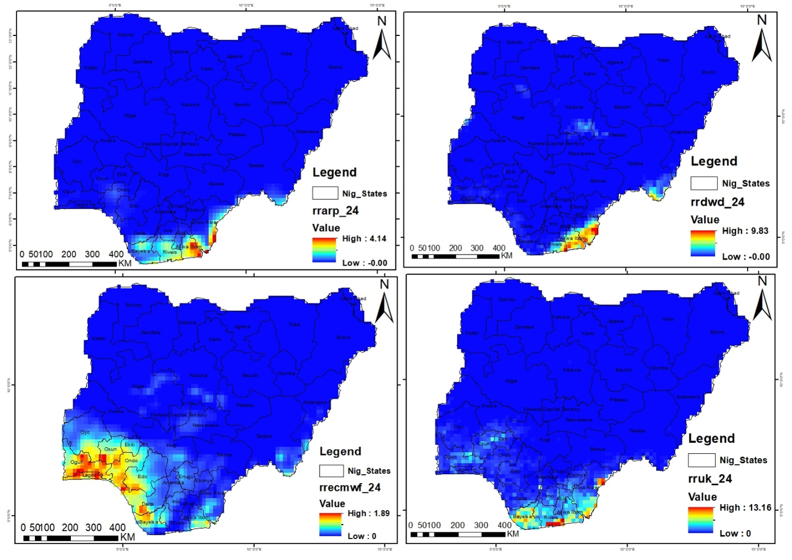

---

#### 5. May 2024 (Northward Shift to the Middle Belt)
* **Historical Map (`10_historical_rainfall_may_2024.png`):** Demonstrates rainfall establishment across virtually the entire country, with heavy precipitation shifting into the Middle Belt (Niger, Kwara, Nasarawa, Benue, Kogi) and southeastern states; legend peak is $30.6\text{ mm}$ (text narrative also cites $244.3\text{ mm}$).
* **Forecast Comparison Map (`11_forecast_rainfall_may_2024.png`):** Models display sharp divergence: `rrecmwf_24` ($35.13\text{ mm}$) and `rrarp_24` ($23.07\text{ mm}$) align closest with historical intensity, whereas `rrdwd_24` overpredicts an extreme north-central/eastern peak ($79.21\text{ mm}$) and `rruk_24` predicts severe dryness ($6.36\text{ mm}$).

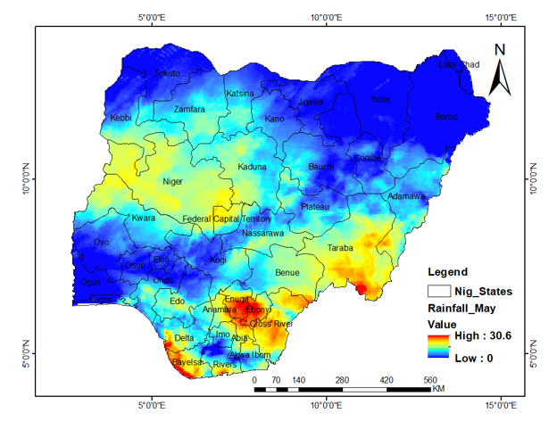


---

#### 6. June 2024 (First Coastal Peak)
* **Historical Map (`12_historical_rainfall_june_2024.png`):** Peak rainfall ($44.0\text{ mm}$) concentrates strongly along the southern coastline, particularly across the Niger Delta (Delta, Bayelsa, and Rivers States).
* **Forecast Comparison Map (`13_forecast_rainfall_june_2024.png`):** `rrarp_24` ($54.30\text{ mm}$) best matches the coastal focus, while `rruk_24` ($39.70\text{ mm}$) shows scattered southern rainfall, `rrdwd_24` ($36.25\text{ mm}$) shifts peak rainfall inland over Taraba and Adamawa, and `rrecmwf_24` ($17.24\text{ mm}$) anomalously centers lighter rain over the Middle Belt.

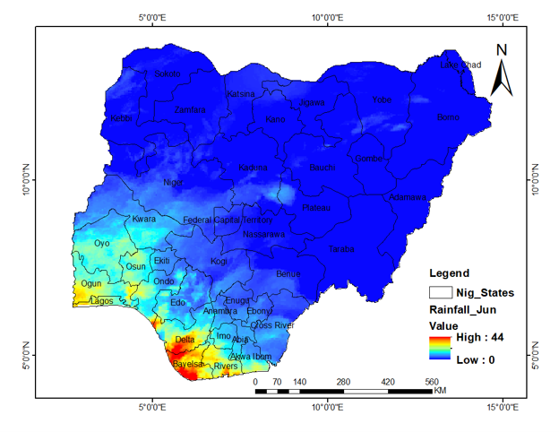


---

#### 7. July 2024 (Consolidation of Coastal Rains & Onset of Inland Dip)
* **Historical Map (`14_historical_rainfall_july_2024.png`):** Heavy coastal rainfall ($53.6\text{ mm}$ peak) spans from Lagos across the Niger Delta to Cross River and Akwa Ibom, accompanied by a slight inland reduction marking the onset of the "Little Dry Season."
* **Forecast Comparison Map (`15_forecast_rainfall_july_2024.png`):** `rrarp_24` ($54.30\text{ mm}$) closely replicates the historical coastal peak magnitude, whereas `rruk_24` ($39.70\text{ mm}$), `rrdwd_24` ($36.25\text{ mm}$), and `rrecmwf_24` ($17.24\text{ mm}$) underestimate peak intensity or misplace maxima inland.

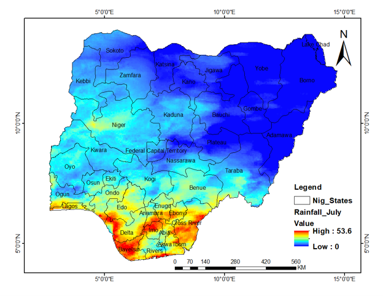
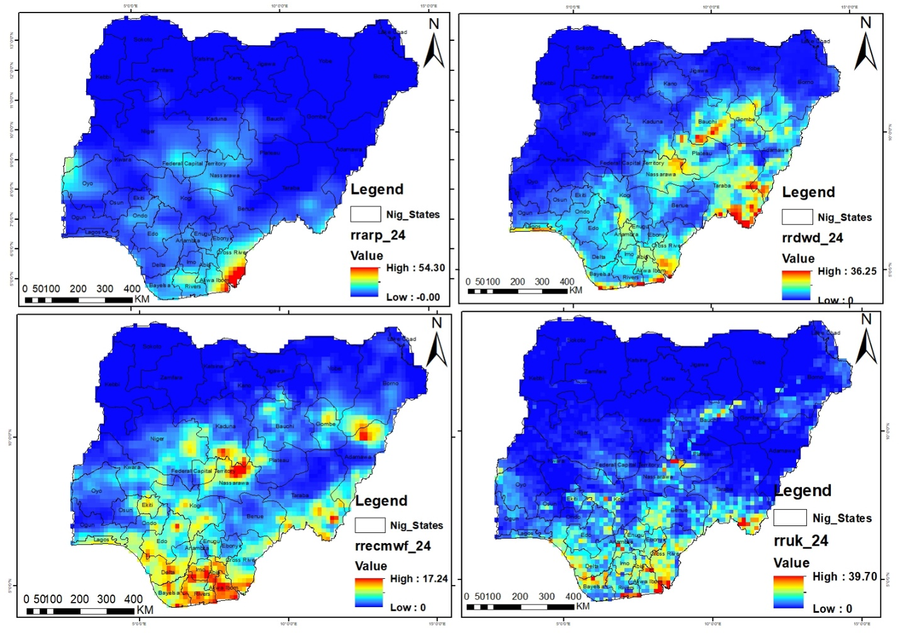

---

#### 8. August 2024 (Sahelian Peak & Southern "August Break")
* **Historical Map (`16_historical_rainfall_august_2024.png`):** Captures the northern monsoon peak ($29.7\text{ mm}$) across Sahelian states (Sokoto, Zamfara, Katsina, Kano, Jigawa) alongside pronounced drying across southern coastal states ("August Break").
* **Forecast Comparison Map (`17_forecast_rainfall_august_2024.png`):** All four models fail to capture the far-northern Sahelian rain belt, erroneously placing rainfall maxima in the southeast (`rrarp_24`: $23.07\text{ mm}$; `rruk_24`: $6.36\text{ mm}$), southwest/central belt (`rrecmwf_24`: $35.13\text{ mm}$), or north-central/eastern highlands (`rrdwd_24`: $79.21\text{ mm}$).

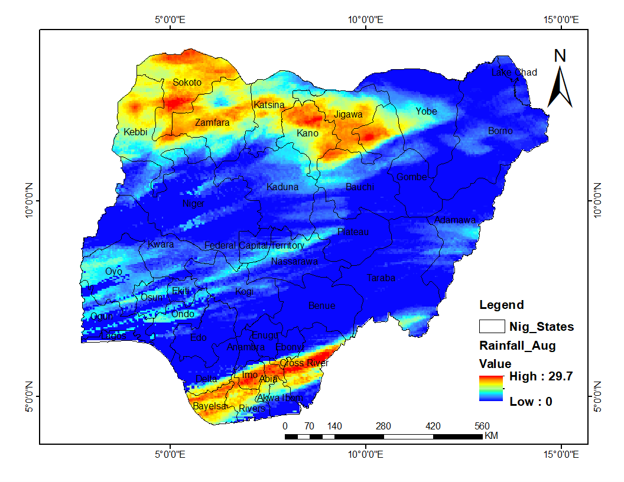
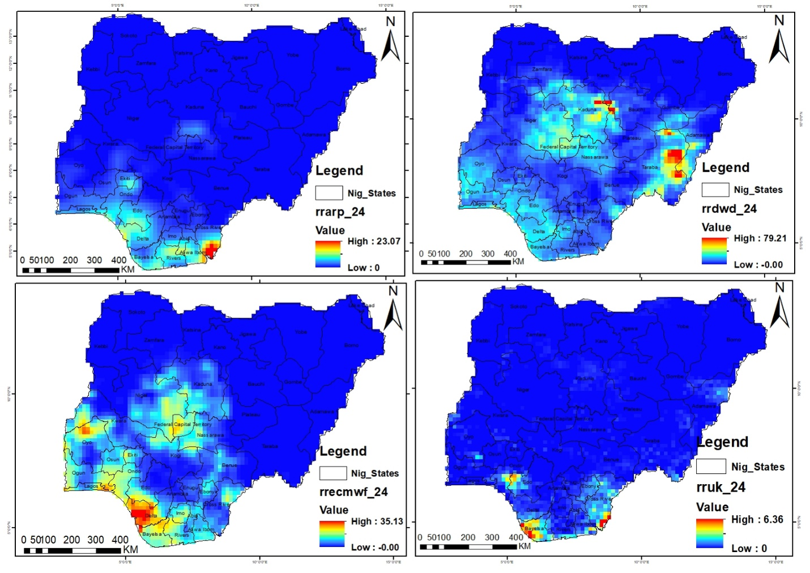

---

#### 9. September 2024 (Second Southern Rainy Season & Northeastern Peak)
* **Historical Map (`18_historical_rainfall_september_2024.png`):** Shows the return of coastal rains to southern Nigeria (second rainy season) and a peak concentration ($34.2\text{ mm}$) in northeastern states (Borno and Yobe) as northern rains begin retreating southward.
* **Forecast Comparison Map (`19_forecast_rainfall_september_2024.png`):** Models significantly overestimate northern rainfall intensity (`rrecmwf_24`: $206.52\text{ mm}$; `rrarp_24`: $185.51\text{ mm}$; `rruk_24`: $78.99\text{ mm}$; `rrdwd_24`: $59.84\text{ mm}$) concentrated in the northwest/north-central sector while under-representing the southern coastal resurgence.

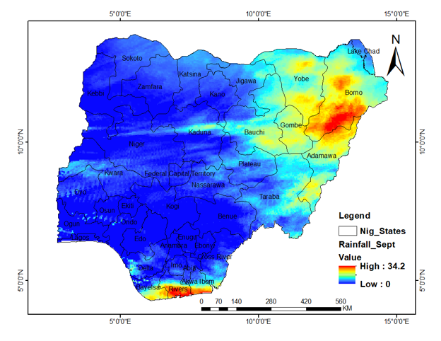
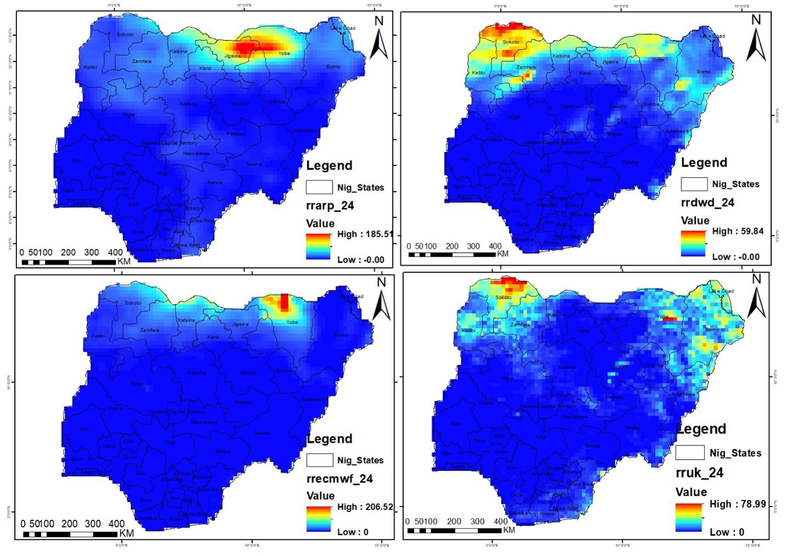

---

#### 10. October 2024 (Northern Cessation & Southern Second Peak)
* **Historical Map (`20_historical_rainfall_october_2024.png`):** Reflects dry-season onset across northern Nigeria while the second rainy season persists in the southwest (Ondo, Osun, Ekiti, Ogun) and southeast (Cross River, Akwa Ibom) with a peak of $25.8\text{ mm}$.
* **Forecast Comparison Map (`21_forecast_rainfall_october_2024.png`):** Three-model comparison (`rrdwd_24`, `rrecmwf_24`, `rruk_24`). `rrecmwf_24` ($24.81\text{ mm}$) closely matches both the southern spatial distribution and peak intensity; `rruk_24` ($43.63\text{ mm}$) captures southern rains but overestimates intensity, while `rrdwd_24` ($24.20\text{ mm}$) misplaces peak rainfall over north-central Kano/Bauchi.

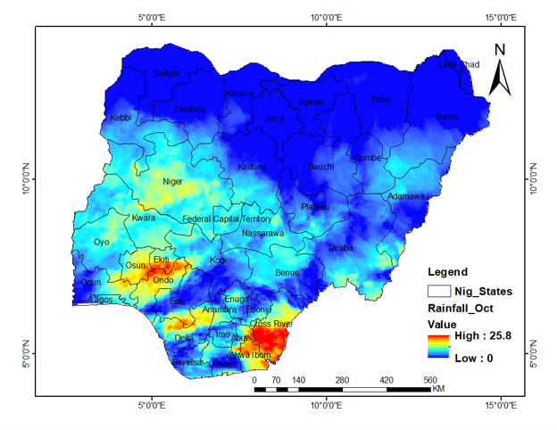
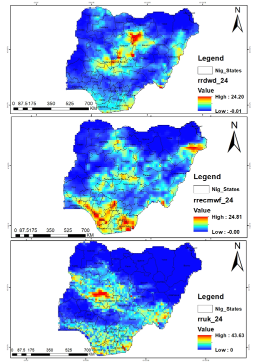

---

#### 11. November 2024 (Dry Season Expansion)
* **Historical Map (`22_historical_rainfall_november_2024.png`):** Dry conditions expand over the northern two-thirds and much of southern Nigeria, leaving a localized remnant pocket of rainfall ($18.9\text{ mm}$ peak) over Oyo, Osun, and Kwara States.
* **Forecast Comparison Map (`23_forecast_rainfall_november_2024.png`):** Models capture the broad nationwide drying trend (`rrarp_24`: $21.25\text{ mm}$; `rrdwd_24`: $16.85\text{ mm}$; `rruk_24`: $16.55\text{ mm}$; `rrecmwf_24`: $7.19\text{ mm}$), but shift the residual rain pocket toward the southeastern coast, central Niger Delta, or Kogi State rather than Oyo/Osun.

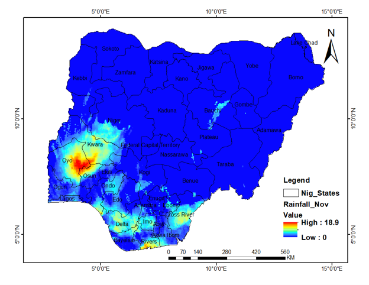
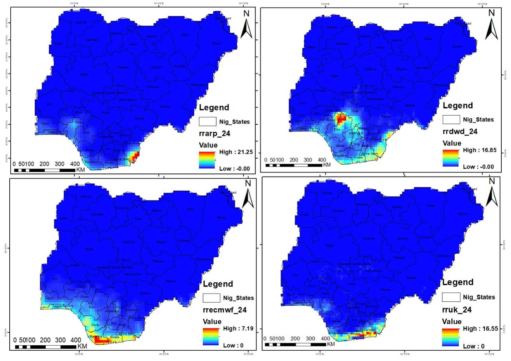

---

#### 12. December 2024 (Full Harmattan Dry Season Completion)
* **Historical Map (`24_historical_rainfall_december_2024.png`):** Completes the annual climate cycle with nationwide Harmattan dryness ($0\text{ mm}$) and a single localized coastal moisture pocket ($16.1\text{ mm}$ peak) over Akwa Ibom and Cross River States.
* **Forecast Comparison Map (`25_forecast_rainfall_december_2024.png`):** Strong consensus across all four models (`rrdwd_24`: $5.52\text{ mm}$; `rrarp_24`: $5.49\text{ mm}$; `rruk_24`: $2.46\text{ mm}$; `rrecmwf_24`: $2.34\text{ mm}$), accurately reproducing nationwide dryness and isolated low-intensity coastal showers.


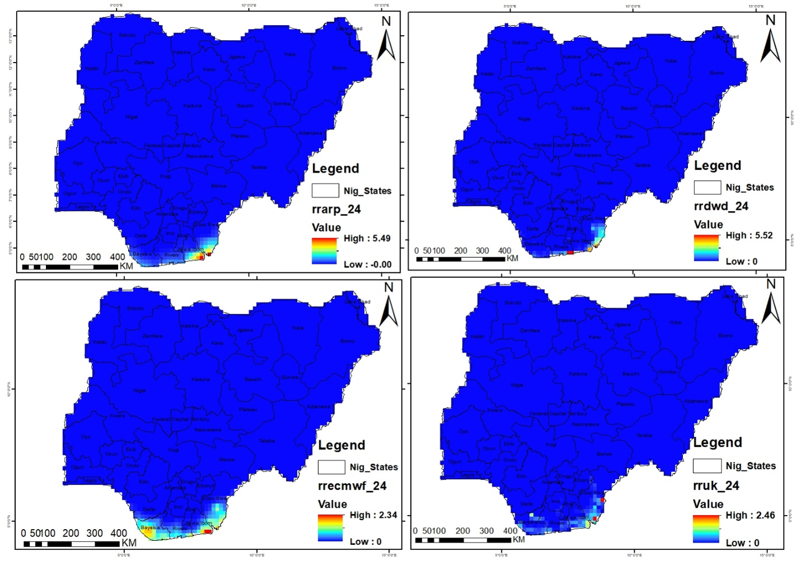

---

## Results and Key Findings

### Monthly Peak Rainfall Comparison ($\text{mm}$) Across 2024

| Month | Historical TAMSAT Peak ($\text{mm}$) | `rrarp_24` Peak ($\text{mm}$) | `rrdwd_24` Peak ($\text{mm}$) | `rrecmwf_24` Peak ($\text{mm}$) | `rruk_24` Peak ($\text{mm}$) | Dominant Spatial Pattern & Verification Summary |
| :--- | :---: | :---: | :---: | :---: | :---: | :--- |
| **January** | $14.1$ | $1.44$ | $1.12$ | $3.52$ | $1.20$ | High agreement on northern/central dryness; models underpredict Niger Delta coastal peak. |
| **February** | $8.3$ | $1.46$ | $2.96$ | $1.84$ | $1.29$ | `rrarp_24` and `rrdwd_24` align with southwestern rain band; `rrecmwf_24` shifts east. |
| **March** | $114.7$ | $29.64$ | $24.89$ | $30.95$ | $45.58$ | All models underestimate onset peak intensity; `rruk_24` captures broad northward advance. |
| **April** | $29.5^*$ ($216.9^\dagger$) | $4.14$ | $9.83$ | $1.89$ | $13.16$ | Severe negative intensity bias across all four models; inland Middle Belt rain missed. |
| **May** | $30.6^*$ ($244.3^\dagger$) | $23.07$ | $79.21$ | $35.13$ | $6.36$ | High inter-model spread: `rrecmwf_24` aligns best; `rrdwd_24` overpredicts; `rruk_24` too dry. |
| **June** | $44.0$ | $54.30$ | $36.25$ | $17.24$ | $39.70$ | `rrarp_24` best captures coastal concentration; `rrecmwf_24` & `rrdwd_24` misplace maxima inland. |
| **July** | $53.6$ | $54.30$ | $36.25$ | $17.24$ | $39.70$ | `rrarp_24` matches coastal peak magnitude; other models underpredict coastal intensity. |
| **August** | $29.7$ | $23.07$ | $79.21$ | $35.13$ | $6.36$ | Models miss northern Sahelian peak and southern "August Break" dry anomaly. |
| **September** | $34.2$ | $185.51$ | $59.84$ | $206.52$ | $78.99$ | Large positive intensity overestimation in northwest/north-central sector across models. |
| **October** | $25.8$ | `[Not shown]` | $24.20$ | $24.81$ | $43.63$ | `rrecmwf_24` closely matches southern second rainy season peak and spatial distribution. |
| **November** | $18.9$ | $21.25$ | $16.85$ | $7.19$ | $16.55$ | Models capture broad drying trend but displace residual rains from Oyo/Osun to the coast. |
| **December** | $16.1$ | $5.49$ | $5.52$ | $2.34$ | $2.46$ | Strong multi-model consensus on nationwide Harmattan dryness and coastal trace showers. |

*\*Value displayed on the ArcGIS map legend (`High` class).*  
*$\dagger$Value cited in the Chapter Four text narrative.*

### Summary of Verification Findings
1. **High Dry-Season Forecast Skill (December–February):** All four models exhibited strong spatial agreement and reliability in predicting nationwide dry conditions during the Harmattan-dominated months of December, January, and February, restricting precipitation strictly to minor coastal zones.
2. **Systematic Underestimation During Onset Months (March–April):** During the northward progression of the rain belt in March and April, all four models substantially underestimated peak rainfall intensities relative to TAMSAT observations and struggled to reproduce inland penetration into the Middle Belt.
3. **High Inter-Model Divergence During Peak Monsoon & Transitional Regimes (May–October):** Forecast skill degraded during convective peak and transitional months, characterized by spatial displacement errors (such as missing the August Sahelian rain belt and southern "August Break") and large positive intensity biases in September (`rrecmwf_24` reaching $206.52\text{ mm}$ and `rrarp_24` reaching $185.51\text{ mm}$ versus $34.2\text{ mm}$ historical).
4. **Quantitative Error Metrics:** `[Information to be provided — insert RMSE, Mean Bias, Correlation Coefficient, or categorical skill scores (POD, FAR, CSI) if computed in the full manuscript]`

---

## Discussion

The spatiotemporal evaluation of multi-resolution rainfall forecasts against TAMSAT satellite-gauge observations highlights critical operational considerations for hydrometeorological applications in Nigeria:

* **Disaster Risk Reduction & Flood Early Warning:** The pronounced spatial displacement and peak intensity biases observed during wet and transitional months (such as May, August, and September) indicate that relying on a single deterministic forecast product for flood forecasting in the Niger Delta, Middle Belt, or Sahelian basins can lead to false alarms or missed extreme events.
* **Agricultural & Water Resources Planning:** Because planting calendars across southern and central Nigeria depend on reliable March–May rainfall onset and the timing of the July–August "Little Dry Season," systematic dry biases in April forecasts and spatial misplacements in August underscore the need for bias correction and multi-model ensemble blending before operational agro-advisory dissemination.
* **Climatological Cycle Representation:** While the models successfully resolve synoptic-scale Harmattan dry-season stability, convective parameterization challenges remain evident during rapid seasonal transitions of the West African Monsoon.

---

## Research Limitations

No dedicated limitations section was included in the provided manuscript chapters; however, the following methodological scope constraints are evident from the study design:

* **Qualitative & Peak-Value Verification Scope:** The analysis evaluates spatial pattern alignment and monthly maximum grid values ($\text{mm}$), without pixel-by-pixel continuous or categorical statistical verification metrics (e.g., RMSE, Bias, POD, FAR).
* **Manuscript Section Availability:** `[Information to be provided — insert any explicit study limitations documented in Chapters One or Five of the complete thesis]`

---

## Conclusion and Recommendations

### Conclusion
Based on the 12-month spatial verification across Nigeria in 2024, multi-resolution numerical forecast models (`rrarp_24`, `rrdwd_24`, `rrecmwf_24`, and `rruk_24`) demonstrate high agreement and reliability in capturing widespread dry-season conditions during December, January, and February. Conversely, model performance degrades markedly during the rainy-season onset (March–April), peak monsoon/August Break dynamics (June–August), and southward retreat transitions (September–November), exhibiting substantial inter-model disagreement, spatial rain-belt displacement, and peak intensity biases.  
*(Note: `[Information to be provided — insert formal concluding statements from Chapter Five]`)*

### Recommendations
* `[Information to be provided — insert formal recommendations from Chapter Five of the manuscript, such as multi-model ensemble calibration, bias correction for hydrological modeling, or operational integration with NiMet ground gauge networks]`

---

## Repository Structure

```text
nigeria-2024-rainfall-forecast-verification/
├── README.md                                        # Complete technical project documentation
├── maps/                                            # Exported ArcGIS 10.8 cartographic outputs (PNG)
│   ├── 01_study_area_map.png                        # Fig 1: Federal Republic of Nigeria study area map
│   ├── 02_historical_rainfall_january_2024.png      # Fig 2: Historical TAMSAT rainfall (Jan 2024)
│   ├── 03_forecast_rainfall_january_2024.png        # Fig 3: Multi-model forecast rainfall (Jan 2024)
│   ├── 04_historical_rainfall_february_2024.png     # Fig 4: Historical TAMSAT rainfall (Feb 2024)
│   ├── 05_forecast_rainfall_february_2024.png       # Fig 5: Multi-model forecast rainfall (Feb 2024)
│   ├── 06_historical_rainfall_march_2024.png        # Fig 6: Historical TAMSAT rainfall (Mar 2024)
│   ├── 07_forecast_rainfall_march_2024.png          # Fig 7: Multi-model forecast rainfall (Mar 2024)
│   ├── 08_historical_rainfall_april_2024.png        # Fig 8: Historical TAMSAT rainfall (Apr 2024)
│   ├── 09_forecast_rainfall_april_2024.png          # Fig 9: Multi-model forecast rainfall (Apr 2024)
│   ├── 10_historical_rainfall_may_2024.png          # Fig 10: Historical TAMSAT rainfall (May 2024)
│   ├── 11_forecast_rainfall_may_2024.png            # Fig 11: Multi-model forecast rainfall (May 2024)
│   ├── 12_historical_rainfall_june_2024.png         # Fig 12: Historical TAMSAT rainfall (Jun 2024)
│   ├── 13_forecast_rainfall_june_2024.png           # Fig 13: Multi-model forecast rainfall (Jun 2024)
│   ├── 14_historical_rainfall_july_2024.png         # Fig 14: Historical TAMSAT rainfall (Jul 2024)
│   ├── 15_forecast_rainfall_july_2024.png           # Fig 15: Multi-model forecast rainfall (Jul 2024)
│   ├── 16_historical_rainfall_august_2024.png       # Fig 16: Historical TAMSAT rainfall (Aug 2024)
│   ├── 17_forecast_rainfall_august_2024.png         # Fig 17: Multi-model forecast rainfall (Aug 2024)
│   ├── 18_historical_rainfall_september_2024.png    # Fig 18: Historical TAMSAT rainfall (Sep 2024)
│   ├── 19_forecast_rainfall_september_2024.png      # Fig 19: Multi-model forecast rainfall (Sep 2024)
│   ├── 20_historical_rainfall_october_2024.png      # Fig 20: Historical TAMSAT rainfall (Oct 2024)
│   ├── 21_forecast_rainfall_october_2024.png        # Fig 21: Multi-model forecast rainfall (Oct 2024)
│   ├── 22_historical_rainfall_november_2024.png     # Fig 22: Historical TAMSAT rainfall (Nov 2024)
│   ├── 23_forecast_rainfall_november_2024.png       # Fig 23: Multi-model forecast rainfall (Nov 2024)
│   ├── 24_historical_rainfall_december_2024.png     # Fig 24: Historical TAMSAT rainfall (Dec 2024)
│   └── 25_forecast_rainfall_december_2024.png       # Fig 25: Multi-model forecast rainfall (Dec 2024)
└── docs/                                            # Supporting research manuscript
    └── Momadelo_Adeleye_Blessing_1.docx             # Research paper manuscript (Chapters 3 & 4)
```

---

## Author and Project Information

* **Author:** Momadelo Adeleye Blessing *(extracted from manuscript filename — please confirm full name order)*
* **Academic Qualification:** `[Information to be provided — e.g., B.Tech / M.Tech in Remote Sensing and GIS / Meteorology]`
* **Department & Institution:** `[Information to be provided — e.g., Federal University of Technology, Akure (FUTA), Nigeria]`
* **Research Supervisor:** `[Information to be provided]`
* **Completion Year:** 2024 / `[Information to be provided]`
* **Project Category:** Hydrometeorology, Numerical Weather Forecast Verification, Remote Sensing & GIS
* **GitHub Profile:** `[Information to be provided — e.g., https://github.com/yourusername]`
* **LinkedIn / Portfolio:** `[Information to be provided]`
* **Contact Email:** `[Information to be provided]`

---

### Citation
> Momadelo, A. B. (`[Year]`). *Verification of Multi-Resolution Model Forecasts of Heavy Rainfall Events in 2024 over Nigeria*. `[Degree/Project Type]`, `[Department and Institution]`.